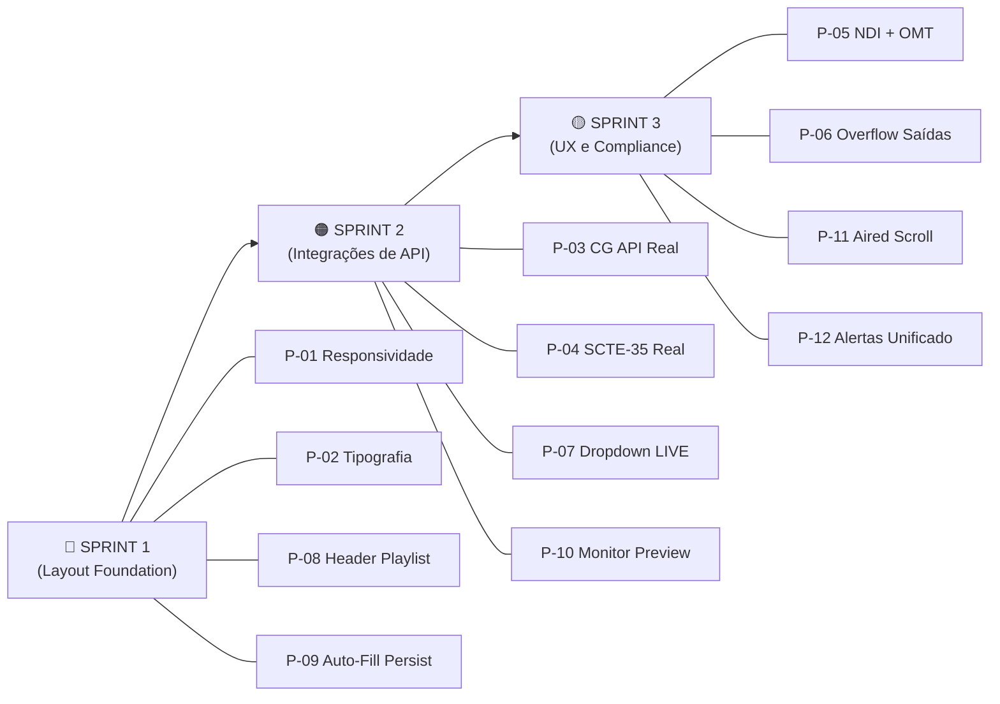

# BUGFIX AUDIT & RESOLUTIONS — RPlayout v1.1
## Plano de Correção Operacional — Consolidação dos 12 Apontamentos de Feedback

**Documento:** `docs/BUGFIX-AUDIT-AND-RESOLUTIONS.md`
**Responsável:** Analista de Sistemas e Produto Broadcast (`broadcast_analyst`)
**Destinatários:** Tech Lead, `broadcast_dev`, `broadcast_ui_designer`, `broadcast_qa_tester`
**Status:** EM ESPECIFICAÇÃO — AGUARDA IMPLEMENTAÇÃO
**Versão:** 1.0.0
**Data de Emissão:** 2026-09-24
**Sessão de Origem:** Auditoria Operacional — Diretoria de Operações RPlayout

---

> [!IMPORTANT]
> Este documento é o contrato de trabalho único para resolução dos 12 problemas operacionais confirmados. Cada seção contém: **raiz do problema**, **localização exata do código**, **especificação da solução**, **contrato de dados** e **critério de aceite (Definition of Done)**. Nenhuma PR deve ser mergeada sem que os critérios de aceite correspondentes estejam verdes.

---

## Índice

| # | Problema | Componente Principal | Prioridade | Fase |
|---|---|---|---|---|
| [P-01](#p-01) | Responsividade e Corte de Tela | Layout Global / Views | 🔴 CRÍTICO | A |
| [P-02](#p-02) | Tipografia e Cabeçalhos Quebrados | PlaylistScheduleView / BroadcastHeader | 🔴 CRÍTICO | A |
| [P-03](#p-03) | CG / Grafismo sem Integração Real de API | DynamicCgSecondaryBar / BroadcastMonitor | 🔴 CRÍTICO | D |
| [P-04](#p-04) | Disparo SCTE-35 sem Endpoint Real | DynamicCgSecondaryBar | 🔴 CRÍTICO | D |
| [P-05](#p-05) | Protocolos NDI e OMT ausentes nas Saídas | SaidasTransmissaoPanel / OutputProfile | 🟠 ALTO | B |
| [P-06](#p-06) | Overflow Bloqueado no Painel de Saídas | SettingsView / SaidasTransmissaoPanel | 🟠 ALTO | A |
| [P-07](#p-07) | Campo Livre no Modal Ao Vivo | PlaylistScheduleView / LiveInputDialog | 🟠 ALTO | B |
| [P-08](#p-08) | Sobreposição do BroadcastHeader | PlaylistScheduleView | 🔴 CRÍTICO | A |
| [P-09](#p-09) | Auto-Fill Gaps sem Persistência | AutoFillDialog / api.ts | 🔴 CRÍTICO | A |
| [P-10](#p-10) | Previews da Aba Monitor Inativos | EngineeringDistributionView | 🟠 ALTO | B |
| [P-11](#p-11) | Responsividade na Aba Aired | AiredView | 🟡 MÉDIO | A |
| [P-12](#p-12) | Central de Alertas Duplicada | Problemas.tsx / BroadcastHeader | 🟡 MÉDIO | A |

---

## P-01 — Responsividade e Corte de Tela

### Diagnóstico

As views `MasterControlView`, `AiredView` e `SettingsView` utilizam containers com `height` fixo ou não definem corretamente `min-height: 0` nos filhos flex, resultando em conteúdo cortado em resoluções 720p (1280×720) e monitores 1080p com escala de DPI diferente de 100%.

O `BroadcastHeader` com `position: fixed` e `h-16` (64px) não é compensado pelo padding-top nos containers filhos em todas as views, causando sobreposição do primeiro conteúdo útil.

### Localização

| Arquivo | Linha(s) Relevante(s) | Problema |
|---|---|---|
| [`MasterControlView.tsx`](../apps/web/src/views/MasterControlView.tsx) | Container raiz | Sem `overflow-y: auto` no wrapper |
| [`AiredView.tsx`](../apps/web/src/views/AiredView.tsx) | Container raiz | Sem scroll habilitado |
| [`SettingsView.tsx`](../apps/web/src/views/SettingsView.tsx) | Container raiz | Sem `min-h-0` nos filhos flex |
| [`styles.css`](../apps/web/src/styles.css) | Global | Ausência de `box-sizing: border-box` em elementos específicos |

### Especificação da Solução

**Regra de layout universal para todas as views broadcast:**

```
┌────────────────────────────────────┐  ← html, body: h-full overflow-hidden
│  BroadcastHeader (fixed, h-16)    │  ← z-50, w-full top-0
├────────────────────────────────────┤
│  <main> pt-16 flex-1 overflow-y-  │  ← Scroll principal da página
│  auto min-h-0                     │
│  ┌──────────────────────────────┐  │
│  │ Conteúdo da View             │  │
│  └──────────────────────────────┘  │
└────────────────────────────────────┘
```

**Classes Tailwind obrigatórias no wrapper de cada view:**

```tsx
// Padrão para TODAS as views que usam BroadcastHeader fixed
<div className="flex flex-col h-screen overflow-hidden bg-surface-page">
  <BroadcastHeader ... />  {/* fixed top-0, h-16 */}
  <main className="flex-1 overflow-y-auto pt-16 min-h-0">
    {/* conteúdo da view */}
  </main>
</div>
```

**Breakpoints de validação obrigatórios:**

| Resolução | Escala DPI | Comportamento Esperado |
|---|---|---|
| 1920×1080 | 100% | Layout completo sem scroll horizontal |
| 1280×720 | 100% | Scroll vertical habilitado, sem corte |
| 1920×1080 | 125% | Equivalente a 1536×864 — scroll funcional |
| 1366×768 | 100% | Toolbar visível, rundown scrollável |

### Critério de Aceite

- [ ] Todas as 5 views principais passam no checklist de resolução acima
- [ ] Nenhuma view apresenta `overflow: hidden` sem `overflow-y: auto` correspondente no filho
- [ ] Teste manual em 1280×720 com DevTools confirma scroll funcional
- [ ] `pt-16` aplicado corretamente em todos os containers principais

---

## P-02 — Tipografia e Cabeçalhos Quebrados

### Diagnóstico

O `BroadcastHeader` usa `position: fixed` e `z-index` elevado. Em `PlaylistScheduleView`, o primeiro filho do layout não recebe `padding-top: 64px`, fazendo com que o header da timeline sobrescreva a linha de título "GRADE DO DIA / PLAYLIST". O mesmo ocorre em textos com classes `font-headline-md` sem `truncate` em containers estreitos (< 800px de largura).

### Localização

| Arquivo | Problema |
|---|---|
| [`PlaylistScheduleView.tsx`](../apps/web/src/views/PlaylistScheduleView.tsx) | Sem `pt-16` no container raiz; timeline header se esconde sob navbar |
| [`BroadcastHeader.tsx`](../apps/web/src/components/broadcast/BroadcastHeader.tsx) | `position: fixed` não documentado para filhos |
| [`MasterControlView.tsx`](../apps/web/src/views/MasterControlView.tsx) | Cabeçalho de seções sem `truncate` |

### Especificação da Solução

1. **Aplicar `pt-16` no container imediato** de cada view que renderiza `BroadcastHeader` com `position: fixed`.
2. **Textos de cabeçalho responsivos:** usar `truncate` ou `line-clamp-1` em todos os títulos de seção que podem ser exibidos em < 120px de largura.
3. **Classe utilitária documentada:** criar comentário JSDoc no `BroadcastHeader` indicando que filhos devem compensar `h-16`.

```tsx
// Em BroadcastHeader.tsx — adicionar JSDoc:
/**
 * Cabeçalho fixo de 64px (h-16). O container pai de cada view
 * que renderizar este componente DEVE aplicar `pt-16` para
 * evitar sobreposição do conteúdo.
 * @see https://tailwindcss.com/docs/padding
 */
```

### Critério de Aceite

- [ ] PlaylistScheduleView exibe o título "GRADE DO DIA" sem sobreposição em 1280px de largura
- [ ] Nenhum texto de cabeçalho quebra para segunda linha em containers < 180px
- [ ] Inspeção no DevTools confirma `padding-top: 64px` no container principal

---

## P-03 — CG / Grafismo sem Integração Real de API

### Diagnóstico

O [`DynamicCgSecondaryBar.tsx`](../apps/web/src/components/broadcast/DynamicCgSecondaryBar.tsx) possui toda a lógica de estado de CG implementada em **local React state apenas** (linhas 29–44). Os handlers `toggleLayer0Logo`, `toggleLayer1Clock`, `toggleLayer2Ticker` e `handleTriggerLowerThird` (linhas 104–145) apenas chamam `setCgState` e `onMessage` — **não fazem nenhuma chamada ao backend**.

O [`BroadcastMonitor.tsx`](../apps/web/src/components/broadcast/BroadcastMonitor.tsx) não possui overlay visual de CG sobre o frame PGM.

A API existente em [`api.ts`](../apps/web/src/api.ts) tem suporte a `showGraphic` / `hideGraphic` (linhas 337–342) que usa `/api/channels/{channelId}/graphic`, mas **não expõe endpoints de layer individual** conforme especificação Fase D.

### Especificação da Solução

#### 3.1 — Novos Endpoints de API (Backend — server)

O Backend DEV deve implementar (se não existente) e o Frontend DEV deve mapear no `api.ts`:

```typescript
// Contratos de API a adicionar em api.ts

// POST /api/v1/graphics/layers/:layer/trigger
triggerCgLayer: (
  channelId: string,
  layer: 0 | 1 | 2 | 3,
  action: 'ON' | 'OFF' | 'TOGGLE',
  payload?: {
    tickerText?: string
    lowerThirdTitle?: string
    lowerThirdSubtitle?: string
    durationSeconds?: number
  }
) => post<{ ok: true; layerState: 'ON' | 'OFF'; timecode: string }>(
  `/api/v1/graphics/layers/${layer}/trigger`,
  { channelId, action, payload }
)

// GET /api/v1/graphics/layers/status?channelId=:id
cgLayersStatus: (channelId: string) =>
  send<{
    channelId: string
    layers: {
      layer: 0 | 1 | 2 | 3
      type: 'STATION_LOGO' | 'ONAIR_CLOCK' | 'CRAWL_TICKER' | 'LOWER_THIRD'
      state: 'ON' | 'OFF'
      visibleSince?: string  // ISO 8601
    }[]
  }>(`/api/v1/graphics/layers/status?channelId=${channelId}`)
```

#### 3.2 — Atualização do DynamicCgSecondaryBar

O componente deve receber `channelId: string` como prop obrigatória e todas as funções toggle devem chamar a API com fallback de UI otimista:

```typescript
// Padrão de handler com integração real:
const toggleLayer0Logo = async () => {
  const next = !cgState.layer0Logo
  // UI otimista imediato
  setCgState((prev) => ({ ...prev, layer0Logo: next }))
  onMessage?.(`CG: Layer 0 (STATION_LOGO) ${next ? 'FADE IN' : 'FADE OUT'} — enviando...`)
  try {
    await api.triggerCgLayer(channelId, 0, next ? 'ON' : 'OFF')
    onMessage?.(`CG: Layer 0 (STATION_LOGO) ${next ? 'NO AR' : 'OCULTADO'} confirmado pelo engine`)
  } catch (err) {
    // Reverter estado em caso de falha
    setCgState((prev) => ({ ...prev, layer0Logo: !next }))
    onMessage?.(`CG: Falha ao controlar Layer 0: ${err instanceof Error ? err.message : 'Erro desconhecido'}`)
  }
}
```

#### 3.3 — Overlay de CG no BroadcastMonitor

O [`BroadcastMonitor.tsx`](../apps/web/src/components/broadcast/BroadcastMonitor.tsx) deve aceitar `cgState: DynamicCgState` como prop e renderizar overlays visuais sobre o monitor PGM:

```
┌─────────────────────────────────────┐
│  [L0] LOGO ████  PGM FRAME   ██:██:██ [L1] │
│                                     │
│       ┌─────────────────────────┐   │
│       │ LOWER THIRD TEXT [L3]   │   │ ← animado com slide-up quando ativo
│       └─────────────────────────┘   │
│ ◄──────── TICKER CRAWL [L2] ────────►│ ← rolagem horizontal contínua
└─────────────────────────────────────┘
```

**Camadas CSS/JSX no monitor:**

```tsx
// Dentro do BroadcastMonitor, sobre o elemento de vídeo:
{cgState.layer0Logo && (
  <div className="absolute top-2 left-2 z-10 opacity-90">
    {/* Logo da emissora — SVG ou img configurável */}
    
  </div>
)}
{cgState.layer1Clock && (
  <div className="absolute top-2 right-2 z-10 font-mono text-white text-sm bg-black/40 px-2 py-0.5 rounded">
    {ntpTimecode}  {/* hora em HH:MM:SS */}
  </div>
)}
{cgState.lowerThirdActive && (
  <div className="absolute bottom-8 left-0 right-0 z-10 animate-slide-up">
    <div className="bg-primary text-white px-4 py-1 font-bold text-sm">{cgState.lowerThirdTitle}</div>
    <div className="bg-black/80 text-gray-200 px-4 py-0.5 text-xs">{cgState.lowerThirdSubtitle}</div>
  </div>
)}
{cgState.layer2Ticker && (
  <div className="absolute bottom-0 left-0 right-0 z-10 bg-black/80 overflow-hidden h-6">
    <div className="animate-ticker-crawl whitespace-nowrap text-white text-xs leading-6 px-4">
      {cgState.tickerText}
    </div>
  </div>
)}
```

**Animações CSS a adicionar em `styles.css`:**

```css
@keyframes slide-up {
  from { transform: translateY(20px); opacity: 0; }
  to   { transform: translateY(0);    opacity: 1; }
}
@keyframes ticker-crawl {
  from { transform: translateX(100%); }
  to   { transform: translateX(-100%); }
}
.animate-slide-up   { animation: slide-up 0.3s ease-out; }
.animate-ticker-crawl { animation: ticker-crawl 30s linear infinite; }
```

### Contrato de Props Atualizado

```typescript
// DynamicCgSecondaryBar — novas props obrigatórias:
interface Props {
  channelId: string        // NOVO — necessário para chamadas API
  className?: string
  onMessage?: (msg: string) => void
  compact?: boolean
  onCgStateChange?: (state: DynamicCgState) => void  // NOVO — notifica BroadcastMonitor
}

// BroadcastMonitor — nova prop:
interface BroadcastMonitorProps {
  // ... props existentes ...
  cgState?: DynamicCgState   // NOVO — para overlay visual
}
```

### Critério de Aceite

- [ ] Clicar em L0 Logo faz `POST /api/v1/graphics/layers/0/trigger` no Network tab
- [ ] Em caso de falha de API, o estado UI reverte (rollback otimista)
- [ ] Overlay de logo aparece sobre o frame PGM no BroadcastMonitor quando L0 = ON
- [ ] Ticker crawl anima horizontalmente quando L2 = ON
- [ ] Lower-Third aparece com slide-up quando L3 é disparado
- [ ] Status das camadas é recuperado via GET ao montar o componente

---

## P-04 — Disparo SCTE-35 sem Endpoint Real

### Diagnóstico

O handler `handleTriggerScte35` em [`DynamicCgSecondaryBar.tsx`](../apps/web/src/components/broadcast/DynamicCgSecondaryBar.tsx) (linhas 148–170) é **puramente local**: incrementa `scte35EventId`, inicia contadores de tempo e emite mensagens — **sem chamar nenhum endpoint**.

O [`api.ts`](../apps/web/src/api.ts) lista `scteCues` para consulta (linha 225) mas **não possui endpoint de insert/trigger SCTE-35**.

### Especificação da Solução

#### 4.1 — Novo Endpoint no api.ts

```typescript
// Adicionar em api.ts:

// POST /api/v1/scte/splice-insert
scteSpliceInsert: (body: {
  channelId: string
  spliceEventId: number       // dinâmico, auto-incrementado pelo frontend
  preRollMs: number           // obrigatório: 4000 (4s conforme spec broadcast)
  durationSeconds: number     // janela comercial (ex: 30)
  autoReturn?: boolean        // true = retorno automático ao fim da janela
  spliceType?: 'CUE_OUT' | 'CUE_IN'  // default: 'CUE_OUT'
}) => post<{
  ok: true
  eventId: number
  ptsTime: string      // PTS no qual o splice será executado
  preRollMs: number
  state: 'PREROLL' | 'CUE_OUT'
}>('/api/v1/scte/splice-insert', body)

// POST /api/v1/scte/splice-cancel
scteSpliceCancel: (body: {
  channelId: string
  spliceEventId: number
}) => post<{ ok: true; cancelled: boolean }>('/api/v1/scte/splice-cancel', body)
```

#### 4.2 — Handler Atualizado com spliceEventId Dinâmico

```typescript
const handleTriggerScte35 = async () => {
  if (cgState.scte35Active) {
    // Cancelar splice em andamento
    try {
      await api.scteSpliceCancel({
        channelId,
        spliceEventId: cgState.scte35EventId
      })
      setCgState((prev) => ({
        ...prev, scte35Active: false, scte35Phase: 'IDLE', scte35TimeRemaining: 0
      }))
      onMessage?.('SCTE-35: Splice Cancel enviado ao encoder (Splice Cancel Indicator = true)')
    } catch (err) {
      onMessage?.(`SCTE-35: Falha ao cancelar splice: ${err instanceof Error ? err.message : 'Erro'}`)
    }
  } else {
    // Gerar novo Event ID dinâmico (Unix time truncado em 32-bit para compatibilidade MPEG)
    const newEventId = Date.now() & 0xFFFFFFFF
    
    // UI otimista — exibir pré-roll antes da confirmação do servidor
    setCgState((prev) => ({
      ...prev,
      scte35Active: true,
      scte35Phase: 'PREROLL',
      scte35TimeRemaining: 4.0,
      scte35EventId: newEventId,
    }))
    
    try {
      const result = await api.scteSpliceInsert({
        channelId,
        spliceEventId: newEventId,
        preRollMs: 4000,
        durationSeconds: 30,
        autoReturn: true,
        spliceType: 'CUE_OUT',
      })
      onMessage?.(`SCTE-35: CUE OUT 30s confirmado pelo engine (Event ID: ${result.eventId}, PTS: ${result.ptsTime})`)
    } catch (err) {
      // Reverter estado
      setCgState((prev) => ({ ...prev, scte35Active: false, scte35Phase: 'IDLE', scte35TimeRemaining: 0 }))
      onMessage?.(`SCTE-35: Falha ao enviar splice insert: ${err instanceof Error ? err.message : 'Erro'}`)
    }
  }
}
```

#### 4.3 — Regra de Negócio Broadcast Inviolável

> [!WARNING]
> O `spliceEventId` **nunca pode ser reutilizado** dentro de uma sessão. Um ID duplicado em SCTE-35 causa comportamento indefinido em encoders de CDN e multiplexadores DVB/ISDB-Tb. A geração via `Date.now() & 0xFFFFFFFF` garante unicidade prática; o backend deve rejeitar IDs duplicados com HTTP 409.

**Tabela de estados SCTE-35:**

| Estado | UI | Backend | Duração |
|---|---|---|---|
| `IDLE` | Botão "SCTE-35 CUE OUT 30S" habilitado | — | — |
| `PREROLL` | Contador 4.0s regressivo + badge âmbar | PTS calculado, mensagem enviada | 4000ms |
| `CUE_OUT` | Contador 30s regressivo + badge vermelho | Janela comercial aberta no mux | 30s |
| `AUTO_RETURN` | Flash "RETORNANDO" + badge verde | `CUE_IN` enviado automaticamente | ~500ms |

### Critério de Aceite

- [ ] Clicar em SCTE-35 faz `POST /api/v1/scte/splice-insert` com `spliceEventId` único
- [ ] Pre-roll de exatamente 4000ms antes da janela comercial
- [ ] Retorno automático ao fim de 30s via `scteSpliceCancel` ou `CUE_IN`
- [ ] Backend rejeta `spliceEventId` duplicado com HTTP 409
- [ ] Registro de auditoria do splice no As-Run Log (`/api/channels/:id/asrun`)

---

## P-05 — Protocolos NDI e OMT ausentes nas Saídas

### Diagnóstico

Em [`SaidasTransmissaoPanel.tsx`](../apps/web/src/components/SaidasTransmissaoPanel.tsx), a variável de estado `newKind` é tipada como `'SDI' | 'SRT' | 'RTMP' | 'FILE'` (linha 19). **NDI** (Network Device Interface — NewTek/Vizrt) e **OMT** (Open Media Transport — protocolo aberto para transporte de mídia profissional) estão ausentes.

O tipo `OutputProfile` em [`types.ts`](../apps/web/src/types.ts) deve ser atualizado correspondentemente.

### Especificação da Solução

#### 5.1 — Atualização de Tipos

```typescript
// Em types.ts — atualizar o tipo OutputProfile:
export interface OutputProfile {
  id: string
  name: string
  kind: 'SDI' | 'SRT' | 'RTMP' | 'FILE' | 'NDI' | 'OMT'  // ← adicionar NDI e OMT
  enabled: boolean
  target: string
  bitrate?: number
  passphrase?: string
  // NDI-specific
  ndiGroupName?: string        // Grupo NDI multicast (ex: "BROADCAST-GRP-1")
  ndiLowBandwidth?: boolean    // Modo baixa largura de banda para preview
  // OMT-specific
  omtPort?: number             // Porta UDP do receptor OMT
  omtSessionId?: string        // Identificador de sessão OMT
  omtRedundancy?: boolean      // Ativar redundância de caminho OMT
}
```

#### 5.2 — Campos do Formulário de Criação

O `SaidasTransmissaoPanel` deve renderizar campos condicionais por tipo:

```
Tipo: [SDI ▾] [SRT ▾] [RTMP ▾] [FILE ▾] [NDI ▾] [OMT ▾]

─── Quando NDI selecionado: ─────────────────────────────
  Nome NDI*: [___________________________]  (ex: "RPLAYOUT-PGM-OUT")
  Grupo NDI:  [___________________________]  (opcional, multicast)
  □ Modo Baixa Largura de Banda (Preview/Monitoring only)

─── Quando OMT selecionado: ─────────────────────────────
  Endereço destino*: [___________________]  (IP ou hostname)
  Porta UDP*:        [____]               (default: 9000)
  Session ID:        [___________________]  (opcional)
  □ Redundância de Caminho OMT
```

#### 5.3 — Metadados de Protocolo

| Protocolo | Padrão | Uso Típico | Validação de Target |
|---|---|---|---|
| NDI | NDI 5.x (Vizrt/NewTek) | Produção local em rede GigE | Nome NDI alfanumérico sem espaços |
| OMT | Open Media Transport (SMPTE) | Transporte IP profissional broadcast | `ip:porta` ou `hostname:porta` |

> [!NOTE]
> NDI e OMT com `enabled: true` são enviados ao backend. O Engine só ativa fisicamente a saída se o driver NDI (`libndi.dll` / `libndi.so`) ou stack OMT estiver presente. A UI deve exibir badge "VALIDAÇÃO FÍSICA PENDENTE" para outputs NDI/OMT quando o engine reportar `driverAvailable: false`.

### Critério de Aceite

- [ ] Dropdown de tipo de saída exibe NDI e OMT como opções
- [ ] Formulário renderiza campos específicos por tipo selecionado
- [ ] `OutputProfile.kind` aceita `'NDI'` e `'OMT'` sem erro TypeScript
- [ ] Backend persiste saídas NDI e OMT na tabela `outputs` (SQLite)
- [ ] Badge "VALIDAÇÃO FÍSICA PENDENTE" exibido quando driver não disponível

---

## P-06 — Overflow Bloqueado no Painel de Saídas

### Diagnóstico

O container do painel de saídas em [`SettingsView.tsx`](../apps/web/src/views/SettingsView.tsx) e/ou [`SaidasTransmissaoPanel.tsx`](../apps/web/src/components/SaidasTransmissaoPanel.tsx) não define `overflow-y: auto` no wrapper da lista de outputs. Com 5 ou mais saídas cadastradas, a lista transborda para fora da viewport ou fica cortada.

### Especificação da Solução

```tsx
// Em SaidasTransmissaoPanel.tsx — wrapper da lista de outputs:
// ANTES:
<div className="space-y-3">
  {outputs.map(...)}
</div>

// DEPOIS:
<div className="space-y-3 overflow-y-auto max-h-[calc(100vh-320px)] pr-1">
  {/* pr-1 para não sobrepor scrollbar ao conteúdo */}
  {outputs.map(...)}
</div>
```

```tsx
// Em SettingsView.tsx — o container da tab de saídas:
// ANTES:
<div className="tab-content">
  <SaidasTransmissaoPanel ... />
</div>

// DEPOIS:
<div className="flex-1 overflow-hidden flex flex-col min-h-0">
  <SaidasTransmissaoPanel ... />
</div>
```

**Fórmula do `max-h` responsivo:** `calc(100vh - 320px)` — descontando header (64px) + tab bar (48px) + formulário de criação (≈180px) + padding (28px).

### Critério de Aceite

- [ ] Com 10+ saídas cadastradas, a lista exibe scrollbar e todas as saídas são acessíveis
- [ ] O formulário de criação de nova saída permanece visível abaixo da lista (não some)
- [ ] Sem scroll horizontal em nenhuma resolução

---

## P-07 — Campo Livre no Modal "Agendar Programa Ao Vivo"

### Diagnóstico

Em [`PlaylistScheduleView.tsx`](../apps/web/src/views/PlaylistScheduleView.tsx) e/ou no modal de agendamento ao vivo, a fonte de entrada é um campo de texto livre (`<input type="text">`). Isso causa erros de digitação de URI e não permite ao operador selecionar fontes já detectadas pelo sistema (DeckLink SDI físico, NDI sources na rede, SRT listeners ativos).

O [`LiveInputDialog.tsx`](../apps/web/src/components/broadcast/LiveInputDialog.tsx) **já possui** tabs para SDI, NDI, SRT e WebRTC com campos específicos (linhas 21–79), mas **não é aproveitado no fluxo de agendamento da Playlist**.

### Especificação da Solução

#### 7.1 — Novo Endpoint de Fontes Disponíveis

```typescript
// Adicionar em api.ts:
liveSources: (channelId: string) => send<{
  sources: Array<{
    id: string
    type: 'SDI' | 'NDI' | 'SRT_CALLER' | 'SRT_LISTENER' | 'WEBRTC'
    label: string           // Nome amigável (ex: "DeckLink 8K Pro — Port 1")
    sourceRef: string       // URI de uso pelo engine
    available: boolean      // true se sinal detectado/conectado
    formatHint?: string     // ex: "1080i59.94 SDI"
  }>
}>(`/api/channels/${channelId}/live-sources`)
```

#### 7.2 — Componente Select com Fontes Detectadas

No modal de agendamento ao vivo da Playlist, substituir o campo de texto livre por:

```
┌─────────────────────────────────────────────────────┐
│  Fonte de Entrada ao Vivo                           │
│  ┌──────────────────────────────────────────────┐   │
│  │ ▾ Selecionar fonte detectada...              │   │
│  ├──────────────────────────────────────────────┤   │
│  │ ● DeckLink 8K Pro — Port 1 (1080i59.94 SDI) │   │  ← SDI disponível
│  │ ● NDI: ESTUDIO-A-MASTER (NDI-HD)             │   │  ← NDI detectado na rede
│  │ ● SRT Caller: 192.168.10.120:9000            │   │  ← SRT configurado
│  │ ◌ SRT Listener: :9001 (aguardando conexão)   │   │  ← SRT sem sinal
│  │ ── Personalizado ──────────────────────────── │   │
│  │   URI customizada: [_______________________]  │   │
│  └──────────────────────────────────────────────┘   │
└─────────────────────────────────────────────────────┘
```

**Lógica de seleção:**
- Ao selecionar fonte detectada: preencher `sourceRef` automaticamente
- Ao selecionar "URI customizada": exibir campo de texto livre abaixo do select
- Fontes com `available: false` exibidas com ícone ◌ e texto cinza, mas ainda selecionáveis
- Loading spinner enquanto `/api/channels/:id/live-sources` carrega

#### 7.3 — Reaproveitar LiveInputDialog

Mover o [`LiveInputDialog.tsx`](../apps/web/src/components/broadcast/LiveInputDialog.tsx) para ser acionável também a partir da PlaylistScheduleView como fonte de seleção estruturada para agendamentos futuros.

### Critério de Aceite

- [ ] Modal de agendamento ao vivo exibe select dropdown com fontes detectadas
- [ ] Fontes SDI, NDI, SRT Caller, SRT Listener aparecem como opções separadas
- [ ] "URI customizada" disponível como opção final com campo de texto
- [ ] Estado `available: false` exibido visualmente (ícone + texto cinza)
- [ ] `sourceRef` preenchido automaticamente ao selecionar fonte detectada

---

## P-08 — Sobreposição de Cabeçalho na Playlist

### Diagnóstico

Em [`PlaylistScheduleView.tsx`](../apps/web/src/views/PlaylistScheduleView.tsx), o `BroadcastHeader` é renderizado com `position: fixed`, mas o container principal da view não possui `padding-top: 64px` (equivalente a `pt-16` Tailwind). O header da seção da timeline (linha do calendário e filtros) colide com a navbar.

Este é um caso específico e mais grave do P-01/P-02, pois a PlaylistScheduleView tem múltiplos subcontainers flex que herdam o problema.

### Especificação da Solução

```tsx
// PlaylistScheduleView.tsx — estrutura de layout corrigida:

return (
  <div className="flex flex-col h-screen overflow-hidden bg-surface-page">
    {/* Header fixo — 64px */}
    <BroadcastHeader
      activeWorkspace="playlist"
      // ... demais props
    />

    {/* Container principal com compensação de 64px */}
    <div className="flex flex-1 overflow-hidden pt-16 min-h-0">
      {/* Painel lateral (biblioteca/acervo) */}
      <aside className="w-80 flex-shrink-0 flex flex-col overflow-y-auto border-r border-border-subtle">
        {/* ... */}
      </aside>

      {/* Área principal da grade */}
      <main className="flex-1 flex flex-col overflow-hidden min-h-0">
        {/* Barra de controles da timeline — fixa dentro do main */}
        <div className="flex-shrink-0 px-4 py-2 border-b border-border-subtle bg-surface-panel">
          {/* filtros de data, botões de ação */}
        </div>

        {/* Lista de itens — scrollável */}
        <div className="flex-1 overflow-y-auto min-h-0">
          {/* rundown items */}
        </div>
      </main>
    </div>
  </div>
)
```

> [!CAUTION]
> **Não remover o `position: fixed` do BroadcastHeader.** A solução é sempre compensar no container filho com `pt-16`. Remover o `fixed` quebra o comportamento de "header sempre visível durante scroll" que é requisito operacional de MCR.

### Critério de Aceite

- [ ] Header da PlaylistScheduleView não cobre nenhum elemento interativo
- [ ] Timeline da grade começa abaixo de 64px do topo da viewport
- [ ] Scroll da lista de itens funciona sem que o header se sobreponha

---

## P-09 — Persistência do Auto-Fill Gaps

### Diagnóstico

O fluxo do botão **"Auto-Fill Gaps"** no `MasterControlView` chama `onAutoFill()` (prop), que abre o `AutoFillDialog`. O `AutoFillDialog` utiliza `api.autoFill()` que faz `POST /api/rundowns/:id/autofill`.

**Problema identificado:** quando `preview: true` (modo de visualização do plano), os itens são calculados mas **não inseridos no banco SQLite**. O botão "Aplicar" do dialog deve chamar `api.autoFill()` com `preview: false`, mas há evidências de que o callback `onApplied` não dispara o `refresh` da view principal corretamente, deixando a grade visual desatualizada.

Adicionalmente, o fluxo de "Auto-Fill Gaps" direto (sem abrir o dialog) pode não estar chamando a variante com `preview: false`.

### Especificação da Solução

#### 9.1 — Fluxo Correto de Persistência

```
Operador clica "Auto-Fill Gaps"
        │
        ▼
AutoFillDialog abre em modo 'gap' (insertTarget = 'gap')
        │
        ▼ [Operador configura e clica "Aplicar"]
api.autoFill(rundownId, { minutes, preview: false, insertAtOrder: ... })
        │
        ▼ Servidor persiste itens em rundown_items (SQLite)
        │ Retorna: { snapshot, plan }
        │
        ▼ onApplied(snapshot, message) chamado
        │
        ▼ App.tsx recebe snapshot → atualiza RundownView via setView(snapshot.view)
        │
        ▼ Grade visual reflete os novos itens imediatamente
```

#### 9.2 — Contrato de onApplied

```typescript
// AutoFillDialog — o callback onApplied DEVE incluir o snapshot completo:
interface Props {
  // ...
  onApplied: (snapshot: Snapshot, message: string) => void
  //                  ^^^^^^^^
  // O snapshot DEVE conter snapshot.view com os itens atualizados
  // O App.tsx deve chamar setView(snapshot.view) ao receber este callback
}
```

#### 9.3 — Verificação no App.tsx

Em [`App.tsx`](../apps/web/src/App.tsx), o handler que trata `onApplied` do AutoFillDialog deve:

```typescript
const handleAutoFillApplied = (snapshot: Snapshot, message: string) => {
  // 1. Atualizar a view com os novos itens
  if (snapshot.view) {
    setView(snapshot.view)   // ← CRÍTICO: atualização imediata da grade
  }
  // 2. Emitir mensagem de confirmação
  pushMessage(message)
  // 3. Fechar dialog
  setAutoFillOpen(false)
}
```

#### 9.4 — Botão "Auto-Fill Rápido" (sem Dialog)

Se existir caminho de "auto-fill rápido" (sem dialog), ele deve sempre usar `preview: false`:

```typescript
const handleQuickAutoFill = async () => {
  try {
    const result = await api.autoFill(view.id, {
      minutes: 60,        // 1 hora padrão
      preview: false,     // ← NUNCA preview: true aqui
    })
    if (result.view) setView(result.view)
    pushMessage(`Auto-Fill: ${result.plan.items?.length ?? 0} itens inseridos.`)
  } catch (err) {
    pushMessage(`Auto-Fill falhou: ${err instanceof Error ? err.message : 'Erro'}`)
  }
}
```

### Critério de Aceite

- [ ] Após clicar "Aplicar" no AutoFillDialog, itens aparecem na grade imediatamente (sem refresh manual)
- [ ] Banco SQLite (`rplayout.db`) contém os novos `rundown_items` após o apply
- [ ] `preview: false` é enviado no body da requisição de apply (verificar Network tab)
- [ ] Se o servidor retornar erro, o dialog exibe mensagem de erro sem fechar
- [ ] Teste com gap de 2h: inserção de ~4 itens de 30min confirma na tabela As-Run ao ar

---

## P-10 — Previews da Aba Monitor Inativos

### Diagnóstico

A [`EngineeringDistributionView.tsx`](../apps/web/src/views/EngineeringDistributionView.tsx) renderiza a seção `MULTIVIEW` com `OperationalMultiview` e a seção `DASHBOARD` com visualizações. Os previews de PGM e PVW dependem do componente [`Whep.tsx`](../apps/web/src/components/Whep.tsx) para receber streams WebRTC do engine.

**O problema:** o componente `Whep` na aba Monitor não chama `api.setWatching(channelId, 'mon', true)` ao montar, e portanto o engine não inicia a codificação do stream de monitor. O endpoint `watching` (linha 292 do `api.ts`) é o mecanismo de "demanda" — o engine só codifica quando há consumidor registrado.

### Especificação da Solução

#### 10.1 — Hook de Watching para Monitor

```typescript
// EngineeringDistributionView.tsx — adicionar useEffect de watching:

useEffect(() => {
  if (activeSection !== 'MULTIVIEW' && activeSection !== 'DASHBOARD') return

  // Sinalizar ao engine que o monitor está sendo visualizado
  void api.setWatching(channel.id, 'mon', true).catch(() => {
    onMessage('Monitor: Engine não respondeu ao aviso de watching. Preview pode não estar disponível.')
  })

  // Heartbeat a cada 30s para manter o stream ativo
  const heartbeat = setInterval(() => {
    void api.setWatching(channel.id, 'mon', true).catch(() => {})
  }, 30_000)

  // Ao desmontar ou mudar de seção: liberar o stream
  return () => {
    clearInterval(heartbeat)
    void api.setWatching(channel.id, 'mon', false).catch(() => {})
  }
}, [channel.id, activeSection, onMessage])
```

#### 10.2 — Exibir o Stream de Monitor

O `OperationalMultiview` deve receber a URL do stream WHEP do monitor e exibi-la:

```typescript
// URL do stream WHEP de monitor:
const monWhepUrl = `/api/channels/${channel.id}/whep?bus=mon`

// Renderizar no painel de MULTIVIEW:
<Whep
  url={monWhepUrl}
  className="w-full aspect-video rounded-lg bg-black"
  label="MON"
  onError={(err) => onMessage(`Monitor preview: ${err}`)}
/>
```

#### 10.3 — Indicador de Estado do Preview

```
┌─────────────────────────────────────┐
│  ● MONITOR PREVIEW                  │
│  ┌─────────────────────────────┐   │
│  │  [frame do monitor aqui]    │   │
│  └─────────────────────────────┘   │
│  🟢 Streaming • 1080p@59.94 • WHEP │
└─────────────────────────────────────┘
```

Estados possíveis:
- `🟡 Conectando...` — WHEP ICE negociando
- `🟢 Streaming` — frame recebido
- `🔴 Sem sinal` — engine não respondeu ou `driverAvailable: false`
- `⚫ Monitor Inativo` — watching = false (seção não ativa)

### Critério de Aceite

- [ ] Ao acessar a aba Monitor, `POST /api/channels/:id/watching` com `{ bus: 'mon', watching: true }` é enviado (Network tab)
- [ ] Heartbeat de watching enviado a cada 30s enquanto a seção está ativa
- [ ] Frame de vídeo aparece no painel Multiview quando engine está rodando
- [ ] Ao sair da seção Monitor, `watching: false` é enviado

---

## P-11 — Responsividade na Aba Aired

### Diagnóstico

A [`AiredView.tsx`](../apps/web/src/views/AiredView.tsx) exibe cards KPI, tabela As-Run e o componente `AncineComplianceCard`. Em resoluções < 1280px de largura, os cards KPI transbordam horizontalmente e a tabela As-Run não possui `overflow-x: auto`, forçando scroll horizontal na página inteira ao invés de dentro da tabela.

### Especificação da Solução

#### 11.1 — Cards KPI

```tsx
// ANTES: grid fixo
<div className="grid grid-cols-4 gap-4">

// DEPOIS: grid responsivo
<div className="grid grid-cols-2 sm:grid-cols-2 lg:grid-cols-4 gap-3">
```

#### 11.2 — Tabela As-Run

```tsx
// Envolver a tabela em container scrollável:
<div className="overflow-x-auto rounded-lg border border-border-subtle">
  <table className="min-w-full text-sm">
    {/* thead e tbody existentes */}
  </table>
</div>
```

#### 11.3 — AncineComplianceCard

```tsx
// Garantir que o card de compliance usa width relativo:
<div className="w-full overflow-hidden">
  <AncineComplianceCard ... />
</div>
```

#### 11.4 — Scroll Principal

A `AiredView` deve aplicar o mesmo padrão do P-01:

```tsx
<div className="flex flex-col h-screen overflow-hidden">
  <BroadcastHeader ... />
  <main className="flex-1 overflow-y-auto pt-16 px-4 pb-6 min-h-0 space-y-4">
    {/* cards KPI, tabela, compliance */}
  </main>
</div>
```

### Critério de Aceite

- [ ] Cards KPI exibem 2 colunas em 720p e 4 colunas em 1080p
- [ ] Tabela As-Run com scroll horizontal interno (não na página)
- [ ] `AncineComplianceCard` não causa overflow horizontal
- [ ] Scroll vertical limpo em todas as resoluções

---

## P-12 — Central de Alertas & Unificação com Configurações

### Diagnóstico

O modal de alertas/problemas (`Problemas.tsx`) atualmente exibe indiscriminadamente todos os logs de saídas, processos, SRT, etc. — conteúdo que **já está organizado** nas abas de Configurações (`SettingsView`) e Engenharia (`EngineeringDistributionView`). Isso cria duplicidade de informação e confunde o operador em momento de incidente.

**Estrutura atual problemática:**

```
Modal "Problemas" atual:
├── Log de Saídas (duplica SettingsView > Saídas)
├── Log de Processos (duplica EngineeringView > Logs)
├── Log de SRT (duplica EngineeringView > SRT Manager)
└── Erros de tela
```

### Especificação da Solução

#### 12.1 — Estrutura Proposta da Central de Alertas

O modal de alertas deve ser **enxuto e focado em eventos de saúde da sessão**:

```
┌─── CENTRAL DE ALERTAS ───────────────────────────────────────┐
│  🔔 3 alertas ativos  [Limpar todos]  [→ Ir para Configurações]│
├──────────────────────────────────────────────────────────────┤
│  EVENTOS DA SESSÃO                                           │
│  ━━━━━━━━━━━━━━━━━━                                          │
│  🔴 14:22:10  SERVIDOR   Engine reiniciado inesperadamente   │
│  🟡 14:20:05  SAÍDA      SRT ingest perdeu pacotes (8%)      │
│  ⚪ 14:18:30  TELA       Falha ao carregar ativo #A0291      │
│                                                              │
│  [Não há mais alertas]                                       │
├──────────────────────────────────────────────────────────────┤
│  Atalhos rápidos:                                            │
│  [📡 Saídas de Transmissão]  [⚙️ Configurações]  [🔧 Engenharia]│
└──────────────────────────────────────────────────────────────┘
```

#### 12.2 — Categorias de Evento Permitidas

| Origem | Mantida no Modal? | Redirecionamento |
|---|---|---|
| `SERVIDOR` (engine crash, restart) | ✅ SIM | — |
| `SAÍDA` (falha de transmissão, dropout) | ✅ SIM (resumido) | "Ver Saídas →" |
| `ARQUIVO` (ativo não encontrado, erro de leitura) | ✅ SIM | — |
| `TELA` (erro de UI, timeout) | ✅ SIM | — |
| Detalhes de SRT/NDI/OMT | ❌ NÃO | "Ver Engenharia →" |
| Lista de processos | ❌ NÃO | "Ver Engenharia →" |
| Configuração de saídas | ❌ NÃO | "Ver Configurações →" |

#### 12.3 — Atualização do Componente Problemas

```typescript
// Problemas.tsx — nova interface:
export interface Problema {
  id: number
  quando: string
  origem: 'SERVIDOR' | 'TELA' | 'ARQUIVO' | 'SAÍDA'
  texto: string
  severity?: 'INFO' | 'WARN' | 'CRITICAL'  // ← NOVO
  actionLink?: 'settings' | 'engineering'  // ← NOVO: atalho de navegação
}

// Novas props:
interface Props {
  problemas: Problema[]
  onLimpar: () => void
  onNavigate?: (dest: 'settings' | 'engineering') => void  // ← NOVO
}
```

#### 12.4 — Botões de Atalho

```tsx
// No footer do modal Problemas, adicionar atalhos:
<footer className="flex justify-between items-center p-4 border-t border-border-subtle">
  <div className="flex gap-2">
    <button
      className="btn-secondary text-xs"
      onClick={() => { onLimpar(); onNavigate?.('settings') }}
    >
      ⚙️ Configurações
    </button>
    <button
      className="btn-secondary text-xs"
      onClick={() => { setAberto(false); onNavigate?.('engineering') }}
    >
      🔧 Engenharia
    </button>
  </div>
  <div className="flex gap-2">
    <button className="btn" onClick={() => setAberto(false)}>Fechar</button>
    <button className="btn-danger-outline text-xs" onClick={() => { onLimpar(); setAberto(false) }}>
      Limpar tudo
    </button>
  </div>
</footer>
```

### Critério de Aceite

- [ ] Modal de alertas exibe apenas `SERVIDOR`, `TELA`, `ARQUIVO` e `SAÍDA` (resumido)
- [ ] Botões "Configurações" e "Engenharia" navegam corretamente ao clicar
- [ ] Não há abas de "Saídas", "Processos" ou "SRT" dentro do modal de alertas
- [ ] Eventos com `severity: 'CRITICAL'` exibem badge vermelho pulsante

---

## Matriz de Responsabilidade (RACI)

| Problema | broadcast_dev | broadcast_ui_designer | broadcast_qa_tester | Tech Lead |
|---|---|---|---|---|
| P-01 Responsividade | **R** | **C** | **A** | I |
| P-02 Tipografia | **R** | **R** | **A** | I |
| P-03 CG / API | **R** | **C** | **A** | **A** |
| P-04 SCTE-35 | **R** | C | **A** | **A** |
| P-05 NDI/OMT | **R** | **C** | A | I |
| P-06 Overflow | **R** | C | A | I |
| P-07 Dropdown Ao Vivo | **R** | **R** | **A** | I |
| P-08 Header Playlist | **R** | C | **A** | I |
| P-09 Auto-Fill | **R** | — | **A** | **A** |
| P-10 Monitor Preview | **R** | C | **A** | **A** |
| P-11 Aired Responsivo | **R** | **C** | A | I |
| P-12 Central Alertas | **R** | **R** | A | I |

**R** = Responsável pela entrega | **A** = Aprovador | **C** = Consultado | **I** = Informado

---

## Ordem de Execução Recomendada



---

## Referências de Arquivos

| Arquivo | Papel |
|---|---|
| [`apps/web/src/views/MasterControlView.tsx`](../apps/web/src/views/MasterControlView.tsx) | View principal de MCR |
| [`apps/web/src/views/PlaylistScheduleView.tsx`](../apps/web/src/views/PlaylistScheduleView.tsx) | Grade e agendamento |
| [`apps/web/src/views/AiredView.tsx`](../apps/web/src/views/AiredView.tsx) | As-Run e compliance |
| [`apps/web/src/views/SettingsView.tsx`](../apps/web/src/views/SettingsView.tsx) | Configurações |
| [`apps/web/src/views/EngineeringDistributionView.tsx`](../apps/web/src/views/EngineeringDistributionView.tsx) | Engenharia e Monitor |
| [`apps/web/src/components/broadcast/DynamicCgSecondaryBar.tsx`](../apps/web/src/components/broadcast/DynamicCgSecondaryBar.tsx) | CG e SCTE-35 |
| [`apps/web/src/components/broadcast/BroadcastMonitor.tsx`](../apps/web/src/components/broadcast/BroadcastMonitor.tsx) | Monitor PGM/PVW |
| [`apps/web/src/components/broadcast/BroadcastHeader.tsx`](../apps/web/src/components/broadcast/BroadcastHeader.tsx) | Header fixo |
| [`apps/web/src/components/broadcast/LiveInputDialog.tsx`](../apps/web/src/components/broadcast/LiveInputDialog.tsx) | Modal de fonte ao vivo |
| [`apps/web/src/components/SaidasTransmissaoPanel.tsx`](../apps/web/src/components/SaidasTransmissaoPanel.tsx) | Painel de saídas |
| [`apps/web/src/components/AutoFillDialog.tsx`](../apps/web/src/components/AutoFillDialog.tsx) | Dialog de preenchimento |
| [`apps/web/src/components/Problemas.tsx`](../apps/web/src/components/Problemas.tsx) | Central de alertas |
| [`apps/web/src/api.ts`](../apps/web/src/api.ts) | Client HTTP da API |
| [`apps/web/src/types.ts`](../apps/web/src/types.ts) | Tipos TypeScript |
| [`apps/web/src/styles.css`](../apps/web/src/styles.css) | Estilos globais |

---

*Documento gerado pelo Broadcast Systems Analyst em 2026-09-24. Próxima revisão: após entrega do Sprint 1.*
