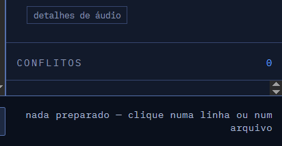
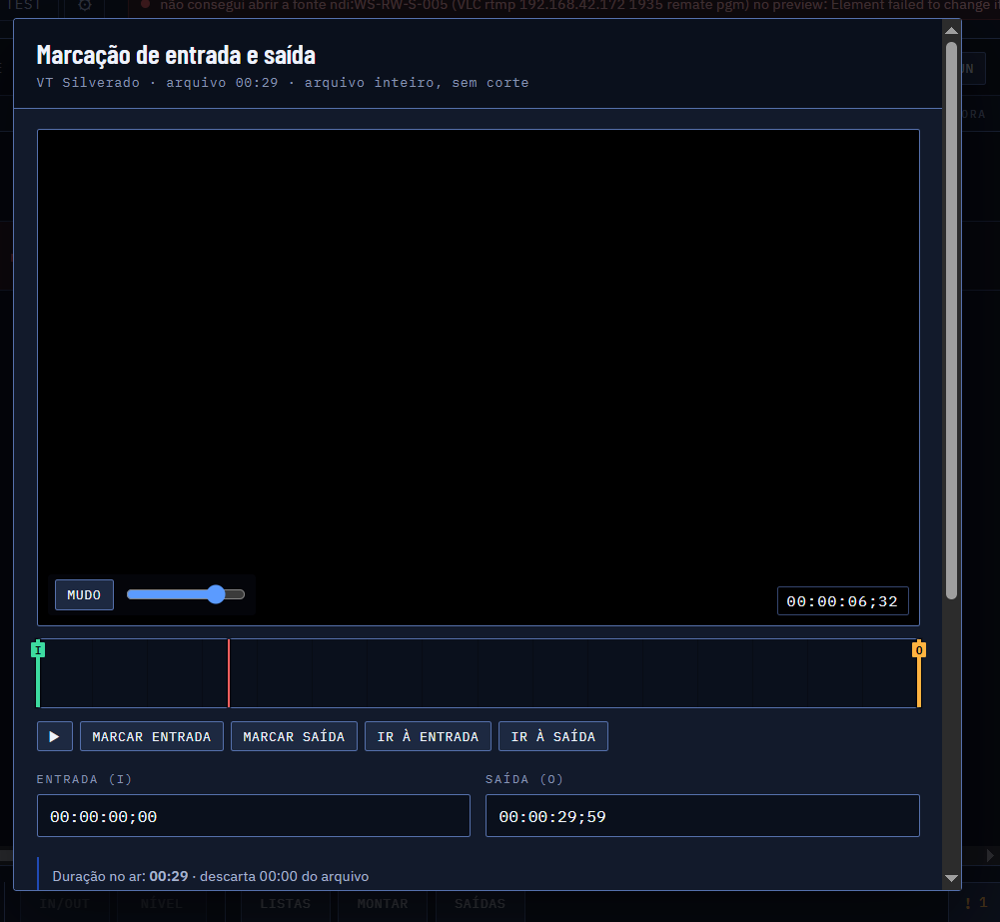

# RPlayout 1.1 — escopo consolidado, funcionalidades e roteiro de operação

## Objetivo

A versão 1.1 organiza o produto como um aplicativo de operação: o Master mantém o PGM protegido, janelas secundárias cuidam de playlist/gestão, e cada estado crítico tem confirmação visual e registro.

## Evidência visual do estado atual

### Monitor WebRTC e áudio

A tela mostra vídeo no endpoint MediaMTX, mas o fluxo exibido não deve ser considerado prova de áudio no painel até a trilha ser confirmada no SDP WHEP.

### Conflitos e rodapé

O conflito precisa ocupar uma área própria, com altura mínima e rolagem interna; o rodapé não deve repetir o arquivo selecionado.

### Marcação IN/OUT

A janela 1.1 deve usar largura menor, vídeo e régua no mesmo quadro e ações fixas no rodapé.

## Funcionalidades da 1.1

### Acesso e administração

- Login por usuário e senha pode ser ativado com `RPLAYOUT_ADMIN_USER` e `RPLAYOUT_ADMIN_PASSWORD`. Após autenticar, a sessão abre a tela do operador e mostra o papel ativo; **SAIR** encerra a sessão.
- **USUÁRIOS** abre o gerenciador para criar contas com papel e ativar/desativar acesso.
- **SAÍDAS E PROCESSOS** reúne distribuição e monitoramento por canal, uso, PID, CPU, memória e estado.

### Organização de playlists

- **PLAYLISTS** abre uma tela separada da operação Master para importar M3U/M3U8/CSV/TXT, filtrar por data, ordenar e remover entradas, escolher data/horário, revisar arquivos ausentes, publicar e baixar a programação em CSV.

### Operação Master

- PGM, PVW e estado de saída no topo do painel direito.
- Grade central com estados inequívocos: NO AR, PRÓXIMO, PREPARADO, INDISPONÍVEL e ERRO.
- TAKE, PARAR e PREPARAR agrupados por risco operacional.
- Acompanhamento PGM fixado, com bloqueio total de rolagem enquanto ativo.
- Aired com entrada real, término real, duração, origem e resultado.
- Conflitos em painel dedicado com altura mínima de 220 px.

### Áudio e vídeo

- PGM WebRTC deve negociar vídeo e áudio no mesmo SDP.
- Speaker inicia mutado; clique explícito libera áudio por política do navegador.
- Estado do áudio: recebido, mutado, ausente ou erro de codec.
- VU permanece evidente; detalhes ficam recolhidos.
- IN/OUT aparecem na régua, nunca como linha sobre o quadro.

### Acervo

- Adição de pasta somente pelo seletor nativo do Windows.
- Nome exibido é o nome da pasta selecionada.
- Remoção de pasta sem apagar os arquivos da grade.
- PNG/JPEG ignorados no modo Playout.
- Pasta ausente continua registrada como indisponível até nova reconciliação.

### Playlist 24 horas

- Tela `PLAYLIST 24H` separada do Master.
- Leitura/importação de `.m3u`/`.csv` via seletor de arquivo.
- Pré-visualização de itens, duração total, entradas sem acervo e conflitos.
- Modos: inserir no fim, publicar a partir do próximo item e substituir o futuro.
- Histórico de versões e desfazer.
- Operador de playlist não altera PGM sem publicar explicitamente.

### Usuários e acesso

- Configuração acessível em `Configurações > Usuários e acesso`.
- Papéis: administrador, operador e consulta.
- Ações de risco exigem permissão e entram na auditoria.
- Auditoria filtrável por usuário, ação e data, com exportação CSV.

### Desempenho

- PGM/PVW e saídas de monitor sob demanda.
- Fechar uma janela de monitor encerra somente sua sessão WHEP.
- Saídas RTMP/SRT/NDI/SDI desligadas por perfil não criam pipeline.
- Processos exibidos por canal e por uso.

## Roteiro de operação

1. Abra `rplayout-test.exe`.
2. Selecione o canal no topo.
3. Em `Configurações > Usuários e acesso`, confirme seu papel.
4. Em `Acervo`, escolha a pasta pelo explorador do Windows.
5. Abra `PLAYLIST 24H`, selecione a lista e confira os itens sem arquivo.
6. Publique no próximo item ou insira no fim.
7. Selecione o próximo item no Master e clique `PREPARAR`.
8. Confira o PVW e clique no speaker somente se precisar ouvir.
9. Clique `TAKE`; confirme PGM, VU, entrada, término e Aired.
10. Ative `PGM FIXADO` para acompanhar o item no ar.
11. Corrija conflitos pelo painel direito.
12. Use `Auditoria` para conferir ações e exportar o relatório.
13. Feche o launcher para encerrar a árvore de processos.

## Critérios de aceite 1.1

- O endpoint `/test-1/pgm/` apresenta áudio audível e a mesma trilha é indicada no painel WebRTC.
- PGM/PVW exibem agulha/régua de posição sem linha sobre o vídeo.
- A marcação IN/OUT cabe em uma janela menor que a área útil do operador.
- O painel de conflitos ocupa área visível e não fica reduzido a uma linha.
- A tela Master não é alterada ao editar/importar uma playlist em janela própria.
- Um arquivo de playlist de 24 horas pode ser importado, validado, publicado e desfeito.
- Usuários, papéis e auditoria estão acessíveis sem procurar a engrenagem.
- `pnpm test`, `pnpm typecheck`, `cargo test` e build de produção passam.
- O launcher serve o hash do bundle que acabou de ser compilado.

## Estado desta entrega

A base existente já contém autenticação, usuários, auditoria, histórico de playlists, seletor de pastas, reconciliação do acervo, Aired e testes automatizados. Os itens de áudio WHEP no fluxo `test-1`, régua/agulha dos monitores, importação nativa de playlist 24h e painel Master/Playlist separado permanecem como os próximos blocos de implementação da 1.1; eles não devem ser considerados concluídos apenas porque existem componentes parciais.

## Atualização desta revisão

- A rota do PGM agora aponta para `path.program`, a mesma origem que deve ser usada para validar áudio no MediaMTX.
- A grade ganhou uma régua de posição do PGM baseada em duração/tempo restante.
- A janela de IN/OUT usa classe própria com largura máxima de 820 px.
- Conflitos usam `conflicts-body` com altura mínima de 220 px.
- Bundle validado nesta revisão: `index-DjQI8g3c.js` e `index-CBYKegOc.css`.
- Testes repetidos: 21 arquivos / 164 testes TypeScript aprovados; typecheck aprovado.

## Implementação adicional concluída

- `PLAYLIST 24H` agora possui botão `IMPORTAR ARQUIVO 24H` com seletor nativo do navegador/Windows.
- O arquivo é lido localmente, enviado para `/api/playlists/read`, validado contra o acervo e exibido com entradas sem mídia antes da publicação.
- A publicação usa o conteúdo importado e mantém os modos existentes de inserir no fim ou publicar no próximo item.
- Bundle desta etapa: `index-CcINIJHs.js` e `index-CBYKegOc.css`.

## Programação por janela de horário

A montagem automática agora aceita `preencher até (horário)`. Ao informar, por exemplo, `18:00`, o sistema calcula os minutos entre o relógio atual e 18:00 e gera uma proposta explicável usando as regras de pauta, categorias e intervalo para não repetir. O operador visualiza a proposta antes de aplicar; o botão `montar o dia` continua preenchendo todas as faixas cadastradas.

Bundle desta etapa: `index-BOGifIoI.js` e `index-CBYKegOc.css`.

## Tela separada do operador

A janela de Playlist 24h agora oferece `abrir tela do operador`. Ela abre uma nova aba com `?workspace=playlist` e inicia diretamente o workspace de playlists, permitindo que outro usuário organize/importa a programação sem ocupar a tela Master. A publicação continua exigindo a ação explícita e é registrada no histórico/auditoria.

Bundle desta etapa: `index-DfogDzRJ.js`.

## Revisão manual da playlist importada

Cada entrada importada pode ser movida para cima/baixo ou removida apenas da publicação atual. O arquivo original não é alterado; a ordem revisada é enviada ao servidor no momento de publicar.

## Visão de programação diária

A playlist importada agora exibe o horário calculado de cada entrada. O operador define o início do dia (por exemplo, `00:00` ou `06:00`) e a tela calcula a hora de entrada de cada item a partir das durações, mantendo a revisão de ordem, remoção e publicação.

Bundle final desta etapa: `index-CEsQ-L1U.js` e `index-B67tZCT4.css`.

## Estado da etapa atual

- Filtro de playlists por data adicionado.
- Programação diária exportável em CSV.
- Workspace separado do operador disponível por `?workspace=playlist`.
- Botão `PROCESSOS` acessível no Master.
- Importação, ordenação e remoção de entradas revisadas antes da publicação.
- Bundle mais recente: `index-CQpfiuUG.js` e `index-RkgDFBL1.css`.

## Persistência da data de programação

A data escolhida no workspace agora é enviada ao servidor ao publicar a playlist e gravada em `playlist_versions.scheduled_date`, preservando a agenda por dia no histórico e permitindo futuras consultas/calendário.
