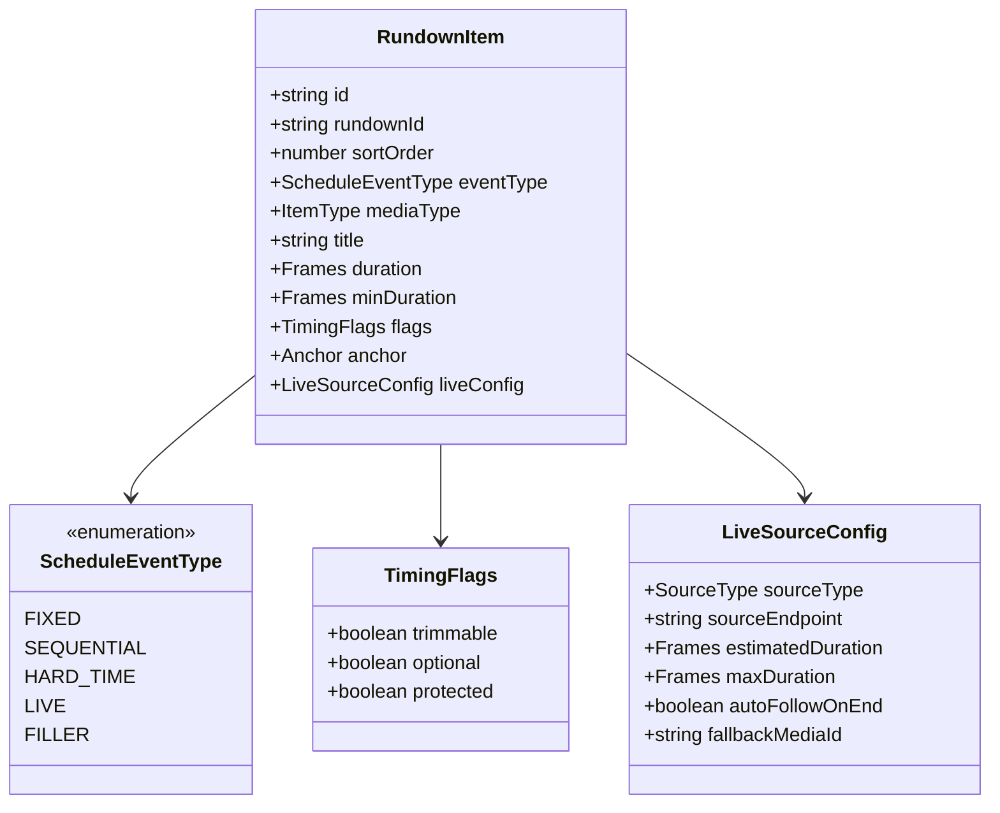
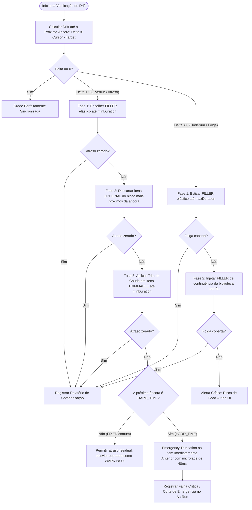
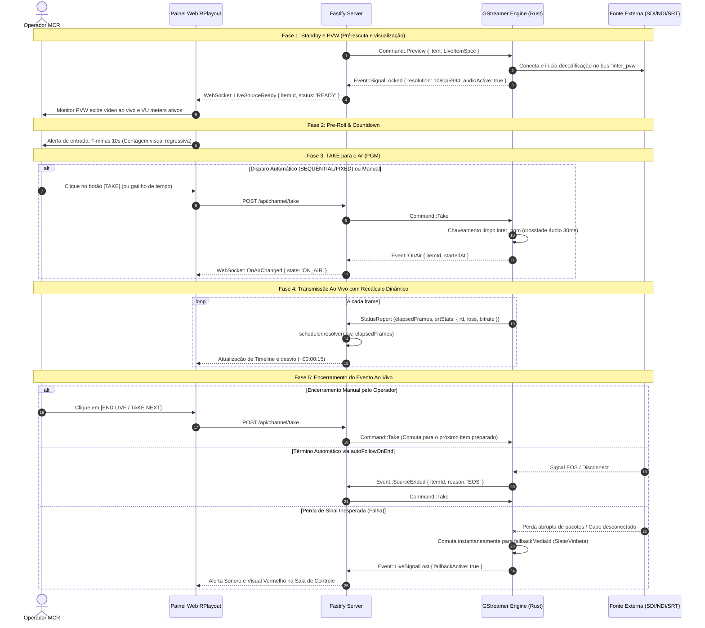

# Especificação Funcional e Técnica — Fase A: Núcleo de Automação 24/7

**Documento:** `SPEC-FASE-A-AUTOMACAO-24-7.md`  
**Módulo:** Núcleo de Automação Master Control (MCR) & Resolução de Grade 24/7  
**Responsável:** Analista de Sistemas e Produto Broadcast  
**Destinatários:** Tech Lead, Broadcast Fullstack DEV (`broadcast_dev`), UI/UX Designer (`broadcast_ui_designer`), QA Tester (`broadcast_qa_tester`)  
**Status:** APROVADO PARA IMPLEMENTAÇÃO  
**Versão:** 1.0.0  
**Data:** 2026-09-24  
**Benchmark de Referência:** Axel Technology XPlayout (XTV Suite) & Arquitetura RPlayout  

---

## 1. Visão Geral e Objetivos do Módulo

O objetivo da **Fase A** do RPlayout é estabelecer o núcleo de automação de transmissão ininterrupta (24 horas por dia, 7 dias por semana) com precisão de quadro (*frame-accurate*), eliminando qualquer risco de *dead-air* (tela preta ou silêncio não planejado) ou atraso cumulativo que comprometa os compromissos de rede e contratos comerciais da emissora.

No benchmark do **XPlayout**, o operador de Master Control Room (MCR) dispõe de ancoragens estritas de tempo (*Hard Time / Fixed Events*), preenchimento automático para intervalos menores que o previsto (*Gap Auto-Fill*), expansão/corte elástico de vinhetas/fillers e comutação nativa de fontes externas ao vivo (*Live Studio / Remote Feeds*) com contagem regressiva e transição limpa.

### 1.1 Metas de Entrega da Fase A
1. **Tipos de Evento Explícitos e Canônicos:** Formalização rigorosa dos tipos `FIXED`, `SEQUENTIAL`, `HARD_TIME`, `LIVE` e `FILLER`.
2. **Políticas de Compensação Determinística:** Implementação das flags `TRIMMABLE`, `OPTIONAL` e `PROTECTED`, garantindo que o algoritmo de alinhamento de grade resolva atrasos (*overrun*) e sobras (*underrun*) de forma previsível e auditável.
3. **Entrada LIVE Nativa:** Tratamento de entradas SDI, NDI, SRT, RTMP e WebRTC como itens de primeira classe na grade, com pré-visualização em PVW, telemetria de sinal, comutação com áudio equalizado e fallback imediato.
4. **Relatório de Auditoria de Compensação:** Geração de logs estruturados de cada ação de remanejamento temporal para compliance operacional e comercial.

---

## 2. Tipos de Eventos Explícitos na Grade

Cada item da grade de programação (`RundownItem`) passa a declarar explicitamente seu **Tipo de Comportamento Temporal** (`ScheduleEventType`), desacoplando a natureza do arquivo de mídia da sua disciplina de disparo no ar.



### 2.1 Definição dos Tipos

| Tipo de Evento | Comportamento Operacional | Comportamento no Overrun (Atraso) | Comportamento no Underrun (Folga) | Caso de Uso Broadcast Típico |
| :--- | :--- | :--- | :--- | :--- |
| **`FIXED`** | Início ancorado em um horário absoluto do relógio da emissora. | O item anterior é empurrado ou cortado; se o relógio passar, o item entra no primeiro instante viável e reporta desvio. | Se o item anterior terminar antes, aguarda no ar ou preenche com FILLER até o timestamp exato. | Início de programas gravados locais (ex: 14:00:00). |
| **`SEQUENTIAL`** | Modo *Auto-Follow*. O evento entra imediatamente no frame seguinte à conclusão do evento anterior. | Absorve o atraso acumulado da fila. | Entra imediatamente sem gerar gap. | Blocos normais de matérias de jornalismo, clipes, chamadas e comerciais em sequência contínua. |
| **`HARD_TIME`** | **Ponto de sincronismo obrigatório e inegociável de rede.** Disparo mandatório no frame `00:00:00:00` do horário designado. | **Interrompe forçadamente o evento anterior** (*Emergency Truncation* com microfade) caso as políticas de compensação antecedentes não tenham eliminado o atraso. | Exige injeção/alongamento de `FILLER` para não deixar a grade em *dead-air* antes do frame zero. | Horário de Rede Nacional (Voz do Brasil 19:00:00), Horário Político Eleitoral Obrigatório, Jornal da Rede via Satélite/SRT. |
| **`LIVE`** | Entrada ao vivo externa ou estúdio local com duração aberta ou estimada. | Se a transmissão ao vivo se estender além de `estimatedDuration`, os itens subsequentes são recalculados dinamicamente na grade com alerta de drift na UI. | Se o feed ao vivo for encerrado antes do estimado, aciona `autoFollowOnEnd` ou ativa *slate* de contingência até o próximo item. | Link de externa (repórter ao vivo via SRT), Jornalismo de estúdio (NDI/SDI), transmissão esportiva. |
| **`FILLER`** | Item elástico inteligente destinado a absorver desvios de grade. Possui faixa de duração configurável `[minDuration, maxDuration]`. | É encolhido prioritariamente até seu `minDuration` ou descartado por completo para eliminar atraso. | É esticado ou duplicado em loop de continuidade para cobrir qualquer folga temporal até a próxima âncora fixa. | Vinhetas de passagem de bloco, clipes musicais de apoio, institucionais genéricos da emissora. |

---

## 3. Política Determinística de Compensação de Tempo

### 3.1 Flags Operacionais de Proteção e Ajuste

Para evitar que comerciais pagos sejam truncados ou que materiais vitais sejam pulados sem autorização do departamento comercial/programação, cada item possui flags binárias explícitas:

1. **`TRIMMABLE` (Pode sofrer corte de cauda):**
   - Autoriza o motor de grade a antecipar o ponto de corte de saída (*Mark Out*) do item caso haja necessidade de recuperar tempo.
   - **Regra de salvaguarda:** O corte de cauda **nunca** pode reduzir a duração do item para um valor inferior a `minDuration`. Se `minDuration` não estiver configurado, assume-se como piso 70% da duração original do item.

2. **`OPTIONAL` (Pode ser descartado integralmente):**
   - Autoriza o motor de grade a cancelar a exibição do item (`state = 'DROPPED'` ou `'SKIPPED'`) se o atraso do bloco não puder ser sanado apenas com encolhimento de fillers e cortes parciais.
   - Utilizado em vinhetas promocionais secundárias, chamadas internas, comerciais de bonificação sem compensação financeira e avisos de utilidade pública rotativos.

3. **`PROTECTED` (Proteção Absoluta de Integridade):**
   - Proíbe estritamente qualquer alteração de duração (nem 1 único quadro a menos) e proíbe descarte.
   - O item **deve** ser reproduzido do primeiro ao último quadro contratado.
   - Utilizado para comerciais comerciais faturados (PI / Pedido de Inserção), chamadas de patrocinador master e conteúdos com minutagem regulatória (ex: cotas ANCINE).



### 3.2 O Algoritmo Determinístico de Compensação

O algoritmo de compensação é executado de forma pura e determinística pelo módulo [`@rplayout/scheduler`](file:///c:/IA/RPlayout/packages/scheduler/src/resolve.ts). O cálculo recebe o estado atual do PGM (`OnAirState`), a hora atual (`now`) e projeta todos os blocos até a última âncora do dia.

#### Matriz de Custo e Ordem de Precedência de Sacrifício
Quando o tempo acumulado no ar excede o horário planejado ($\Delta > 0$):
1. **Prioridade 0 (Sem Custo Editorial):** Encolher itens do tipo `FILLER` com propriedade elástica (`SHRUNK`).
2. **Prioridade 1 (Baixo Impacto):** Descartar itens com a flag `OPTIONAL` (`DROPPED`), da cauda do bloco para a frente.
3. **Prioridade 2 (Impacto Médio):** Aplicar corte de cauda em itens com a flag `TRIMMABLE` (`TRIMMED`), respeitando rigorosamente o piso `minDuration`.
4. **Prioridade 3 (Proteção Máxima):** Itens com flag `PROTECTED = true` jamais sofrem ajuste.
5. **Prioridade 4 (Imperativo de Rede):** Em caso de colisão com `HARD_TIME`, se ainda restar $\Delta > 0$ no exato instante de disparo, o engine força a troca de chaveamento (*Emergency Take*) no frame zero, aplicando um microfade de áudio de 40ms (1000 amostras a 48kHz) para evitar clique acústico.

### 3.3 Relatório de Auditoria de Compensação de Grade

Cada remanejamento efetuado gera um registro detalhado retornado junto ao payload de sincronização e persistido no As-Run Log.

#### Estrutura do Relatório (`ScheduleCompensationReport`)
```typescript
export interface CompensationAction {
  readonly itemId: string
  readonly itemTitle: string
  readonly actionType: 'SHRUNK' | 'EXPANDED' | 'DROPPED' | 'TRIMMED' | 'EMERGENCY_CUT' | 'INJECTED_FILLER'
  readonly plannedDurationFrames: number
  readonly effectiveDurationFrames: number
  readonly deltaFrames: number
  readonly targetAnchorId: string
  readonly targetAnchorType: 'HARD_TIME' | 'FIXED'
  readonly reason: string
  readonly timestamp: string
}

export interface ScheduleCompensationReport {
  readonly rundownId: string
  readonly generatedAt: string
  readonly rateNum: number
  readonly rateDen: number
  readonly initialDriftFrames: number
  readonly compensatedDriftFrames: number
  readonly residualDriftFrames: number
  readonly actions: readonly CompensationAction[]
  readonly status: 'RESOLVED_CLEAN' | 'RESOLVED_WITH_WARNINGS' | 'HARD_TIME_VIOLATION_PREVENTED' | 'CRITICAL_UNDERRUN'
}
```

---

## 4. LIVE Nativo na Grade de Programação

A reprodução de fontes externas ao vivo é tratada nativamente dentro do fluxo do canal, com total isolamento contra travamentos do engine principal.

### 4.1 Estrutura de Dados do Item LIVE

```typescript
export type LiveSourceType = 'SDI' | 'NDI' | 'SRT' | 'WEBRTC' | 'RTMP'

export interface LiveItemProperties {
  readonly sourceType: LiveSourceType
  /**
   * Endpoint da fonte:
   * - SDI: 'sdi:0' (porta DeckLink 1)
   * - NDI: 'ndi:ESTUDIO_A (PGM)'
   * - SRT: 'srt://192.168.1.100:9000?mode=caller&latency=200'
   * - WEBRTC: 'whep://transmissao.emissora.com.br/canal1'
   * - RTMP: 'rtmp://127.0.0.1:1935/live/stream1'
   */
  readonly sourceEndpoint: string
  
  /** Duração estimada em frames para o cálculo preliminar da grade */
  readonly estimatedDuration: number
  
  /** Limite máximo previsto antes de emitir alerta de perigo de estouro de grade */
  readonly maxDuration: number | null
  
  /**
   * Se true, ao detectar encerramento do sinal ou EOF na fonte,
   * dispara o TAKE automático para o próximo item da grade.
   * Se false, congela o último quadro ou exibe fallback até TAKE manual.
   */
  readonly autoFollowOnEnd: boolean
  
  /** Identificador de mídia para fallback imediato caso a conexão caia */
  readonly fallbackMediaId: string | null

  /** Roteamento e ganho de áudio dedicado para a entrada */
  readonly audioGainDb: number
  readonly audioChannels: number
}
```

### 4.2 Ciclo de Vida Operacional do Evento LIVE



---

## 5. Especificações Técnicas de Integração

### 5.1 Extensão do Schema do Banco de Dados (Drizzle ORM)

No arquivo [`apps/server/src/db/schema.ts`](file:///c:/IA/RPlayout/apps/server/src/db/schema.ts), a tabela `rundown_items` é expandida com os seguintes campos tipados:

```typescript
// Novos enums e tipos canônicos
export type ScheduleEventType = 'FIXED' | 'SEQUENTIAL' | 'HARD_TIME' | 'LIVE' | 'FILLER'

export const rundownItems = sqliteTable('rundown_items', {
  id: text('id').primaryKey(),
  rundownId: text('rundown_id').notNull().references(() => rundowns.id, { onDelete: 'cascade' }),
  sortOrder: integer('sort_order').notNull(),
  type: text('type').$type<ItemType>().notNull(),
  
  // Novo tipo explícito de evento na grade
  eventType: text('event_type').$type<ScheduleEventType>().notNull().default('SEQUENTIAL'),
  
  title: text('title').notNull(),
  mediaId: text('media_id'),
  sourceRef: text('source_ref'),

  // Flags operacionais da Fase A
  trimmable: integer('trimmable', { mode: 'boolean' }).notNull().default(false),
  optional: integer('optional', { mode: 'boolean' }).notNull().default(false),
  protected: integer('protected', { mode: 'boolean' }).notNull().default(false),

  // Parâmetros de fonte ao vivo
  liveSourceType: text('live_source_type').$type<'SDI' | 'NDI' | 'SRT' | 'WEBRTC' | 'RTMP'>(),
  liveEndpoint: text('live_endpoint'),
  liveEstimatedDuration: integer('live_estimated_duration'),
  liveMaxDuration: integer('live_max_duration'),
  liveAutoFollowOnEnd: integer('live_auto_follow_on_end', { mode: 'boolean' }).default(false),
  liveFallbackMediaId: text('live_fallback_media_id'),

  // Parâmetros existentes de corte, áudio e sincronismo
  trim: text('trim', { mode: 'json' }).$type<Trim | null>(),
  audio: text('audio', { mode: 'json' }).$type<AudioLevel | null>(),
  durationOverride: integer('duration_override'),
  minDuration: integer('min_duration').notNull().default(0),
  anchor: text('anchor', { mode: 'json' }).$type<Anchor>().notNull(),
  onOverrun: text('on_overrun').$type<OverrunPolicy>().notNull().default('PUSH'),
  elastic: text('elastic', { mode: 'json' }).$type<Elastic | null>(),
  blockId: text('block_id'),
  fit: text('fit').$type<Fit>().default('PILLARBOX'),
  audioTrack: integer('audio_track'),
  locked: integer('locked', { mode: 'boolean' }).notNull().default(false),
  autoNext: integer('auto_next', { mode: 'boolean' }).notNull().default(true),
  loop: integer('loop', { mode: 'boolean' }).notNull().default(false),
  notes: text('notes'),
})
```

### 5.2 Contrato IPC com o Engine (Rust / GStreamer)

No arquivo [`apps/engine/src/protocol.rs`](file:///c:/IA/RPlayout/apps/engine/src/protocol.rs), a mensagem `ItemSpec` é enriquecida para suportar metadados de contingência e tipo de entrada:

```rust
#[derive(Debug, Clone, Deserialize, Serialize)]
#[serde(rename_all = "camelCase")]
pub struct ItemSpec {
    pub item_id: String,
    #[serde(default)]
    pub path: String,
    #[serde(default)]
    pub source: Option<String>,
    #[serde(default)]
    pub source_type: Option<String>, // "SDI", "NDI", "SRT", "WEBRTC", "RTMP"
    #[serde(default)]
    pub fallback_path: Option<String>,
    pub trim_in: i64,
    pub trim_out: i64,
    pub gain_db: f64,
    #[serde(default)]
    pub fit: Fit,
    #[serde(default)]
    pub audio_track: usize,
    #[serde(default)]
    pub auto_follow_on_end: bool,
    #[serde(default)]
    pub emergency_cut_fade_ms: Option<u64>, // Ex: 40ms para corte de HARD_TIME
}
```

---

## 6. Critérios de Aceite e Cenários de Teste Detalhados (BDD)

A implementação da Fase A deve satisfazer 100% dos seguintes cenários de validação automatizada e teste operacional de bancada.

### Cenário 1: Evento atrasa 45 segundos antes de um bloco com HARD_TIME

**Contexto:**
- Canal operando a 30 fps (1 segundo = 30 frames; 45 segundos = 1350 frames).
- Programação atual:
  - Item 1 (VT Jornalístico): em execução no ar, excedeu o tempo previsto em 1350 frames ($\Delta = +1350$).
  - Bloco subsequente:
    - Item 2: VT Promocional (`TRIMMABLE = true`, duração original = 900 frames, `minDuration = 300 frames`).
    - Item 3: Vinheta de Patrocínio (`PROTECTED = true`, duração = 150 frames).
    - Item 4: Chamada Cultural (`OPTIONAL = true`, duração = 600 frames).
    - Item 5: Filler de Alinhamento (`FILLER`, elástico `min = 150`, `max = 900`, duração atual = 450 frames).
    - Item 6: **Voz do Brasil / Rede Nacional (`HARD_TIME`, início obrigatório às 19:00:00:00)**.

**Comportamento Esperado do Motor de Resolução:**
1. O algoritmo identifica que o cursor alcançará o Item 6 às `19:00:45:00` (atraso de 1350 frames em relação ao `HARD_TIME`).
2. **Passo 1 (Filler):** Reduz o Item 5 (FILLER) de 450 frames para o piso `minDuration = 150 frames`.  
   *Recuperação:* 300 frames. *Atraso restante:* 1050 frames.
3. **Passo 2 (Opcionais):** Descarta o Item 4 (`OPTIONAL = true`). Item marcado como `DROPPED` com flag de auditoria.  
   *Recuperação:* 600 frames. *Atraso restante:* 450 frames.
4. **Passo 3 (Trimmable):** Aplica corte de cauda no Item 2 (`TRIMMABLE = true`).  
   O Item 2 pode ceder até $900 - 300 = 600$ frames. O algoritmo corta exatamente 450 frames, definindo nova duração em 450 frames.  
   *Recuperação:* 450 frames. *Atraso restante:* **0 frames**.
5. **Passo 4 (Proteção):** O Item 3 (`PROTECTED = true`) permanece intacto com seus 150 frames.
6. **Resultado:** O Item 6 (`HARD_TIME`) entra com precisão milimétrica no frame `19:00:00:00`.
7. **Auditoria:** O `ScheduleCompensationReport` registra todas as 3 intervenções justificadas pela ancoragem no Item 6.

---

### Cenário 2: Entrada ao vivo estende além da duração estimada

**Contexto:**
- Transmissão ao vivo de entrevista coletiva (`LIVE`).
- `estimatedDuration`: 18.000 frames (10 minutos a 30fps).
- `maxDuration`: 27.000 frames (15 minutos).
- Itens seguintes na grade: Bloco de matérias gravadas sequenciais culminando em um telejornal fixo às 12:30:00.

**Comportamento Esperado do Sistema:**
1. Aos 10 minutos (18.000 frames transcorridos), o feed continua ativo no ar.
2. O sistema não interrompe abruptamente o sinal.
3. A cada segundo adicional, o motor recalcula o horário projetado dos próximos eventos na grade.
4. **Na UI de Master Control:**
   - O badge do item no ar muda de verde `LIVE` para âmbar `OVERRUN +00:01:23`.
   - A timeline projeta em tom tracejado a nova previsão de término do bloco.
   - O painel exibe aviso: *"Atraso acumulado ameaça âncora das 12:30:00. Compensação automática ativada: 2 itens opcionais pré-marcados para descarte"*.
5. Se o tempo atingir `maxDuration` (15 minutos), o badge na UI passa a vermelho pulsante emitindo alerta sonoro configurável na estação do operador para solicitar intervenção ou corte imediato.

---

### Cenário 3: Inserção de evento com trigger manual vs automático

**Contexto:**
- Teste de transição entre blocos com modos de disparo alternados.

**Subcenário 3A: Disparo Automático (Auto-Follow / `autoNext = true`):**
1. O Item $N$ (VT comercial) atinge seu último frame.
2. O engine executa o chaveamento no frame seguinte ($N+1$) sem lacuna de áudio ou vídeo.
3. O As-Run log registra a transição automática com desvio zero.

**Subcenário 3B: Disparo Manual (Wait for Operator / `autoNext = false`):**
1. O Item $N$ atinge o fim do seu conteúdo gravado.
2. Como `autoNext = false`, o engine **não** avança automaticamente.
3. O engine congela com perfeição o último quadro (*Hold Last Frame*) ou entra em um loop programado de vinheta institucional, mantendo a saída de vídeo estável (sem tela preta nem queda de sincronismo HDMI/SDI).
4. O botão `TAKE` na UI fica destacado com indicador piscante de espera operacional.
5. Quando o operador clica em `TAKE` ou aciona atalho físico de teclado (ex: barra de espaço / F12), o Item $N+1$ entra no ar instantaneamente no próximo ciclo de quadro.

---

## 7. Requisitos de Interface (Master Control UI)

Para que a operação em sala escura (MCR) seja segura e ergonômica, a interface web deve atender às seguintes especificações de design e telemetria:

1. **Codificação Visual de Tipos de Eventos na Grade:**
   - `HARD_TIME`: Tarja lateral vermelha `#EF4444` e ícone de relógio rígido com indicação visual de horário travado.
   - `FIXED`: Tarja lateral azul `#3B82F6` com horário planejado.
   - `SEQUENTIAL`: Tarja cinza neutro `#6B7280` com indicação de duração contínua.
   - `LIVE`: Tarja vermelha viva pulsante `#DC2626` com indicador `ON AIR` e medidor de latência/perda de pacotes SRT/NDI.
   - `FILLER`: Tarja roxa/âmbar `#8B5CF6` com visualizador de elasticidade `[min | atual | max]`.

2. **Indicadores de Flags:**
   - Tag visual compacta `TRIM` em itens `TRIMMABLE`.
   - Tag visual compacta `OPT` em itens `OPTIONAL`.
   - Ícone de cadeado dourado `LOCK` em itens `PROTECTED`.

3. **Painel de Compensação e Drift em Tempo Real:**
   - Indicador no topo da grade exibindo o desvio acumulado até a próxima âncora obrigatória:
     - `SYNC: 00:00:00 (Verde)`: Grade perfeitamente sincronizada.
     - `EARLY: -00:00:12 (Azul)`: Underrun compensado por fillers.
     - `LATE: +00:00:45 (Vermelho)`: Overrun exigindo ação de corte ou descarte.

---

## 8. Próximos Passos de Desenvolvimento

Com a aprovação desta especificação:
1. **`broadcast_dev`**:
   - Atualizar definições em [`packages/protocol`](file:///c:/IA/RPlayout/packages/protocol/src/rundown.ts).
   - Refinar o algoritmo de corte em [`packages/scheduler/src/resolve.ts`](file:///c:/IA/RPlayout/packages/scheduler/src/resolve.ts).
   - Implementar os novos campos no schema Drizzle e migrations em [`apps/server/src/db/schema.ts`](file:///c:/IA/RPlayout/apps/server/src/db/schema.ts).
   - Estender os comandos IPC no Rust Engine [`apps/engine/src/protocol.rs`](file:///c:/IA/RPlayout/apps/engine/src/protocol.rs).
2. **`broadcast_ui_designer`**:
   - Adequar os cards e linhas da Monumental Grade para exibir os badges de `HARD_TIME`, `LIVE`, `TRIMMABLE`, `OPTIONAL` e `PROTECTED`.
3. **`broadcast_qa_tester`**:
   - Criar suíte de testes unitários para o `resolve.ts` cobrindo os Cenários 1, 2 e 3 descritos nesta especificação.
