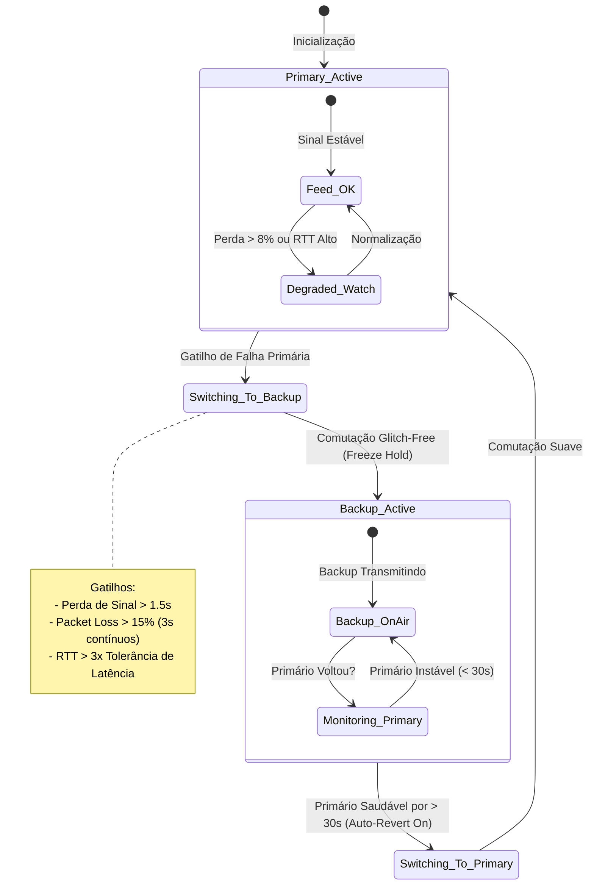
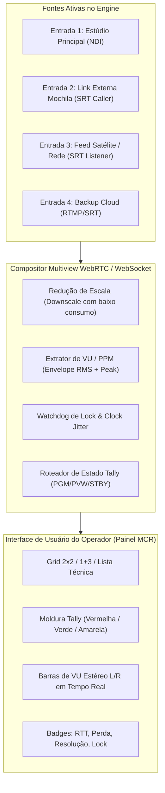

# Especificação Funcional e Técnica — Fase B: Entradas e Distribuição Profissional

**Documento:** `SPEC-FASE-B-ENTRADAS-DISTRIBUICAO.md`  
**Módulo:** Ingest Ao Vivo, SRT Manager, Redundância Primário/Backup, Normalização Multiformato e Multiview MCR  
**Responsável:** Analista de Sistemas e Produto Broadcast  
**Destinatários:** Tech Lead, Broadcast Fullstack DEV (`broadcast_dev`), UI/UX Designer (`broadcast_ui_designer`), QA Tester (`broadcast_qa_tester`)  
**Status:** APROVADO PARA IMPLEMENTAÇÃO  
**Versão:** 1.0.0  
**Data:** 2026-09-24  
**Benchmark de Referência:** Axel Technology XPlayout / XTV Suite (XRemote, XRouter, XMirror) & Padrões SRT Alliance / EBU / SMPTE  

---

## 1. Visão Geral e Objetivos do Módulo

A **Fase B** do RPlayout expande as capacidades operacionais do sistema para o domínio das **Entradas Heterogêneas** e da **Distribuição Profissional de Alta Confiabilidade**. Enquanto a Fase A assegura o cumprimento do relógio e a integridade da grade ininterrupta 24/7, a Fase B garante que qualquer sinal externo — originado de links remotos de jornalismo móvel (mojos), links de satélite/estúdio, enlaces internacionais de baixa latência ou feeds de estúdios locais — seja recebido, validado, normalizado e comutado sem interrupções perceptíveis e em perfeita conformidade técnica de áudio e vídeo.

No benchmark do **XPlayout (Axel Technology)**, a estabilidade de entradas remotas e saídas de distribuição assenta-se em:
1. Conexões SRT tolerantes a redes públicas com telemetria detalhada de jitter, RTT e perda de pacotes;
2. Comutação de contingência automatizada (perfil Primário e Secundário / Backup) sem depender de intervenção manual em situações de instabilidade de enlace;
3. Mecanismo de conformação em tempo real (ingest multi-rate/multi-resolution) que impede travamentos do pipeline central causados por variações de cadência (fps) ou resoluções divergentes;
4. Monitoração visual centralizada (Multiview operacional) que confere ao operador de Master Control (MCR) visibilidade imediata da saúde de todas as fontes com sinalizadores de Tally e medições acústicas pré-ar.

### 1.1 Metas de Entrega da Fase B
1. **SRT Manager Completo:** Suporte nativo e auditável aos modos `caller`, `listener` e `rendezvous`, criptografia AES (128/192/256-bit) com mascaramento estrito de senhas em UI e logs, controle milimétrico de latência de buffer (120ms a 2000ms), e telemetria por socket em tempo real (`rttMs`, `packetLossPercent`, `bitrateKbps`, `packetsDropped`, `reconnectCount`).
2. **Redundância Automática Primário/Backup (Main/Hot-Standby):** Configuração de duplos enlaces independentes para entradas e saídas de transmissão com gatilhos de chaveamento autônomo (falta de sinal > 1,5s, perda de pacotes > 15%, RTT > 3x tolerância) e transição limpa (*freeze-frame hold* / comutação coordenada).
3. **Engine de Normalização Multiformato e Audio Loudness:** Pipeline universal de ingest capaz de conformar resoluções (720p, 1080i, 1080p), cadências de quadro (25, 29.97, 50, 59.94, 60 fps) e aspect ratios (4:3 com *pillarbox* regulatório broadcast, 16:9), além de normalização dinâmica de áudio estéreo 48 kHz / 24-bit em conformidade com o padrão EBU R128 / ITU-R BS.1770 (-24 LUFS / True Peak a -1.0 dBTP).
4. **Multiview Técnico de Entradas:** Matriz de monitoração em tempo real integrada à interface web (layouts 2x2, 1+3 e Lista Técnica Compacta) com Tally State (PGM Vermelho, PVW Verde, Standby Amarelo, Offline Cinza), VU/PPM estéreo por canal e indicativo de sincronismo de lock.

---

## 2. SRT Manager Completo (Secure Reliable Transport)

O SRT é o protocolo central de transporte broadcast em redes IP não gerenciadas (Internet pública) e em enlaces dedicados. O subsistema `SrtManager` gerencia instâncias de recepção (`srtsrc`) e transmissão (`srtsink`) fornecendo telemetria contínua e políticas determinísticas de reconexão.

```mermaid
flowchart TD
    subgraph SrtManager ["RPlayout SRT Manager (Rust Engine & Server Domain)"]
        subgraph ModeSelection ["Modos Operacionais de Conexão"]
            M_Caller["SRT Caller (Empurra/Puxa via IP Remoto)"]
            M_Listener["SRT Listener (Abre Porta Local para Conexões)"]
            M_Rendezvous["SRT Rendezvous (Traversal NAT P2P Simétrico)"]
        end

        subgraph ParamValidation ["Validação & Criptografia"]
            LatencyBuf["Buffer Latência (120ms - 2000ms)"]
            AESCrypt["Criptografia AES-128 / AES-256 (pbkeylen)"]
            MaskedPass["Passphrase Mascarada (AES Key Derivation)"]
            StreamIdTag["StreamID (Multiplexação / Chave de Roteamento)"]
        end

        subgraph TelemetryEngine ["Telemetria e Observabilidade (1000ms Tick)"]
            MetricRTT["RTT (ms)"]
            MetricLoss["Packet Loss (%) & Dropped Pkts"]
            MetricBitrate["Bitrate Efetivo (kbps)"]
            MetricState["Socket State / Reconnect Count"]
        end

        subgraph ResilienceLogic ["Resiliência & Conexão"]
            ExpBackoff["Backoff Exponencial (500ms -> 15s)"]
            DegradationDetect["Detecção de Link Degradado"]
        end
    end

    M_Caller --> ParamValidation
    M_Listener --> ParamValidation
    M_Rendezvous --> ParamValidation
    ParamValidation --> TelemetryEngine
    TelemetryEngine --> ResilienceLogic
```



### 2.1 Modos de Conexão e Parâmetros Canônicos

O protocolo e o banco de dados do RPlayout passam a contemplar os três modos da especificação SRT Alliance:

| Parâmetro | Tipo | Valores Válidos | Padrão | Descrição Broadcast |
| :--- | :--- | :--- | :--- | :--- |
| `mode` | `enum` | `'caller'`, `'listener'`, `'rendezvous'` | `'caller'` | Define o papel do socket na negociação do handshake SRT. |
| `host` | `string` | IP IPv4/IPv6 ou FQDN | Obrigatório no modo caller; `0.0.0.0` no modo listener | Endereço de destino ou bind local. |
| `port` | `integer` | 1024 a 65535 | 9000 | Porta UDP utilizada pelo handshake SRT. |
| `latency` | `integer` | 120 a 2000 (ms) | 800 (ms) | Buffer de absorção de jitter e retransmissão de pacotes perdidos (ARQ). Em enlaces locais LAN recomenda-se 120-200ms; para links móveis de internet pública recomenda-se 800-1500ms (regra: 4x RTT). |
| `passphrase` | `string` | 10 a 79 caracteres | `null` | Frase secreta compartilhada para derivação de chaves simétricas AES. **Armazenada com criptografia em repouso e estritamente mascarada na UI**. |
| `pbkeylen` | `enum` | 16 (AES-128), 24 (AES-192), 32 (AES-256) | 32 (AES-256) | Tamanho da chave de cifragem simétrica de pacotes SRT. |
| `streamid` | `string` | Máx. 512 caracteres alfanuméricos | `null` | Identificador de fluxo para roteadores SRT multi-stream (ex: `#!::r=live/main,m=publish`). |
| `pollTimeoutMs` | `integer` | 50 a 1000 (ms) | 200 (ms) | Timeout de verificação de atividade no socket antes de reportar enlace ocioso. |

### 2.2 Telemetria em Tempo Real (Métricas de Socket)

A cada segundo (tick configurável de 500ms a 1000ms), o elemento `srtsrc` ou `srtsink` do GStreamer é consultado através da leitura da estrutura nativa `GstStructure` devolvida pelo sinal `stats` do socket SRT (`libsrt`).

As seguintes métricas são extraídas, calculadas e propagadas via WebSocket para a interface de MCR:

```typescript
export interface SrtTelemetry {
  /** Timestamp da amostragem em UTC ISO-8601 */
  readonly timestamp: string
  /** Round Trip Time em milissegundos */
  readonly rttMs: number
  /** Taxa de pacotes perdidos não recuperados a tempo (%) */
  readonly packetLossPercent: number
  /** Bitrate líquido recebido/transmitido em kbps */
  readonly bitrateKbps: number
  /** Total acumulado de pacotes descartados pelo buffer de latência (too late) */
  readonly packetsDropped: number
  /** Total de pacotes reenviados com sucesso (ARQ retransmissions) */
  readonly packetsRetransmitted: number
  /** Capacidade estimada do enlace IP em kbps */
  readonly linkBandwidthKbps: number
  /** Tamanho atual da fila interna de buffer SRT em ms */
  readonly bufferMs: number
  /** Contador de reconexões desde a ativação do perfil */
  readonly reconnectCount: number
  /** Estado de integridade do enlace segundo o engine */
  readonly linkState: 'OPTIMAL' | 'DEGRADED' | 'CRITICAL' | 'DISCONNECTED'
}
```

#### Classificação de Integridade do Link (`linkState`):
- **`OPTIMAL` (Verde):** `packetLossPercent` < 1.0%, `rttMs` <= 1.5 * `latency` configurada, sem descarte de pacotes (`packetsDropped` estático).
- **`DEGRADED` (Amarelo):** `packetLossPercent` entre 1.0% e 8.0%, ou `rttMs` entre 1.5x e 2.5x da tolerância contratada. O buffer está operando no limite de recuperação.
- **`CRITICAL` (Laranja):** `packetLossPercent` entre 8.0% e 15.0%, pacotes sendo descartados (`packetsDropped` incrementando), RTT instável. Alerta sonoro/visual no Master.
- **`DISCONNECTED` (Vermelho):** Perda de socket, ausência de dados por mais de 1500ms. Dispara rotina de contingência imediata.

### 2.3 Política de Reconexão e Backoff Exponencial

Para enlaces `caller` que sofrem desconexão súbita ou interrupção de rota IP, a reconexão automática segue um algoritmo determinístico de backoff exponencial com teto (*cap*):

$$\Delta t_{retry} = \min\left(T_{base} \times 2^{\min(tentativas, 5)} + \text{jitter}, T_{cap}\right)$$

Onde:
- $T_{base} = 500\text{ ms}$
- $T_{cap} = 15.000\text{ ms}$ (15 segundos)
- $\text{jitter} = \text{random}(0, 250\text{ ms})$ para evitar colisão cíclica em caso de reinício de servidores centrais.
- O contador de tentativas é zerado após **60 segundos contínuos** no estado `OPTIMAL` com fluxo de vídeo estável.

---

## 3. Arquitetura de Redundância Primário/Backup

Para emissoras de televisão e operadoras de distribuição aberta/fechada, transmissões críticas não podem depender de um único enlace de telecomunicação. A Fase B introduz a abstração de **Perfil Duplo Redundante (Primary / Backup Streams)** tanto para entradas (*Live Ingest*) quanto para saídas de transmissão (*Distribution Outputs*).



### 3.1 Definição do Perfil Duplo de Redundância

Cada entrada ou saída configurada no RPlayout pode ser associada a um par redundante:

```typescript
export interface RedundantStreamPair {
  readonly id: string
  readonly name: string
  readonly role: 'INGEST' | 'DISTRIBUTION'
  /** Enlace principal */
  readonly primary: StreamEndpointConfig
  /** Enlace de contingência */
  readonly backup: StreamEndpointConfig
  /** Políticas operacionais de chaveamento */
  readonly policy: FailoverPolicy
  /** Estado operacional corrente */
  readonly runtimeState: RedundantPairState
}

export interface StreamEndpointConfig {
  readonly id: string
  readonly label: string
  readonly kind: 'SRT' | 'RTMP' | 'SDI' | 'NDI'
  readonly uri: string
  readonly srtConfig?: SrtSpecificConfig
  readonly priority: 1 | 2
  readonly enabled: boolean
}

export interface FailoverPolicy {
  /** Timeout sem pacotes/frames para considerar sinal perdido (padrão: 1500 ms) */
  readonly signalLossTimeoutMs: number
  /** Limite de perda de pacotes para forçar comutação (padrão: 15.0%) */
  readonly packetLossThresholdPercent: number
  /** Limite de estouro de RTT em relação à latência contratada (padrão: 3.0x) */
  readonly rttMultiplierThreshold: number
  /** Tempo mínimo em que a falha deve persistir antes do trigger (padrão: 1000 ms) */
  readonly qualificationTimeMs: number
  /** Retornar automaticamente ao Primário quando este se restabelecer (padrão: false) */
  readonly autoRevertToPrimary: boolean
  /** Tempo que o Primário deve ficar 100% OPTIMAL antes de acionar reversão (padrão: 30000 ms) */
  readonly primaryHysteresisStabilizationMs: number
  /** Estratégia de transição do frame durante a comutação */
  readonly transitionStrategy: 'FREEZE_FRAME_HOLD' | 'BLACK_BURST_CROSSFADE'
}

export interface RedundantPairState {
  readonly activeStream: 'PRIMARY' | 'BACKUP'
  readonly primaryHealth: SrtTelemetry | null
  readonly backupHealth: SrtTelemetry | null
  readonly lastSwitchTimestamp: string | null
  readonly lastSwitchReason: string | null
  readonly switchCount: number
}
```

### 3.2 Algoritmo de Failover Automático e Comutação Limpa

O motor de comutação do engine opera com o conceito de **Hot-Standby**. Ambos os pipelines (Primário e Backup) podem estar decodificados/prontos na memória RAM (*pre-rolled*). 

#### 1. Avaliação de Gatilhos de Falha
A cada 100 milissegundos, o watchdog de entrada avalia as três condições eliminatórias no link ativo:
- **Ausência Total de Buffers ($T_{gap} > \text{signalLossTimeoutMs}$):** O relógio do demuxer/decodificador não avança por mais de 1,5 segundos.
- **Degradação Crítica Prolongada:** `packetLossPercent` > 15.0% ou `packetsDropped` > 50 pkts/segundo durante o intervalo de qualificação ($1000\text{ ms}$).
- **Esgotamento do Buffer de Latência:** $\text{RTT} > 3 \times \text{latência contratada}$, indicando colapso da rota de rede.

#### 2. Execução da Comutação Limpa (Glitch-Free / Freeze-Frame Hold)
Quando a comutação é acionada:
1. O compositor de vídeo do engine congela imediatamente o último quadro válido do sinal primário (*Freeze Frame Hold*) na saída PGM por até 4 quadros (80ms a 160ms dependendo do framerate).
2. O seletor de entrada comuta a matriz de vídeo interna para o pipeline de backup.
3. Assim que o decodificador do sinal backup entrega o primeiro quadro I-frame decodificado com áudio sincronizado, o compositor libera a imagem ao vivo.
4. O áudio sofre um microfade (*equal-power crossfade* de 20ms) para anular estalos de descontinuidade de fase (*audio pops/clicks*).
5. O evento é registrado com severidade `CRITICAL` no As-Run Log e propagado via WebSocket com `failoverEvent`.

---

## 4. Normalização Multiformato no Engine

No dia a dia broadcast, fontes externas chegam em formatos totalmente heterogêneos: transmissões internacionais em 1080i50 ou 720p50, reportagens de campo em 1080p59.94, sinais legados em 4:3 SD (NTSC/PAL-M) e encoders remotos operando em H.265 (HEVC), ProRes ou H.264.

O canal de saída do RPlayout possui uma geometria e cadência canônica rígida (ex: `1080i59.94` para TV aberta brasileira ou `1080p50` para cabo europeu). **O engine é estritamente proibido de travar, falhar ou apresentar stuttering quando uma fonte externa divergente entra no ar.**

```mermaid
flowchart LR
    subgraph InputFeed ["Fonte de Entrada Heterogênea"]
        InRes["Resolução: 720p / 1080i / 1080p / 4:3 SD"]
        InFPS["FPS: 25 / 29.97 / 50 / 59.94 / 60"]
        InCodec["Codec: H.264 / H.265 / ProRes / MPEG-2"]
        InAudio["Áudio: Taxa Arbitrária / Volume Variável"]
    end

    subgraph ConformPipeline ["Pipeline de Conformação Universal (Engine Rust)"]
        Dec["Decodificador Universal (Hardware/Software)"]
        Deint["Desentrelaçador Adaptativo (yadif / deinterlace)"]
        AR["Aspect Ratio & Scaler (Pillarbox/Letterbox Bt.709)"]
        FRConv["Conformador de Cadência (videorate determinístico)"]
        
        AudioResample["Resample 48kHz / 24-bit PCM"]
        AudioLoudness["Conformidade EBU R128 (-24 LUFS / TruePeak)"]
    end

    subgraph MasterMixer ["Compositor Master do Canal"]
        PGMVid["Mixer de Vídeo (Slot PGM no formato do Canal)"]
        PGMAud["Mixer de Áudio (48kHz Master Bus)"]
    end

    InputFeed --> Dec
    Dec --> Deint
    Deint --> AR
    AR --> FRConv
    FRConv --> PGMVid

    InputFeed --> AudioResample
    AudioResample --> AudioLoudness
    AudioLoudness --> PGMAud
```



### 4.1 Matriz de Tratamento de Resolução e Aspect Ratio

Todas as entradas passam por um estágio de conformação geométrica obrigatório:
1. **Preservação de Aspect Ratio (Proporção):**
   - Entrada **4:3 SD** para Canal **16:9 HD**: Inserção automática de **Pillarbox** (barras pretas laterais 100% broadcast black RGB 16,16,16).
   - Entrada **16:9** para Canal **4:3**: Inserção de **Letterbox** (barras superior e inferior).
   - Configuração avançada de corte: Opção de *Zoom/Crop 14:9* ou *Full 16:9 Crop* selecionável por configuração de fonte.
2. **Espaço de Cor e Matriz de Cores:**
   - Resoluções SD (< 720 linhas): Conversão explícita de `BT.601` para `BT.709` utilizando matriz broadcast de precisão.
   - Resoluções HD/FHD (>= 720 linhas): Fixação estrita em `BT.709` com limitação de *broadcast legal levels* (16-235 luma, 16-240 chroma) para evitar violação de modulação de transmissores.

### 4.2 Desentrelaçamento e Conversão de Cadência (Frame Rate)

1. **Fontes Entrelaçadas (`1080i50`, `1080i59.94`):**
   - Utilização do algoritmo adaptativo de movimento `yadif` (Yet Another Deinterlacing Filter) ou elemento de deinterlace nativo acelerado por hardware quando disponível.
   - Detecção rigorosa de ordem de campos: `Top Field First (TFF)` padrão em 1080i; `Bottom Field First (BFF)` para DVCPRO/legados.
2. **Conversão de Cadência (`videorate` determinístico):**
   - Conversões de cadência inteira para fracionada (ex: `60 fps -> 59.94 fps` ou `30 fps -> 29.97 fps`): Remoção/duplicação de 1 quadro a cada 1000 quadros sem introdução de artefatos de interpolação.
   - Conversões de padrões cruzados (ex: `50 fps -> 59.94 fps` ou `25 fps -> 29.97 fps`): O pipeline utiliza repetição de quadros baseada em timestamps monotônicos (*presentation time stamp*), preservando sincronismo labial (A/V Sync).

### 4.3 Pipeline GStreamer de Ingest Normalizado

O engine implementa o seguinte padrão de pipeline isolado para recepção SRT normalizada:

```text
srtsrc uri="srt://host:port?mode=caller&latency=800" !
  tsdemux name=demux
  
demux. ! queue max-size-time=500000000 ! parsebin ! avdec_h264 !
  deinterlace mode=auto !
  videoconvert !
  videoscale add-borders=true !
  videorate drop-only=false !
  capsfilter caps="video/x-raw, width=1920, height=1080, framerate=60000/1001, pixel-aspect-ratio=1/1, colorimetry=bt709" !
  intervideosink channel="live_norm_ch1"

demux. ! queue max-size-time=500000000 ! parsebin ! decodebin !
  audioconvert !
  audioresample quality=8 !
  capsfilter caps="audio/x-raw, rate=48000, channels=2, format=S24LE" !
  interaudiosink channel="live_norm_ch1_audio"
```

### 4.4 Normalização Dinâmica de Áudio (EBU R128 / -24 LUFS)

O áudio proveniente de links de campo varia drasticamente (repórter falando baixo, som ambiente estrondoso, comerciais desregulados). Cada entrada ao vivo recebe um estágio de controle de nível dinâmico:
- **Amostragem Canônica:** Resampling para 48.000 Hz, 24 bits PCM estéreo (*Linear PCM*).
- **Medição R128 Integrada:** Medição em tempo real de Loudness Momentâneo (400ms), Curto Prazo (3s) e Integrado.
- **Normalização Automática de Entrada:** DSP integrado aplicando ganho automático moderado (*AGC Broadcast com teto de expansão de +6dB e atenuação rápida de picos*) com limitador True Peak parametrizado a **-1.0 dBTP** para evitar qualquer ceifamento (*clipping*) antes da mixagem no barramento master.

---

## 5. Multiview Operacional de Entradas (MCR Master Control)

O operador de Master Control precisa enxergar o status visual, dinâmico e técnico de todas as fontes disponíveis antes de colocá-las no ar através do botão `TAKE`.



### 5.1 Modos de Visualização Operacional

A interface web de Master Control deve oferecer três layouts selecionáveis pelo operador:
1. **Grid 2x2 (Quatro Fontes Primárias):** Exibição balanceada de 4 entradas ao vivo em alta fluidez (30 fps WebRTC/HLS de baixa latência).
2. **Grid 1+3 (Foco Operacional):** Uma janela grande em destaque (fonte selecionada para inspeção) e 3 miniaturas laterais com os demais sinais.
3. **Lista Técnica Compacta:** Linhas detalhadas para até 16 entradas, com miniatura de vídeo 16:9 (160x90px), medidor VU estéreo, indicadores numéricos de RTT, Bitrate, FPS, Resolução detectada e botão de ação direta `ENVIAR PARA PREVIEW`.

### 5.2 Sistema de Tally Broadcast

A borda de cada visor no Multiview e seu cabeçalho mudam de cor dinamicamente para indicar o estado operacional no sistema de playout:

| Cor do Tally | Estado Técnico | Significado Operacional Broadcast |
| :--- | :--- | :--- |
| **Vermelho Pulsante / Sólido (`#E53935`)** | **ON AIR (PGM)** | A fonte está comutada diretamente na saída de Programa principal. Qualquer alteração ou queda impacta os telespectadores. |
| **Verde Sólido (`#43A047`)** | **NEXT / PREVIEW (PVW)** | A fonte é o próximo item agendado na grade ou está selecionada no monitor de Preview, pronta para o disparo imediato do comando `TAKE`. |
| **Amarelo Sólido (`#FDD835`)** | **CUED / STANDBY** | A fonte está conectada, decodificada e com sinal íntegro (Locked), porém fora do ar. Pronta para comutação manual de emergência. |
| **Cinza Escuro (`#424242`)** | **OFFLINE / DISCONNECTED** | Fonte cadastrada, mas sem sinal de rede ou handshake SRT pendente. Imagem substituída por padrão de barras ou arte técnica informando status. |

### 5.3 Indicadores Técnicos por Célula do Multiview

Cada cartão de monitor de entrada exibe visualmente:
1. **Medidor de VU/PPM Estéreo:** Barra dupla vertical com escala de -60 dBFS a 0 dBFS. Marcações coloridas: Verde (-60 a -18 dBFS), Amarelo (-18 a -6 dBFS), Vermelho (-6 a 0 dBFS) com indicador de pico flutuante (*Peak Hold* de 1,5s).
2. **Status de Sincronismo (`SYNC LOCK`):**
   - `LOCK` (Verde): Sinal presente com cadência estável correspondente ao formato nominal.
   - `DRIFT` (Amarelo): Variação de cadência detectada (+/- 0,5% do framerate nominal).
   - `NO SIGNAL` (Vermelho): Sem quadros recebidos nos últimos 1,5s.
3. **Badge de Enlace SRT:** Exibição compacta no formato `RTT: 42ms | LOSS: 0.1% | 4.8 Mbps`.
4. **Indicador de Redundância Ativa:** Ícone comutável `[PRI]` (Primário ativo) ou `[BCK]` (Backup ativo em contingência).

---

## 6. Modelagem de Dados e Contratos de API (TypeScript & Protocol)

### 6.1 Extensões no Pacote `@rplayout/protocol`

As definições canônicas de entradas, SRT e redundância são centralizadas em `packages/protocol/src/channel.ts` e `packages/protocol/src/sources.ts`:

```typescript
export type SrtConnectionMode = 'CALLER' | 'LISTENER' | 'RENDEZVOUS'
export type SrtKeyLength = 16 | 24 | 32

export interface SrtConfiguration {
  readonly mode: SrtConnectionMode
  readonly host: string
  readonly port: number
  readonly latencyMs: number
  readonly passphrase?: string // Mascarada na serialização de API
  readonly keyLength?: SrtKeyLength
  readonly streamId?: string
  readonly pollTimeoutMs?: number
}

export type StreamRole = 'PRIMARY' | 'BACKUP'

export interface ManagedLiveSource {
  readonly id: string
  readonly channelId: string
  readonly name: string
  readonly kind: 'SRT' | 'RTMP' | 'SDI' | 'NDI'
  readonly targetUrl: string
  readonly srt?: SrtConfiguration
  readonly role: StreamRole
  readonly pairedSourceId?: string // Vincula o par Primário <-> Backup
  readonly autoFailoverEnabled: boolean
  readonly failoverThresholds: {
    readonly signalLossTimeoutMs: number
    readonly maxPacketLossPercent: number
    readonly maxRttMultiplier: number
  }
  readonly enabled: boolean
}
```

### 6.2 Endpoints REST da API do Server

#### Gerenciamento de Fontes e SRT (`/api/sources`)

1. **`GET /api/sources/live`**
   - Retorna a lista de todas as fontes ao vivo cadastradas, agregando status físico (DeckLink, NDI) e instâncias de rede (SRT, RTMP) com seus pares redundantes.
2. **`POST /api/sources/live`**
   - Cria uma nova fonte gerenciada com configuração de SRT e redundância.
   - *Body:* `ManagedLiveSourceInput` (validação de porta, host, latência entre 120 e 2000 ms, e mascaramento de senha).
3. **`PUT /api/sources/live/:id`**
   - Atualiza propriedades operacionais da fonte (alteração de latência a quente, nova passphrase, toggle de failover automático).
4. **`POST /api/sources/live/:id/force-failover`**
   - Comanda manualmente a comutação do par redundante (ex: força chaveamento para o Backup para manutenção programada do link Primário).
   - Registra auditoria com usuário responsável.

#### Multiview & Telemetria (`/api/multiview`)

1. **`GET /api/multiview/layout`**
   - Retorna a lista de entradas ordenadas para o grid do Multiview com layout preferencial do operador (2x2, 1+3, lista).
2. **`GET /api/multiview/telemetry`**
   - Snapshot instantâneo de todas as fontes com métricas de RTT, perda de pacotes, níveis de áudio RMS/Peak e estado de Tally.

### 6.3 Eventos de WebSocket e Telemetria em Tempo Real

Canal de comunicação contínuo (`ws://host:porta/ws/live-telemetry`):

```json
{
  "type": "SOURCE_TELEMETRY_TICK",
  "channelId": "ch-main",
  "sourceId": "src-reporter-mochila-1",
  "telemetry": {
    "timestamp": "2026-09-24T15:30:00.100Z",
    "rttMs": 64,
    "packetLossPercent": 0.2,
    "bitrateKbps": 5420,
    "packetsDropped": 0,
    "packetsRetransmitted": 12,
    "bufferMs": 792,
    "reconnectCount": 0,
    "linkState": "OPTIMAL",
    "audioLevels": {
      "leftRmsDb": -23.4,
      "rightRmsDb": -23.1,
      "leftPeakDb": -14.2,
      "rightPeakDb": -13.9
    },
    "tally": "ON_AIR"
  }
}
```

```json
{
  "type": "FAILOVER_EVENT",
  "channelId": "ch-main",
  "pairedGroupId": "grp-external-link-1",
  "event": "AUTOMATIC_SWITCH",
  "fromSourceId": "src-primary-srt",
  "toSourceId": "src-backup-srt",
  "reason": "SIGNAL_LOSS_TIMEOUT (1520ms sem buffers de vídeo)",
  "freezeFrameApplied": true,
  "switchDurationMs": 140,
  "timestamp": "2026-09-24T15:31:12.450Z"
}
```

---

## 7. Critérios de Aceite e Cenários de Teste

Para assegurar conformidade broadcast irrestrita, a homologação da Fase B é regida pelos seguintes cenários determinísticos de aceitação:

### Cenário 1: Queda do Stream Primário SRT Caller e Failover Transparente
- **Contexto:** Entrada configurada com par redundante (Primário: SRT Caller `srt://198.51.100.10:9000`, Backup: SRT Caller `srt://198.51.100.20:9000`). O canal está exibindo a fonte no ar (Tally Vermelho).
- **Ação:** Interrupção forçada do tráfego de rede do link primário (simulação de corte de fibra ou desativação de interface).
- **Critérios de Aceite:**
  1. A ausência de sinal é detectada pelo watchdog de entrada em no máximo 1500 ms.
  2. O comutador do engine comuta para o link de backup mantendo o último quadro válido congelado (*Freeze Frame Hold*) por menos de 500 ms no ar.
  3. O áudio comuta suavemente sem estalos sonoros (*equal-power crossfade*).
  4. A saída PGM permanece ininterrupta sem queda do pipeline GStreamer ou desconexão de clientes SRT/RTMP/WebRTC downstream.
  5. A UI de MCR atualiza o badge para `[BCK]` em amarelo com notificação visual crítica de failover.
  6. O log de As-Run registra o evento `FAILOVER_TRIGGERED` com carimbo de tempo milimétrico.

### Cenário 2: Normalização de Entrada 1080i59.94 para Saída 1080p50
- **Contexto:** O canal de transmissão opera nativamente no padrão europeu `1080p50` (1920x1080 progressivo a 50 fps).
- **Ação:** Inserção na grade de uma fonte ao vivo externa com sinal NTSC/EUA em `1080i59.94` (1920x1080 entrelaçado, Top Field First, 59.94 campos/s) e áudio em 44.1 kHz desregulado a -14 LUFS.
- **Critérios de Aceite:**
  1. O desentrelaçamento de hardware/software converte os campos em quadros progressivos sem efeito de pente (*interlace comb artifacts*).
  2. O conformador de cadência (`videorate`) ajusta a cadência de 59.94 fps para 50 fps sem acúmulo de buffer de memória e sem congelamento perceptível de movimento (*judder* excessivo).
  3. O áudio é reamostrado de forma limpa para 48.000 Hz sem variação de tom (*pitch shifting*).
  4. O estágio de controle dinâmico EBU R128 atenua o volume para a faixa nominal de -24 LUFS (+/- 0.5 LU) sem estourar o teto de -1.0 dBTP.
  5. O consumo de CPU do engine permanece dentro da margem operacional nominal (< 45% por pipeline de entrada em Core i7 / Xeon de referência).

### Cenário 3: Configuração e Telemetria de SRT Listener Aguardando Conexão
- **Contexto:** Operador de MCR cria uma entrada SRT no modo `listener` na porta UDP `9200`, latência de 1000 ms e criptografia AES-256 com passphrase `BroadcastSecretKey2026!`.
- **Ação:** A entrada é salva no sistema e aguarda a conexão de um encoder remoto de campo.
- **Critérios de Aceite:**
  1. O engine abre o socket UDP `0.0.0.0:9200` em modo escuta sem bloquear outras operações do sistema.
  2. No painel de Multiview, a célula da fonte exibe estado `LISTENING` / `OFFLINE` com moldura cinza e indicativo de porta pronta.
  3. A senha é exibida na UI com máscara de proteção (`•••••••••••••••••••••••`) e nunca é enviada em texto plano nos logs da aplicação.
  4. Ao conectar o encoder remoto com a chave correta, o handshake é concluído em menos de 1000 ms, a célula do Multiview comuta para `CUED / STANDBY` (Tally Amarelo), a imagem aparece e os dados de telemetria (`rttMs`, `packetLossPercent`, `bitrateKbps`) passam a atualizar a cada 1 segundo no painel.

---

## 8. Glossário Broadcast e Padrões Aplicados

- **ARQ (Automatic Repeat reQuest):** Mecanismo de retransmissão de pacotes perdidos no protocolo SRT, essencial para garantir transporte de vídeo sem perdas sobre redes com jitter.
- **EBU R128 / ITU-R BS.1770:** Padrões internacionais de medição e normalização de Loudness em radiodifusão televisiva, substituindo a medição tradicional de pico por sonoridade percebida pelo ouvido humano (-23 LUFS na Europa / -24 LUFS nas Américas).
- **Freeze-Frame Hold:** Técnica de tolerância a falhas em equipamentos broadcast que mantém o último quadro decodificado na tela durante a perda de sinal transitória, evitando que a tela fique preta (*dead-air*) antes da ativação do canal de contingência.
- **Hot-Standby:** Configuração redundante em que o sinal de backup é mantido ativo, sincronizado e decodificado simultaneamente ao primário, permitindo comutação quase instantânea.
- **Pillarbox:** Efeito óptico broadcast de barras verticais pretas nas laterais da imagem quando um conteúdo de formato 4:3 é exibido em uma tela de proporção 16:9.
- **Tally:** Sistema de sinalização luminosa que avisa operadores, diretores e apresentadores qual fonte de vídeo está efetivamente no ar (PGM) ou pronta para entrar (Preview).
- **YADIF:** Algoritmo de desentrelaçamento de alta precisão que analisa pixels vizinhos temporal e espacialmente para reconstruir quadros progressivos sem perda de nitidez vertical.
