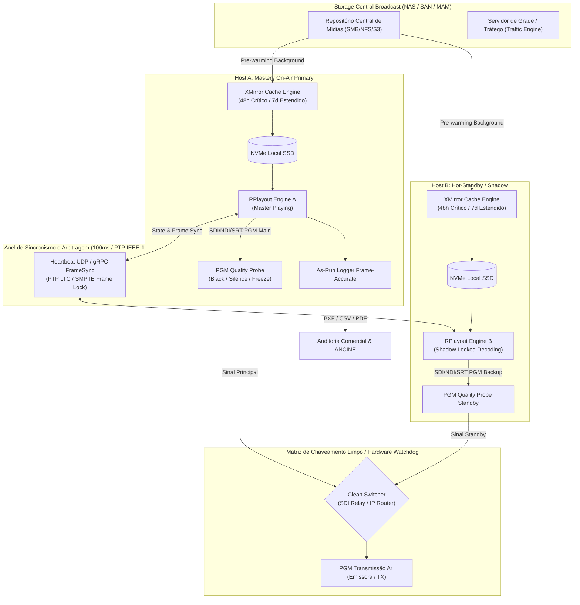
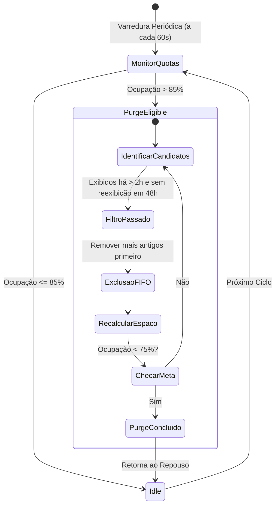
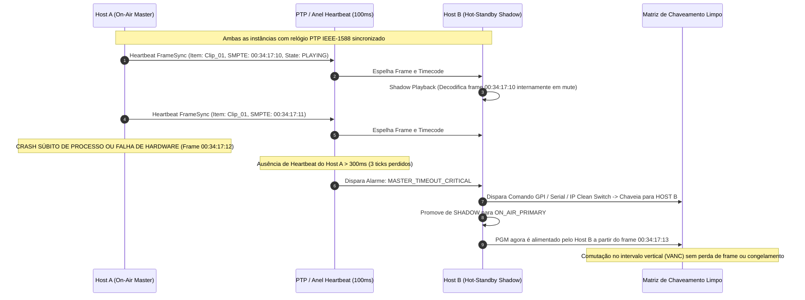
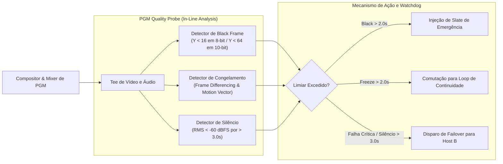
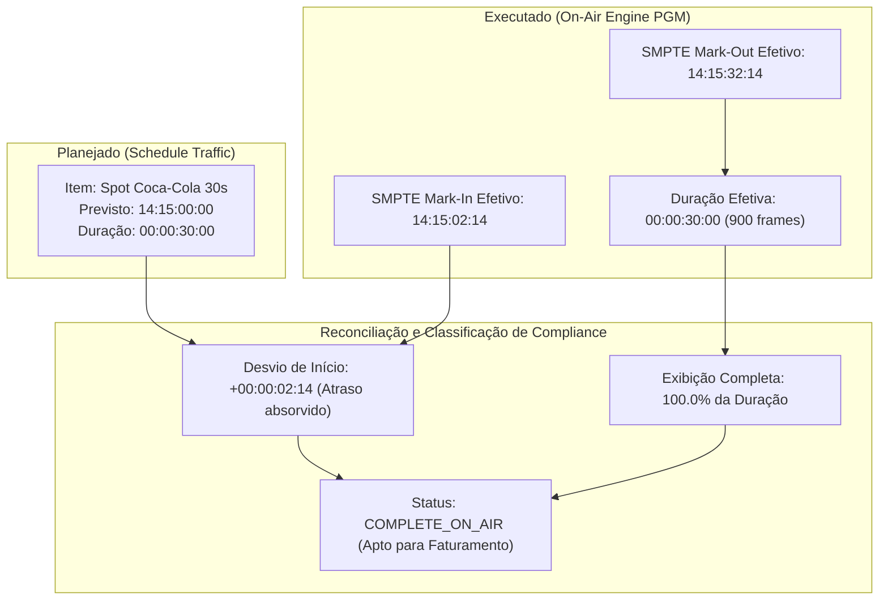

# Especificação Funcional e Técnica — Fase C: Continuidade e Compliance Broadcast

**Documento:** `SPEC-FASE-C-CONTINUIDADE-COMPLIANCE.md`  
**Módulo:** Cache Inteligente de Continuidade (48h/7d), Redundância de Cluster N+1 (Frame-Accurate State Sync), Sonda de PGM (Black/Silêncio/Freeze) e As-Run Logs / Compliance Regulatório (ANCINE / BXF)  
**Responsável:** Analista de Sistemas e Produto Broadcast  
**Destinatários:** Tech Lead, Broadcast Fullstack DEV (`broadcast_dev`), UI/UX Designer (`broadcast_ui_designer`), QA Tester (`broadcast_qa_tester`)  
**Status:** APROVADO PARA IMPLEMENTAÇÃO  
**Versão:** 1.0.0  
**Data:** 2026-09-24  
**Benchmark de Referência:** Axel Technology XPlayout / XTV Suite (XMirror, XRemote, XBackup, XAutomation) & Normas SMPTE-2021 (BXF), EBU R128, ITU-R BS.1770, ANCINE IN nº 95 e Lei nº 4.117/1962  

---

## 1. Visão Geral e Objetivos do Módulo

A **Fase C** do RPlayout consolida a robustez de missão crítica do sistema para operações ininterruptas 24/7 de classe mundial (*Five Nines* — 99.999% de disponibilidade operacional). Playouts de televisão aberta e por assinatura não toleram interrupções provocadas por falhas de conectividade de rede com storages centrais (NAS/SAN), quebras de hardware, corrupção de mídias ou desvios de processo operacional.

No ecossistema de referência do **XPlayout (Axel Technology)** e nos grandes sistemas de Master Control da indústria (Imagine Versio, Grass Valley Morpheus, Harmonic Spectrum):
1. **O Playout nunca lê diretamente do storage central compartilhado no instante do ar**: uma cópia espelhada local em SSD (*pre-warming cache*, análogo ao módulo **XMirror**) garante autonomia completa mesmo em isolamento total de rede (*air-gap survival*).
2. **A redundância não é mera tolerância a falhas estática**: instâncias em paralelo (Host A Master / Host B Hot-Standby) executam pipelines em sincronismo de frame exato (*frame-accurate shadow playback*), sincronizadas via PTP IEEE-1588 e timecode SMPTE, possibilitando comutações limpas (*zero-glitch clean switch*) sem pulo temporal perceptível pelo telespectador.
3. **A fiscalização do PGM é contínua e algorítmica**: sondas em linha no sinal de saída detectam imediatamente telas pretas acidentais, congelamento de vídeo e ausência de áudio, tomando ações automáticas (injeção de card/slate de contingência ou chaveamento de cluster).
4. **O compliance legal e comercial é inviolável**: o relatório de execução (*As-Run Log*) é o instrumento jurídico de auditoria da emissora, comprovando a veiculação de publicidade para faturamento comercial, o cumprimento de cotas nacionais de conteúdo (ANCINE) e a observância dos limites máximos de publicidade por hora.



---

## 2. Cache Inteligente de Continuidade (Estilo XMirror)

### 2.1 Princípio de Arquitetura e Filosofia "Zero-Network Dependency"

No modelo tradicional broadcast de alto rendimento, o motor de playout **jamais decodifica mídia diretamente sobre conexões de rede CIFS/SMB ou NFS em tempo real**. Variações de largura de banda, bloqueios de I/O por processos de edição (NLEs), renegociação de switches ou panes no storage central podem introduzir travamentos no buffer do decodificador (*drop frames* ou *pipeline stall*).

O subsistema **`ContinuityCacheEngine`** atua de forma autônoma e assíncrona, executando o espelhamento preditivo das mídias da grade para a unidade SSD NVMe local de cada nó de playout.

### 2.2 Estratégia de Pré-Aquecimento (Pre-Warming) em Dupla Camada

O cache divide o horizonte temporal de exibição em duas camadas operacionais:

```mermaid
flowchart LR
    ScheduleTimeline["Linha do Tempo da Grade de Programação"]
    
    subgraph Layer1 ["Camada 1: Buffer Crítico (0h até 48h)"]
        direction TB
        L1_Desc["Pré-aquecimento Obrigatório (Pinning)"]
        L1_SLA["SLA de Cópia: Prioridade Máxima (High I/O)"]
        L1_Val["Verificação SHA-256 e Conformidade A/V"]
        L1_Rule["Regra: 100% dos clipes devem residir no SSD"]
    end

    subgraph Layer2 ["Camada 2: Grade Estendida (48h até 7 Dias)"]
        direction TB
        L2_Desc["Espelhamento Antecipado em Background"]
        L2_SLA["SLA de Cópia: I/O Throttled (Baixa Prioridade)"]
        L2_Rule["Reserva de Espaço Conforme Quota"]
    end

    ScheduleTimeline --> Layer1
    Layer1 --> Layer2
```



1. **Camada 1 — Buffer Crítico (Próximas 48 Horas):**
   - **Prioridade:** `CRITICAL` (1).
   - **Objetivo:** Garantir sobrevivência total a um fim de semana inteiro sem intervenção de engenharia e sem conectividade com o storage central.
   - **Regra:** Todo arquivo presente na grade nas próximas 48 horas tem transferência iniciada imediatamente após a publicação da grade ou inserção do item.
   - **Comportamento no Playout:** O player redireciona a URI da mídia para o caminho do arquivo no SSD local validado.

2. **Camada 2 — Grade Estendida (48 Horas até 7 Dias):**
   - **Prioridade:** `BACKGROUND` (2).
   - **Objetivo:** Adiantar cópias de longa duração (programas semanais, séries, pacotes de filmes) durante as madrugadas e horários de baixa concorrência de I/O na rede.
   - **Controle de Throttling:** A taxa de transferência para mídias além de 48h é limitada (ex: max 25 MB/s) para evitar saturação do link de produção da emissora.

### 2.3 Quotas de Disco, Verificação de Integridade e Política de Poda

#### Verificação de Integridade (Hash SHA-256 e Fast Probe)
Para evitar que arquivos incompletos ou corrompidos durante a cópia de rede entrem no ar:
1. Durante a cópia do NAS para o SSD local, o fluxo é gravado em um arquivo temporário com extensão `.caching`.
2. O hash SHA-256 é calculado de forma incremental em blocos de 4MB durante a escrita.
3. Se o MAM/Storage fornecer o hash pré-calculado nos metadados, o hash final é comparado diretamente. Caso contrário, um `ffprobe` / `gst-discoverer` em memória afere:
   - Presença dos fluxos válidos de vídeo e áudio;
   - Duração real de quadros em relação à duração esperada na grade;
   - Integridade dos primeiros e últimos 50 quadros do contêiner.
4. Somente após a validação completa, o arquivo é atomicamente renomeado para a extensão final `.mp4` / `.mxf` no diretório de cache e registrado no catálogo local como `VERIFIED_LOCAL`.

#### Gestão de Quotas e Política de Poda por Antiguidade (Purge)
A partição dedicada de SSD local possui limites rígidos de armazenamento:
- **Limite Operacional Máximo:** 85% da capacidade total do disco (ex: 1,7 TB em um SSD de 2 TB).
- **Limite Crítico de Emergência:** 92% da capacidade total.



**Critérios Inegociáveis de Poda (Purge Rules):**
1. **Mídias com reexibição programada nas próximas 48 horas NUNCA são podadas**, independentemente da antiguidade do primeiro arquivo.
2. Mídias já exibidas no ar há mais de 2 horas (e que não constem na grade futura dos próximos 7 dias) são elegíveis para deleção imediata segundo ordem cronológica de última exibição (FIFO de veiculação).
3. Caso a ocupação atinja o patamar crítico de 92%, a poda seletiva pode descartar itens da *Camada 2 (Grade Estendida > 48h)*, preservando intactas as 48 horas críticas.

### 2.4 Comportamento Autônomo em Isolamento Total (Air-Gap Survival)

Se o enlace de rede com o storage central ou o switch de infraestrutura cair:
1. O subsistema `ContinuityCacheEngine` detecta a indisponibilidade do storage compartilhado (timeout de heartbeat de storage > 5000ms ou erro de montagem CIFS/NFS).
2. O engine entra em modo **`LOCAL_STORAGE_ONLY`** (Air-Gap Autónomo).
3. Todas as requisições de execução são atendidas exclusivamente a partir do SSD local `/cache/media/...`.
4. Uma notificação visual e sonora de alto nível (`STORAGE_OFFLINE_AUTONOMOUS_OK`) é transmitida ao Master Control, informando exatamente quantas horas de operação estão 100% garantidas sem dependência externa.

### 2.5 Indicador Visual de Cobertura e Interfaces de Dados

O frontend do RPlayout deve exibir em tempo real no topo do Master Control o status de cobertura do cache com código de cores e percentual auditado:

```typescript
export type CacheHealthStatus = 'OPTIMAL' | 'DEGRADED' | 'CRITICAL' | 'STORAGE_OFFLINE_AUTONOMOUS'

export interface CacheCoverageTelemetry {
  /** Percentual de cobertura garantida das próximas 48 horas (0.0 a 100.0%) */
  readonly coverage48hPercent: number
  /** Percentual de cobertura da grade estendida de 7 dias */
  readonly coverage7dPercent: number
  /** Total de itens na janela de 48h */
  readonly totalItems48h: number
  /** Total de itens já cacheados e validados no SSD local */
  readonly cachedItems48h: number
  /** Total de itens em processo ativo de transferência */
  readonly downloadingItems48h: number
  /** Total de itens com pendência ou erro de download */
  readonly missingItems48h: number
  /** Espaço total do SSD local em Gigabytes */
  readonly totalDiskGb: number
  /** Espaço livre no SSD local em Gigabytes */
  readonly freeDiskGb: number
  /** Percentual de ocupação do disco local (0.0 a 100.0%) */
  readonly diskUsagePercent: number
  /** Estado de saúde global do subsistema de cache */
  readonly healthStatus: CacheHealthStatus
  /** Lista de itens faltantes críticos ordenados pelo horário de exibição mais próximo */
  readonly urgentMissingMedia: Array<{
    readonly rundownItemId: string
    readonly mediaId: string
    readonly title: string
    readonly scheduledAirTime: string
    readonly timeUntilAirSeconds: number
    readonly transferStatus: 'PENDING' | 'TRANSFERRING' | 'CHECKSUM_FAILED' | 'SOURCE_NOT_FOUND'
  }>
}
```

#### Regras Visuais de Sinalização:
- **`OPTIMAL` (Verde Neon / `#22C55E`):** `coverage48hPercent` = 100%. Mensagem: *"Cache 48h: 100% Garantido (Local SSD)"*.
- **`DEGRADED` (Amarelo / `#F59E0B`):** `coverage48hPercent` entre 90.0% e 99.9%, ou faltam itens com mais de 6h para ir ao ar. Mensagem: *"Cache 48h: 94.2% (Sincronizando 4 itens)"*.
- **`CRITICAL` (Vermelho / `#EF4444`):** Item faltante com menos de 2 horas para entrar no ar, ou disco com mais de 92% de ocupação. Mensagem: *"Cache Crítico: Mídia faltante em 42min!"*.
- **`STORAGE_OFFLINE_AUTONOMOUS` (Azul Ciano / `#06B6D4`):** Rede/NAS desconectado, mas 100% dos arquivos das próximas 48h estão disponíveis no SSD local. Mensagem: *"Operação Autônoma Offline: 48h Protegidas"*.

---

## 3. Redundância N+1 de Cluster e Sincronização de Estado Frame-Accurate

### 3.1 Topologia de Cluster Broadcast (Host A Primary e Host B Hot-Standby)

Para eliminar qualquer Ponto Único de Falha (*Single Point of Failure - SPOF*), o RPlayout adota uma topologia de dupla máquina ativa em espelho (*Host A On-Air Master / Host B Hot-Standby Shadow*), acoplada a um anel de comunicação redundante e comutador limpo de saída.



### 3.2 Protocolo de Sincronização de Estado Quadro a Quadro (`FrameSyncProtocol`)

Para que a transição ocorra sem qualquer salto visível ou audível (*seamless transition*), o Host B não pode simplesmente "começar a abrir o arquivo" no instante da falha do Host A. Ele deve estar com a mídia já decodificada no mesmo instante do tempo.

#### Requisitos de Sincronismo Físico e Temporal:
1. **Clock PTP IEEE-1588 / SMPTE ST 2059-2:** Ambos os servidores Host A e Host B devem estar sincronizados pelo mesmo mestre de tempo PTP da rede broadcast (ou via placa PCIe de referência com entrada Blackburst / Tri-Level / Genlock).
2. **Heartbeat Multicast UDP de Alta Frequência (100ms):**
   - Transmissão periódica de pacotes de telemetria a cada 100ms por interface de rede dedicada de interconexão direta entre os nós.
3. **Payload do Pacote de Sincronismo (`FrameSyncPacket`):**

```typescript
export interface FrameSyncPacket {
  /** Versão do protocolo de sincronização */
  readonly protocolVersion: number
  /** Identificador do host emissor (ex: 'node-playout-01') */
  readonly senderHostId: string
  /** Papel atual do nó */
  readonly role: 'PRIMARY_MASTER' | 'SHADOW_STANDBY'
  /** Sequencial monotônico do pacote */
  readonly sequenceNumber: number
  /** Timestamp PTP TAI/UTC em microssegundos */
  readonly ptpTimestampMicros: number
  /** ID único da grade em reprodução */
  readonly rundownId: string
  /** Hash SHA-256 da grade em execução (garante que ambos possuem a mesma playlist) */
  readonly rundownHash: string
  /** ID do item atualmente no ar */
  readonly currentItemId: string
  /** Nome ou caminho do arquivo no ar */
  readonly currentMediaClip: string
  /** Timecode SMPTE corrente (HH:MM:SS:FF) */
  readonly smpteTimecode: string
  /** Posição absoluta em frames reproduzidos desde o início do item */
  readonly currentFrameOffset: number
  /** Duração total do item em frames */
  readonly itemTotalFrames: number
  /** Velocidade de reprodução (1.0 = normal) */
  readonly playoutSpeed: number
  /** ID do próximo item preparado no slot de continuidade */
  readonly nextPreparedItemId: string
  /** Estado do motor de áudio (RMS dBFS, fase) */
  readonly audioMetrics: {
    readonly peakDbfsLeft: number
    readonly peakDbfsRight: number
    readonly loudnessLufs: number
  }
}
```

#### Modo Shadow Playback no Host B:
- O Host B mantém aberta e em decodificação a mesma mídia reproduzida pelo Host A.
- Os quadros de vídeo e amostras de áudio são processados exatamente na mesma posição de quadros informada pelo Host A, compensando pequenos drifts por ajuste fino de buffer (*clock slewing* de até ±0.25 quadro por segundo, sem artefatos sonoros).
- **Saída Física do Host B:** Permanece ativa e alimentando a entrada de backup da matriz de chaveamento limpo (*Clean Switcher*). O áudio do Host B permanece ativo na entrada de backup, preparado para assunção imediata.

### 3.3 Critérios Determinísticos de Falha e Failover Automático

O watchdog de cluster avalia um conjunto de sondas de integridade tanto de software quanto de hardware. O chaveamento autônomo para o Host B é disparado sob as seguintes condições:

| Código de Falha | Gatilho Técnico | Janela de Decisão | Ação do Cluster |
| :--- | :--- | :--- | :--- |
| **`FAIL_HB_TIMEOUT`** | Perda contínua de 3 pacotes de heartbeat (300ms sem resposta do Host A). | 300 ms | Host B assume como Master; dispara comando de comutação na matriz de vídeo. |
| **`FAIL_PROCESS_CRASH`** | Morte súbita do processo do engine no Host A (`SIGSEGV`, panic ou encerramento anômalo). | Imediata (< 50 ms) | Watchdog local do Host A notifica Host B via socket de emergência e desarma relay SDI. |
| **`FAIL_OUTPUT_LOCK`** | Perda de sinal SDI/NDI na placa de saída principal do Host A (ausência de carrier/lock detectada por hardware). | 200 ms | Comutador físico de bypass/relay desvia sinal para Host B. |
| **`FAIL_SYNC_LOSS`** | Perda de referência Genlock/PTP no Host A com drift acumulado > 2 frames. | 1.000 ms | Alerta Master; chaveamento preventivo limpo para Host B no início do próximo evento. |
| **`FAIL_PROBE_BLACK`** | Sonda de PGM do Host A detecta tela preta não programada por > 2.0s enquanto Host B tem vídeo íntegro. | 2.000 ms | Corte forçado para Host B. |

### 3.4 Hardware Watchdog e Controle de Matriz Limpa (Clean Switcher)

Para garantir que a comutação não introduza ruído digital, congelamento ou tela preta durante a transição:
1. **Comutação por Hardware SDI:** Utiliza-se roteador broadcast com entrada de referência Genlock (ex: Blackmagic Smart Videohub, Ross Carbonite ou chaveador A/B de bypass comutado no intervalo vertical VANC — SMPTE RP 168).
2. **Comutação por Software IP / SRT:** No caso de saídas SRT/IP, o cluster utiliza um proxy roteador redundante que efetua o chaveamento no nível do pacote TS (*Transport Stream Seamless Switching* conforme SMPTE 2022-7), mantendo a numeração de PID e continuidade de PCR inalteradas para o encoder de transmissão.

---

## 4. Detecção Contínua de Black Frame, Silêncio e Congelamento de Vídeo no PGM

### 4.1 Arquitetura da Sonda em Linha no Pipeline (`pgm_probe`)

A sonda de PGM atua diretamente no frame buffer de saída do engine de playout, analisando cada quadro renderizado e cada bloco de áudio estéreo/multicanal antes do multiplexador e da placa de saída física.



### 4.2 Métricas, Algoritmos e Limiares Técnicos de Alarme

A sonda opera com precisão de amostragem em tempo real sobre três vetores de falha:

#### 1. Black Frame Contínuo (Ausência de Sinal de Vídeo)
- **Definição Técnica:** Quadro com valor médio de luminância $Y < 16$ (em quantização 8-bit Studio Video ITU-R BT.601/BT.709) ou $Y < 64$ (em 10-bit) abrangendo mais de 98.5% da área útil do quadro.
- **Tolerância Normal:** Transições estéticas de corte em preto (*Dip-to-black*) e vinhetas comerciais possuem duração típica entre 6 e 24 quadros (200ms a 800ms a 29.97/25 fps).
- **Limiar de Alarme:** **$T_{\text{black}} > 2.0\text{ segundos}$** ininterruptos.
- **Ação:**
  - Em $t = 1.0\text{s}$: Alarme visual amarelo na tela de Master Control (*Warning: Black detected*).
  - Em $t = 2.0\text{s}$: Disparo de intervenção automática de emergência.

#### 2. Silêncio de Áudio Contínuo (Ausência de Modulação Sonora)
- **Definição Técnica:** Nível de potência de áudio RMS de todos os canais do programa (L e R) inferior a **$-60\text{ dBFS}$** de forma ininterrupta.
- **Tolerância Normal:** Pausas dramáticas ou transições de bloco de no máximo 1.5 segundo.
- **Limiar de Alarme:** **$T_{\text{silence}} > 3.0\text{ segundos}$** ininterruptos.
- **Ação:**
  - Em $t = 2.0\text{s}$: Alarme visual amarelo de áudio no painel de medidores.
  - Em $t = 3.0\text{s}$: Disparo de ação de emergência configurada.

#### 3. Freeze Frame de Vídeo (Imagem Estática / Decodificador Travado)
- **Definição Técnica:** Diferença absoluta média de luminância entre quadros consecutivos ($\text{SAD}$ — *Sum of Absolute Differences*) inferior a $0.05\%$ da variação máxima, indicando repetição exata dos mesmos pixels em quadros sucessivos.
- **Diferenciação de Slides/Fotos Intencionais:** Se o item programado na grade for categorizado como `SLIDE` ou `STILL_GRAPHIC`, a detecção de congelamento é temporariamente mascarada para aquele clipe. Para itens de vídeo regular (`ItemType = VIDEO`), congelamento não é permitido.
- **Limiar de Alarme:** **$T_{\text{freeze}} > 2.0\text{ segundos}$** ininterruptos.
- **Ação:**
  - Em $t = 1.5\text{s}$: Alarme crítico no Master.
  - Em $t = 2.0\text{s}$: Força descarte do clipe com avanço para o próximo item (*Force Skip*) ou corte de contingência.

### 4.3 Matriz de Ações de Emergência Configuráveis

O Master Control permite ao diretor técnico definir o perfil de reação automática da sonda:

| Modo de Ação | Descrição Operacional | Caso de Uso Recomendado |
| :--- | :--- | :--- |
| **`INJECT_EMERGENCY_SLATE`** | O engine suspende a decodificação do item com defeito e injeta instantaneamente um gráfico estático pré-renderizado (*Slate Institucional com música de fundo em loop contínuo*). | Queda de sinal durante programação ao vivo ou jornalismo. |
| **`SWITCH_CONTINUITY_LOOP`** | O motor desvia o mixer de PGM para um canal auxiliar dedicado contendo clipes institucionais e vinhetas elásticas validadas (*Emergency B-Roll / Filler*). | Falhas no bloco de entretenimento ou filmes. |
| **`TRIGGER_CLUSTER_FAILOVER`** | O watchdog local conclui que o Host A sofreu travamento grave no pipeline e comuta imediatamente para o Host B via matriz limpa. | Falha de decodificação geral ou travamento de placa SDI/NDI. |
| **`FORCE_ADVANCE_NEXT`** | O engine encerra o item congelado com fade de 5 frames e executa o *TAKE* imediato do próximo item da grade. | Arquivo de mídia com corrupção de índice após a metade do clipe. |

---

## 5. Relatórios Formais de As-Run Logs & Compliance Comercial e Regulatório

### 5.1 Arquitetura de Registro de As-Run Frame-Accurate

O **As-Run Log** é o documento de fé pública e contábil da emissora de televisão. Ele registra com exatidão matemática o que efetivamente esteve no ar, cotejando o planejado com o transmitido:



### 5.2 Estados Canônicos de Execução no As-Run

Cada evento de exibição concluído é classificado segundo os padrões da indústria:

```typescript
export type AsRunExecutionStatus =
  | 'COMPLETE'           // Exibido integralmente (>= 98.0% da duração contratada)
  | 'TRUNCATED'          // Cortado antes do fim por política de compensação de atraso ou TAKE manual
  | 'DROPPED_OPTIONAL'   // Removido da fila por política de atraso (item opcional)
  | 'SKIPPED_MANUAL'     // Pulado intencionalmente por comando do operador de MCR
  | 'FAILED_MEDIA_ERROR' // Não executado por arquivo corrompido, inacessível ou formato incompatível
  | 'FAILED_PROBE_ABORT' // Interrompido pela sonda de qualidade (black/freeze/silêncio prolongado)
  | 'EMERGENCY_REPLACED' // Substituído por slate ou filler de contingência

export interface AsRunLogEntry {
  readonly id: string
  readonly rundownId: string
  readonly rundownItemId: string
  readonly mediaId: string
  readonly title: string
  readonly mediaType: 'VT' | 'COMMERCIAL' | 'PROMO' | 'LIVE' | 'FILLER' | 'STATION_ID'
  /** Identificadores Comerciais e Legais */
  readonly contractId?: string
  readonly agencyName?: string
  readonly advertiserName?: string
  readonly commercialCodeCrt?: string // Código CRT (Ancine)
  readonly isrcCode?: string          // Código ISRC para direitos autorais musicais (ECAD)
  
  /** Timestamps Frame-Accurate */
  readonly scheduledStartTime: string
  readonly scheduledDurationFrames: number
  readonly actualStartTime: string
  readonly actualEndTime: string
  readonly actualStartSmpte: string
  readonly actualEndSmpte: string
  readonly actualDurationFrames: number
  
  /** Análise de Desvio */
  readonly startDriftFrames: number
  readonly executionPercent: number // (actualDurationFrames / scheduledDurationFrames) * 100
  readonly executionStatus: AsRunExecutionStatus
  
  /** Auditoria Técnica */
  readonly hostNodeId: string
  readonly audioLoudnessIntegratedLufs: number
  readonly audioTruePeakDbtp: number
  readonly probeIncidentsCount: number
}
```

### 5.3 Compliance Comercial para Faturamento e Comprovação Legal

Para que uma inserção comercial possa ser faturada para agências de publicidade e anunciantes com respaldo jurídico:
1. **Regra de Validação de Faturamento:** A exibição deve alcançar no mínimo **95% da duração nominal contratada** sem falhas técnicas impeditivas. Se um comercial de 30 segundos for cortado aos 22 segundos (`executionPercent = 73.3%`), o status é marcado como `TRUNCATED_NON_BILLABLE`, emitindo alerta automático para o departamento de tráfego agendar compensação de veiculação (*make-good spot*).
2. **Comprovante de Exibição Comercial (CEV):** Relatório assinado digitalmente gerado para cada anunciante, atestando dia, horário exato com timecode SMPTE, número da autorização de veiculação e integridade do sinal transmitido.

### 5.4 Compliance Regulatório: ANCINE e Lei de Radiodifusão

O RPlayout automatiza a apuração das exigências regulatórias brasileiras da **ANCINE (Agência Nacional do Cinema)** e da **Legislação Federal de Telecomunicações**:

#### 1. Limite Máximo de Publicidade Comercial (Regra dos 25%)
- Conforme o **artigo 67 do Decreto nº 52.795/1963** e **Lei nº 4.117/1962 (Código Brasileiro de Telecomunicações)**, as emissoras de televisão não podem destinar mais de **25% do tempo de cada hora de transmissão à publicidade comercial** (máximo de 15 minutos de publicidade comercial por hora cheia de relógio, das `HH:00:00` às `HH:59:59`).
- **Vinhetas institucionais, chamadas de programação própria da emissora e propaganda eleitoral gratuita não entram no cômputo dos 25%**.
- O motor de compliance calcula em janelas móveis e fixas de 60 minutos o percentual acumulado de itens do tipo `COMMERCIAL`. Caso uma hora atinja 14 minutos de comerciais, o sistema sinaliza alerta amarelo no Master; se ultrapassar 15 minutos, é gerada uma advertência de infração regulatória no log de auditoria.

#### 2. Cotas de Conteúdo Nacional e Produção Independente (Instrução Normativa ANCINE)
- Classificação obrigatória de cada item de programação gravada:
  - `IS_NATIONAL_CONTENT: boolean` (Conteúdo de Produção Brasileira);
  - `IS_INDEPENDENT_PROD: boolean` (Produção Independente não ligada ao grupo emissor);
  - `ANCINE_CPB: string` (Certificado de Produto Brasileiro);
  - `ANCINE_ROE: string` (Registro de Obra Estrangeira).
- Geração de relatório consolidado semanal e mensal com a somatória em horas de conteúdo nacional exibido nos horários nobres (*Prime Time* das 18h às 22h).

### 5.5 Formatos de Exportação da Indústria Broadcast

O RPlayout fornece 4 vias padronizadas de exportação do As-Run:

1. **BXF (SMPTE-2021 XML — Broadcast eXchange Format):**
   - Padrão universal para comunicação bidirecional entre sistemas de automação de playout e sistemas de tráfego corporativo (Sintec, WideOrbit, Imagine Landmark, ERPs de Televisão).
   - Exporta `<BxfMessage>` estruturada contendo blocos `<AsRun>` com `<ScheduleItem>`, `<BroadcastEvent>`, timestamps ISO-8601 estritos e nós de `<Discrepancy>`.

2. **CSV Estruturado e Normalizado:**
   - Formato tabular para importação em bancos de dados corporativos, contabilidade e planilhas analíticas de engenharia.
   - Separadores configuráveis (vírgula ou ponto-e-vírgula), cabeçalhos padronizados e colunas de tempo SMPTE.

3. **PDF Executivo de Auditoria com Assinatura Digital:**
   - Relatório gráfico diagramado para apresentação comercial a clientes e agências.
   - Inclui resumo executivo das últimas 24h: gráfico de pizza de ocupação da grade, tabela de discrepâncias técnicas e termo de fechamento diário do Master Control.

4. **EPG (XMLTV):**
   - Arquivo padronizado XMLTV para alimentação de guias eletrônicos de programação em operadoras de TV por assinatura, receptores de TV Digital aberta (DTVi / Ginga) e portais web da emissora.

---

## 6. Contrato de API, Modelos de Dados e Eventos WebSocket

### 6.1 Endpoints REST da Fase C

```yaml
# Endpoints de Cache e Continuidade
GET    /api/v1/cache/status              # Retorna telemetria detalhada do cache 48h/7d e saúde do SSD
POST   /api/v1/cache/prewarm             # Força o pré-aquecimento imediato das próximas N horas
POST   /api/v1/cache/purge               # Dispara ciclo manual de poda de mídias antigas elegíveis
GET    /api/v1/cache/missing             # Lista de arquivos faltantes ordenados por proximidade do ar

# Endpoints de Redundância e Cluster N+1
GET    /api/v1/cluster/status            # Retorna o papel do nó (Master/Standby), peer health e sincronismo
POST   /api/v1/cluster/heartbeat         # Envio de pacote de heartbeat e sincronização de frame
POST   /api/v1/cluster/takeover          # Comando forçado de assunção de Master Control (Promoção)
POST   /api/v1/cluster/clean-switch      # Dispara chaveamento na matriz física de saída

# Endpoints da Sonda de Qualidade de PGM
GET    /api/v1/probe/pgm/status          # Leituras instantâneas de black, silêncio e freeze
POST   /api/v1/probe/pgm/settings        # Configuração de limiares técnicos e ações de emergência
GET    /api/v1/probe/pgm/incidents       # Histórico de incidentes detectados nas últimas 24h

# Endpoints de As-Run Logs e Compliance
GET    /api/v1/as-run                    # Consulta filtrada de registros com paginação e status
GET    /api/v1/as-run/export/bxf         # Download do arquivo formal SMPTE-2021 BXF XML
GET    /api/v1/as-run/export/csv         # Download do arquivo CSV estruturado
GET    /api/v1/as-run/export/pdf         # Geração do relatório executivo diagramado em PDF
GET    /api/v1/as-run/compliance/ancine  # Relatório consolidado de cotas nacionais e limite dos 25%
```

### 6.2 Eventos WebSocket Transmitidos em Tempo Real (`/ws/mcr`)

| Evento | Direção | Frequência | Descrição |
| :--- | :--- | :--- | :--- |
| `cluster:heartbeat` | Server -> Client | 100ms / 500ms | Telemetria de frame sync entre nós Master e Standby. |
| `cluster:failover_triggered` | Server -> Client | Sob evento | Notificação imediata de comutação do ar para o Host B com causa raiz documentada. |
| `cache:coverage_update` | Server -> Client | A cada 5s | Percentual de cobertura das 48h e status de I/O de transferências. |
| `probe:pgm_alarm` | Server -> Client | Sob evento | Alerta crítico de detecção de Black, Silêncio ou Congelamento no PGM. |
| `asrun:item_logged` | Server -> Client | Ao término de cada item | Notificação com o registro de execução conciliado e métricas acústicas. |

---

## 7. Critérios de Aceite e Cenários de Teste

Para atender ao critério de produto inegociável do RPlayout, cada componente da Fase C possui testes automatizados determinísticos e rotinas de validação física com hardware de Master Control:

### Cenário 1: Desconexão Abrupta do Storage Central (NAS Offline)
- **Pré-condição:** A grade das próximas 48 horas foi publicada e o `ContinuityCacheEngine` reportou `coverage48hPercent = 100%` com arquivos validados no SSD local.
- **Ação:** Interromper fisicamente o cabo de rede que conecta o servidor de playout ao storage NAS (ou desligar o serviço SMB/NFS).
- **Resultado Esperado (Critério de Aceite):**
  1. O engine do RPlayout **não pode abortar, travar ou congelar o vídeo no ar**;
  2. As transições de clipes subsequentes continuam acontecendo com precisão de quadro (*frame-accurate*), lendo diretamente da pasta local de cache `/cache/media/...`;
  3. A UI do Master Control atualiza o indicador para o estado `STORAGE_OFFLINE_AUTONOMOUS`, exibindo aviso claro de que o sistema está operando em isolamento seguro;
  4. O As-Run registra os eventos normalmente com o atributo `mediaSource = 'LOCAL_CONTINUITY_CACHE'`.

### Cenário 2: Falha Súbita de Processo no Host A (Crash com Failover no Mesmo Frame)
- **Pré-condição:** Host A no ar no papel de `PRIMARY_MASTER` e Host B em `SHADOW_STANDBY`, com heartbeat PTP estável e recebendo pacotes a cada 100ms. O clipe `VT_JORNAL_1080P` está sendo executado no frame `00:34:17:12`.
- **Ação:** Enviar um sinal `SIGKILL` (ou corte abrupto de energia) no processo do engine no Host A.
- **Resultado Esperado (Critério de Aceite):**
  1. O watchdog do cluster detecta a perda de 3 pacotes de heartbeat (300ms) ou a desconexão do socket do Host A;
  2. O Host B é promovido a `PRIMARY_MASTER` e dispara o comando de acionamento da matriz limpa (*Clean Switcher*);
  3. A matriz comuta a saída para o Host B exatamente no frame correspondente à progressão contínua temporal, sem que ocorra tela preta, salto perceptível de áudio ou dessincronização de timecode;
  4. A UI de MCR atualiza o painel de redundância, sinalizando `HOST_B_ON_AIR` em vermelho/destaque e registrando o incidente com timestamp milimétrico no log de auditoria.

### Cenário 3: Injeção de Vídeo Preto por > 2.0s no PGM
- **Pré-condição:** O canal está no ar e a sonda de qualidade de PGM está ativa com limiar configurado para $T_{\text{black}} = 2.0\text{s}$ e ação definida como `INJECT_EMERGENCY_SLATE`.
- **Ação:** Injetar artificialmente um vídeo com luminância zero ($Y = 0$) por 2.5 segundos no pipeline do programa.
- **Resultado Esperado (Critério de Aceite):**
  1. Aos 1.0s, a sonda registra aviso de luminância baixa;
  2. Exatamente aos 2.0s (60 quadros a 29.97 fps), a sonda dispara o gatilho `PROBE_BLACK_ALARM`;
  3. O engine comuta em menos de 1 frame para o *Slate de Emergência Institucional*;
  4. A interface de MCR exibe banner vermelho piscante de alerta sonoro e visual;
  5. O evento é registrado no As-Run com o status `FAILED_PROBE_ABORT` e o início do slate como `EMERGENCY_REPLACED`.

### Cenário 4: Validação e Conciliação do Relatório de As-Run BXF / ANCINE
- **Pré-condição:** Uma grade de 2 horas contendo programas jornalísticos, institucionais, cotas nacionais e 8 comerciais pagos é executada com 1 comercial sofrendo corte proposital de 10 segundos para compensação de atraso.
- **Ação:** Requisitar a exportação do As-Run nos formatos BXF XML e CSV, e emitir o relatório de compliance ANCINE.
- **Resultado Esperado (Critério de Aceite):**
  1. O XML BXF gerado valida perfeitamente contra o esquema XSD formal SMPTE-2021;
  2. O comercial cortado é explicitamente rotulado como `TRUNCATED` com percentual de exibição gravado (ex: 66.7%) e flag `isBillable = false`;
  3. Os comerciais integrais contêm os códigos CRT, contratos e horários exatos de início e fim com timecodes SMPTE;
  4. O relatório da ANCINE indica o total de minutos dedicados a comerciais na hora cheia (atestando se ficou $\le 15\text{ minutos}$ / $25\%$) e soma a minutagem de obras nacionais com CPB informado.

---

## 8. Conclusão e Próximos Passos de Integração

A **Fase C: Continuidade e Compliance** dota o RPlayout da blindagem operacional requerida por qualquer grande emissora de televisão ou operadora de playout comercial. Ao eliminar a dependência em tempo real da rede local através do **Cache 48h (XMirror)**, prover redundância sem salto de quadros com **Cluster N+1**, fiscalizar o sinal no ar via **Sonda de PGM** e garantir comprovação jurídica e regulatória através dos **As-Run Logs e Compliance ANCINE/BXF**, o produto atinge paridade e superioridade competitiva em relação ao legado de hardware do mercado.

O Tech Lead e os times de desenvolvimento (`broadcast_dev`), interface (`broadcast_ui_designer`) e testes (`broadcast_qa_tester`) devem adotar este documento como diretriz normativa para sprints de implementação e homologação.
