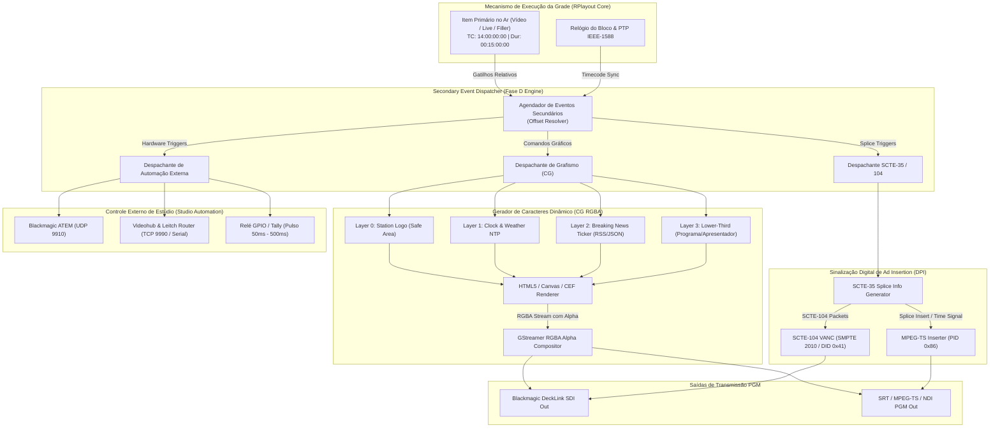
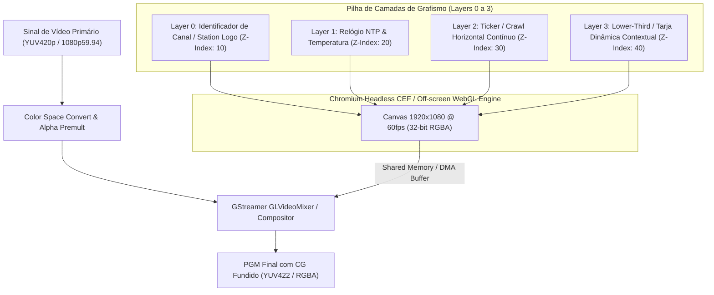
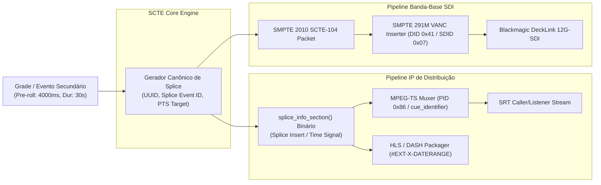
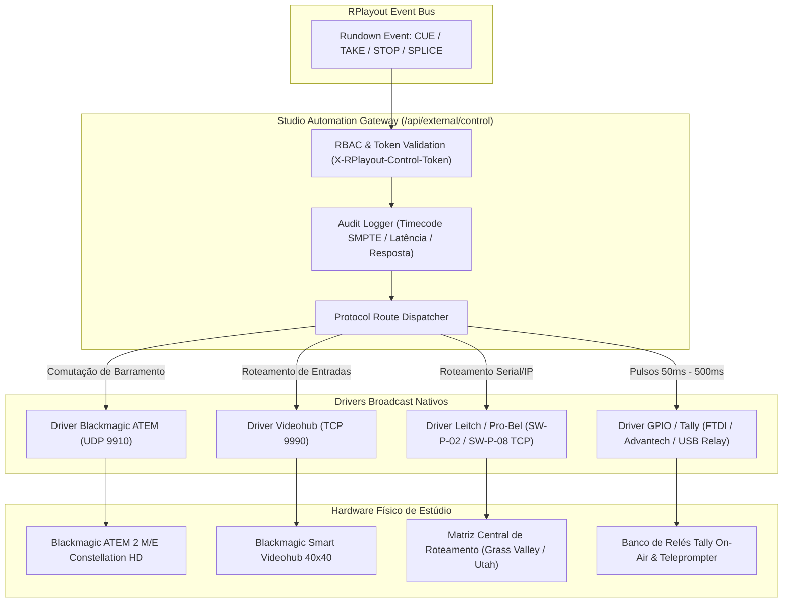

# Especificação Funcional e Técnica — Fase D: Eventos Secundários e Automação de Estúdio

**Documento:** `SPEC-FASE-D-EVENTOS-SECUNDARIOS.md`  
**Módulo:** Gerador de Caracteres Dinâmico (CG RGBA), Sinalização SCTE-35/SCTE-104 (DPI & Regional Ad Insertion), Controle Externo de Dispositivos (Blackmagic ATEM, Videohub, Matrizes Leitch/Pro-Bel, GPIO/Tally) e Gateway de Automação  
**Responsável:** Analista de Sistemas e Produto Broadcast  
**Destinatários:** Tech Lead, Broadcast Fullstack DEV (`broadcast_dev`), UI/UX Designer (`broadcast_ui_designer`), QA Tester (`broadcast_qa_tester`)  
**Status:** APROVADO PARA IMPLEMENTAÇÃO  
**Versão:** 1.0.0  
**Data:** 2026-09-24  
**Benchmark de Referência:** Axel Technology XPlayout / XTV Suite (XCG, XTrigger, XRouter, XRemote) & Normas SCTE-35 (2020), SCTE-104 (2019), SMPTE 2010, SMPTE 291M, SMPTE RP 2046-1 (Safe Areas) e EBU R95  

---

## 1. Visão Geral e Objetivos do Módulo

A **Fase D** do RPlayout implementa a orquestração de **Eventos Secundários (*Secondary Events*) e Automação Master Control (MCR)**. Em uma emissora de televisão profissional, um evento primário da grade (o clipe de vídeo, filme, jornal ou sinal ao vivo) raramente é veiculado de forma isolada: ele coordena simultaneamente a ativação de marcas d'água de canal (logos), tarjas informativas com dados em tempo real (Lower-Thirds), relógio com temperatura, rodapé de notícias de última hora (*tickers/crawls*), sinais digitais de comutação para inserção de publicidade local (*SCTE-35 / SCTE-104*) e comandos de chaveamento em switches de estúdio (ATEM), matrizes de roteamento e relés físicos de tally/GPIO.

No ecossistema de referência do **XPlayout (Axel Technology / XCG)** e nos playouts de alta gama (Imagine ADC/Versio, Grass Valley Morpheus/iTX, Harmonic Polaris):
1. **O Gráfico é Escravo do Tempo de Bloco**: Os grafismos não requerem disparos manuais contínuos do operador; eles são amarrados como eventos secundários relativos ao início (`OFFSET_FROM_START`) ou fim (`OFFSET_BEFORE_END`) de cada bloco de exibição, com suporte a *manual override* imediato via mesa virtual.
2. **Sinalização SCTE Inviolável para Ad Insertion e Desconexão de Rede**: O playout atua como o gerador primário de mensagens SCTE-35 (IP) e SCTE-104 (VANC SDI), disparando comandos com *pre-roll time* estrito (ex: 4000ms de antecipação) para que encoders de CDN, multiplexadores DVB/ISDB-Tb e comutadores de afiliadas realizem o splice regional sem cortes abruptos.
3. **Controle Integrado de Parque de Estúdio**: Através de drivers diretos de rede e GPIO, o playout envia comandos determinísticos de comutação para switches de produção (Blackmagic ATEM), roteadores SDI (Videohub, Leitch) e relés mecânicos/ópticos de sinalização de estúdio.
4. **Gateway Seguro e Auditável**: Todos os acionamentos de controle externo e CG são registrados no log de auditoria e no As-Run Log com timecode SMPTE exato e latência de resposta.



---

## 2. Gerador de Caracteres Dinâmico (CG / Graphics Engine)

### 2.1 Arquitetura de Camadas e Pipeline de Composição RGBA

O motor de CG do RPlayout adota uma arquitetura em 4 camadas independentes de sobreposição com precisão de pixel e renderização acelerada por GPU. A composição é realizada em espaço de cor nativo RGBA com canal alfa premultiplicado (*premultiplied alpha*), eliminando bordas serrilhadas (*halos*) em transições translúcidas sobre o vídeo do programa (PGM).



#### Especificação Técnica das Camadas

| Camada | Identificador | Função Primária | Formato / Fonte | Safe Area Regulamentar | Comportamento Padrão |
| :--- | :--- | :--- | :--- | :--- | :--- |
| **Layer 0** | `STATION_LOGO` | Marca d'água / Logo da Emissora | PNG 32-bit com transparência / WebM Alpha | EBU R95 / SMPTE RP 2046-1 (90% Action Safe) | Canto superior direito ou inferior direito; opacidade configurável (50% a 100%). |
| **Layer 1** | `ONAIR_CLOCK` | Relógio Oficial e Clima/Temperatura | Texto vetorial dinâmico + SVG/JSON de clima | Alinhado adjacente ao Logo ou barra superior | Sincronizado ao relógio NTP/PTP da máquina local. Atualização a cada segundo (sem jitter). |
| **Layer 2** | `CRAWL_TICKER` | Rodapé de Notícias / Alertas Urgentes | RSS 2.0, JSON API Webhook ou Texto Estático | 80% Title Safe (inferior da tela) | Movimento horizontal suave contínuo (*smooth subpixel scrolling* a 2-8 px/frame). |
| **Layer 3** | `LOWER_THIRD` | Crédito de Apresentador, Repórter e Programa | Template HTML5 animado (GSAP / Lottie / WebGL) | 80% Title Safe (canto inferior esquerdo) | Animação de entrada (*in*), permanência sustentada (*hold*) e saída limpa (*out*). |

---

### 2.2 Tipos Canônicos de Camadas Gráficas

#### A. Identificador de Canal (Station Logo / DVE Bug)
- **Áreas Seguras de Proteção**: Em conformidade com a norma **SMPTE RP 2046-1** e **EBU R95**, o logo deve respeitar estritamente a margem de *Title Safe* (80% da área útil: 192px de borda lateral e 108px de borda vertical em 1080p) e *Action Safe* (90% da área útil: 96px lateral e 54px vertical).
- **Tratamento de Transparência**: Suporte a assets estáticos (PNG com canal alpha 8-bit por canal) e vinhetas animadas em loop (sequência de PNGs, ProRes 4444 ou WebM com VP9+Alpha).
- **Atenuação Automática (*Logo Dimming*)**: Durante a exibição de reclames comerciais ou intervalos locais, o sistema aplica automaticamente *fade out* de 15 quadros no logotipo principal, reativando-o no retorno ao bloco jornalístico/artístico.

#### B. Relógio e Temperatura no Ar (On-Air Clock & Telemetry)
- **Sincronismo de Tempo**: A fonte de tempo deriva diretamente do timecode de referência mestre do RPlayout (sincronizado a servidores NTP locais stratum-1 ou PTP IEEE-1588).
- **Formatação de Exibição**: `HH:MM` ou `HH:MM:SS` em tipografia monoespaçada tabular (*tabular figures*), impedindo tremulação de largura (*character jitter*) na virada dos segundos.
- **Módulo Meteorológico**: Integração com serviços de meteorologia via REST endpoint com cache local TTL de 15 minutos e suporte a fallback de dados para não travar a exibição se a conexão de internet externa oscilar.

#### C. Ticker / Crawl de Notícias Contínuo
- **Renderização com Precisão de Frame**: Para erradicar o clássico efeito de trepidação (*judder/stutter*) do ticker em 59.94Hz ou 50Hz, o crawl calcula o deslocamento em ponto flutuante atrelado ao `requestAnimationFrame` da GPU, mantendo velocidade milimétrica constante (ex: 3.5 pixels/quadro a 60fps).
- **Ingestão Dinâmica de Notícias**:
  * **RSS Feed / Atom**: Parsing periódico com fila circular e filtragem de caracteres inválidos.
  * **Webhook JSON / REST**: Endpoint `/api/cg/ticker/push` para inserção imediata de *Breaking News* (tarja vermelha de plantão jornalístico com prioridade máxima de interrupção da fila normal).
  * **Separadores Gráficos**: Suporte a glifos vetoriais customizados entre manchetes (ex: bullets esféricos, logo da emissora estilizado).

#### D. Lower-Third / Tarja de Programa e Apresentador
- **Mecanismo de Templates Paramétricos**: O designer broadcast cria o template em HTML5/CSS3/GSAP. O operador de tráfego ou o sistema de MAM preenche campos de metadados em JSON:
```json
{
  "template": "lower_third_news_v2",
  "data": {
    "headline": "RODRIGO SILVEIRA",
    "subheadline": "Correspondente Internacional — Genebra",
    "location": "AO VIVO",
    "themeColor": "#0052CC"
  },
  "in_transition": "slide_from_left",
  "out_transition": "fade_and_wipe",
  "duration_frames": 240
}
```

---

### 2.3 Mecânica de Disparo Automatizado como Eventos Secundários (*Secondary Events*)

No modelo broadcast profissional de Master Control, um evento secundário é vinculado hierarquicamente ao ciclo de vida do item primário que está no ar.

```mermaid
sequenceDiagram
    autonumber
    participant Engine as RPlayout Playback Core
    participant Dispatcher as Secondary Event Dispatcher
    participant CG as CG Engine (RGBA Layers)
    participant SCTE as SCTE-35 Mux
    participant ATEM as ATEM Switcher (External)

    Note over Engine: Item 101 entra no AR (00:00:00:00)
    Engine->>Dispatcher: on_item_start(item_id: 101, duration: 00:05:00:00)
    
    rect rgb(20, 30, 45)
        Note over Dispatcher,CG: OFFSET_FROM_START (+00:00:03:00)
        Dispatcher->>CG: trigger_layer(STATION_LOGO, action: FADE_IN, speed: 15f)
        CG-->>Dispatcher: ack_rendered(Layer 0 ACTIVE)
    end

    rect rgb(20, 40, 30)
        Note over Dispatcher,CG: OFFSET_FROM_START (+00:00:10:00, dur: 8s)
        Dispatcher->>CG: trigger_layer(LOWER_THIRD, template: "rep_genebra", dur: 240f)
        CG-->>Dispatcher: ack_rendered(Layer 3 ACTIVE)
        Note over CG: Após 8s (240 frames), executa FADE_OUT automático
    end

    rect rgb(35, 30, 20)
        Note over Dispatcher,CG: OFFSET_FROM_START (+00:02:00:00)
        Dispatcher->>CG: trigger_layer(CRAWL_TICKER, action: SLIDE_IN)
    end

    rect rgb(45, 20, 20)
        Note over Dispatcher,SCTE: OFFSET_BEFORE_END (-00:00:04:00 - Pre-roll SCTE-35)
        Dispatcher->>SCTE: inject_splice_insert(event_id: 8841, preroll: 4000ms, dur: 30s)
        SCTE-->>Dispatcher: ack_scte_packet_queued(PTS: PGM + 4000ms)
    end

    rect rgb(45, 25, 25)
        Note over Dispatcher,CG: OFFSET_BEFORE_END (-00:00:05:00)
        Dispatcher->>CG: dismiss_all_layers(fade_out_frames: 30)
        CG-->>Dispatcher: ack_layers_cleared()
    end

    Note over Engine: Final do Item 101 -> Transição limpa para Comercial
    Engine->>ATEM: trigger_action(PGM_BUS, input: INPUT_COMMERCIAL_SERVER)
```



#### Modos Canônicos de Disparo Temporal (`TriggerOffsetMode`)
1. **`OFFSET_FROM_START`**: O evento secundário é disparado após decorrido um determinado número de quadros ou tempo (SMPTE Timecode relativo) a contar do primeiro quadro executado do item primário.
   - *Exemplo clássico*: Logo da emissora entra com fade de 15 quadros aos `00:00:03:00` (3 segundos após o corte).
   - *Exemplo clássico*: Lower-third de identificação do programa entra aos `00:00:10:00` por 8 segundos.
2. **`OFFSET_BEFORE_END`**: O evento secundário é disparado calculando-se regressivamente a contagem em relação ao último quadro planejado do item primário.
   - *Exemplo clássico*: Retirar todos os grafismos do ar (`FADE_OUT_ALL`) exatos `00:00:05:00` (5 segundos) antes do corte final para intervalo comercial.
   - *Exemplo clássico*: Disparar pacote SCTE-35 com pré-roll de `4000ms` aos exatos `00:00:04:00` antes do término do programa jornalístico.
3. **`MANUAL_OVERRIDE` (Painel MCR Live Take)**: Disparo sob demanda pelo operador de Master através de hotkeys configuradas ou botões de toque dedicados na interface gráfica. O operador pode forçar a entrada/saída de qualquer layer a qualquer momento, sem quebrar o agendamento dos próximos itens.

---

### 2.4 Interface de Gerenciamento e Payload JSON de Templates

Cada template de grafismo expõe uma definição de esquema tipada que permite validação antes da veiculação:

```json
{
  "id": "sec_evt_001",
  "channelId": "ch_main_pgm",
  "rundownItemId": "item_bloco_01",
  "type": "GRAPHICS_OVERLAY",
  "layer": "LOWER_THIRD",
  "triggerMode": "OFFSET_FROM_START",
  "offsetFrames": 300,
  "durationFrames": 240,
  "transitionIn": { "type": "SLIDE_LEFT", "frames": 15 },
  "transitionOut": { "type": "FADE_OUT", "frames": 15 },
  "templateUri": "file:///opt/rplayout/templates/lower_third_standard.html",
  "payload": {
    "title": "PLENÁRIO DO SENADO",
    "subtitle": "Votação da Nova Lei das Comunicações",
    "badge": "AO VIVO / BRASÍLIA"
  },
  "status": "ARMED"
}
```

---

## 3. Sinalização SCTE-35 (IP) e SCTE-104 (SDI)

### 3.1 Fundamentos de Ad Insertion Broadcast (DPI - Digital Program Insertion)

A inserção de publicidade digital direcionada e a comutação de janelas regionais exigem precisão de quadro (*frame-accurate splice*). Emissoras de rede (cabeças de rede nacionais) transmitem a programação com marcações embutidas informando às afiliadas, operadoras de cabo, satélite e CDNs OTT o momento milimétrico em que a programação nacional é suspensa para a entrada de reclames locais, bem como o momento em que a rede deve ser retomada.

- **SCTE-35**: Padrão do consórcio SCTE/ISBE para fluxos de rede IP (MPEG-TS, HLS, SRT). As mensagens são encapsuladas em seções binárias privadas (`splice_info_section`, PID dedicado).
- **SCTE-104**: Norma SMPTE/SCTE para infraestrutura física SDI. As mensagens trafegam em pacotes de metadados no espaço VANC (*Vertical Ancillary Data*) segundo a norma SMPTE 2010.



---

### 3.2 Campos Canônicos da Mensagem SCTE-35

A especificação do RPlayout adota a estrutura canônica da norma **SCTE-35 (2020)** para comandos `splice_insert()` e `time_signal()` com descritores de segmentação (*Segmentation Descriptors*):

| Campo Canônico | Tipo | Descrição Técnica Broadcast |
| :--- | :--- | :--- |
| `splice_event_id` | `uint32` | Identificador único de 32 bits do evento de corte, incrementado monotonamente. |
| `splice_event_cancel_indicator` | `boolean` | Flag indicando se a mensagem cancela um splice previamente agendado (`false` para armação normal). |
| `out_of_network_indicator` | `boolean` | `true` indica saída da rede nacional (início de comercial/janela local); `false` indica retorno à rede. |
| `program_splice_flag` | `boolean` | `true` quando o corte afeta todos os PIDs elementares de áudio e vídeo do programa simultaneamente. |
| `pts_time` | `uint33` | Marcação de Presentation Time Stamp (base de tempo de 90 kHz) onde o corte deve ocorrer fisicamente. |
| `duration_seconds` | `float32` | Duração exata da janela de comercial/desconexão (ex: `30.0` ou `60.0` segundos). |
| `break_duration` | `uint33` | Duração expressa em ticks de clock de 90 kHz (`duration_seconds * 90000`). |
| `auto_return` | `boolean` | `true` instrui os receptores a retornarem ao sinal principal automaticamente finda a duração, mesmo sem mensagem explícita de encerramento. |
| `unique_program_id` | `uint16` | Código identificador da programação (ex: `1001` para Jornal da Noite). |
| `avail_num` | `uint8` | Número sequencial do corte comercial dentro do bloco ou dia (ex: `1` para primeiro break). |
| `avails_expected` | `uint8` | Quantidade total de intervalos previstos na transmissão (ex: `4`). |
| `preroll_time_ms` | `uint16` | Tempo de antecipação do sinal em relação ao instante exato do corte (padrão de emissora: `4000ms`). |

#### Exemplo de Estrutura de Injeção SCTE-35
```json
{
  "command_type": "SPLICE_INSERT",
  "splice_event_id": 14209,
  "out_of_network_indicator": true,
  "program_splice_flag": true,
  "duration_seconds": 30.0,
  "auto_return": true,
  "unique_program_id": 105,
  "avail_num": 2,
  "avails_expected": 3,
  "preroll_time_ms": 4000,
  "segmentation_descriptor": {
    "segmentation_event_id": 99182,
    "segmentation_type_id": 52,
    "segmentation_type_name": "Provider Ad Start",
    "sub_segment_num": 1,
    "sub_segments_expected": 1
  }
}
```

---

### 3.3 Mapeamento SCTE-104 para Pacotes VANC SDI (Blackmagic DeckLink)

Nas transmissões através de infraestrutura banda-base SDI (placas Blackmagic DeckLink 8K Pro, Duo 2, Quad 2):
1. O comando é convertido para um pacote **SCTE-104 `single_operation_message`** contendo a operação `splice_request_data()`.
2. O pacote é encapsulado em pacotes de dados auxiliares verticais (**SMPTE 291M / SMPTE 2010**) inseridos na linha VANC selecionada (por padrão: linha 13 no formato 1080i/1080p).
3. **DID e SDID Regulamentares**:
   - `DID` (*Data Identification*): `0x41` (formato padrão de dados SMPTE 2010).
   - `SDID` (*Secondary Data Identification*): `0x07` (reservado para sinalização SCTE-104).
4. O buffer de quadros SDI transmite os metadados sincronizados frame a frame com o buffer de saída do GStreamer `decklinkvideosink`.

---

## 4. Automação e Controle Externo de Equipamentos (Routers, ATEM, GPIO)

### 4.1 Arquitetura do Gateway de Controle de Estúdio

O módulo `StudioAutomationGateway` atua como a ponte unificada de comando entre a lógica de eventos da grade e o parque de hardware broadcast da emissora. 



---

### 4.2 Protocolos Broadcast Suportados

#### A. Blackmagic ATEM Switcher
- **Conectividade**: Protocolo binário UDP nativo na porta `9910` (implementação de handshake bidirecional, sincronização de estado de sessão e retransmissão de pacotes).
- **Ações Mapeadas**:
  * `SET_PROGRAM_INPUT`: Comuta o barramento de PGM principal (M/E 1 ou M/E 2) para a entrada especificada (ex: `input: 1` para Câmera Estúdio, `input: 5` para Playout).
  * `SET_PREVIEW_INPUT`: Prepara a próxima fonte no barramento de PVW.
  * `DO_TRANSITION`: Executa transição imediata `CUT` ou transição suave `AUTO` (DISSOLVE / WIPE) com taxa de quadros programável (ex: 20 quadros).
  * `SET_DOWNSTREAM_KEYER (DSK)`: Liga ou desliga DSK 1 / DSK 2 para grafismo externo.

#### B. Matrizes de Roteamento de Vídeo (Routers)
- **Blackmagic Videohub**:
  * Conexão persistente TCP na porta `9990`.
  * Protocolo ASCII assíncrono com handshake de blocos.
  * Comando canônico de crosspoint:
    ```text
    VIDEO OUTPUT ROUTING:
    <destination_index> <source_index>
    \n
    ```
- **Protocolo Leitch / Pro-Bel (SW-P-02 e SW-P-08)**:
  * Suporte a conexões TCP ou RS-422/RS-232 serial.
  * Comutação de crosspoints em matrizes industriais de grande porte (Grass Valley, Utah Scientific, Evertz).

#### C. Relés GPIO e Tally Óptico
- **Interface Físico**: Módulos de relé USB/Ethernet (placas Advantech ADAM-6060, Numato USB GPIO, DLI Ethernet Relay e contatos secos optoisolados).
- **Temporização Determinística**: Disparo de pulsos configuráveis entre **50ms e 500ms** (padrão de pulso: `150ms`) para acionamento de máquinas externas de gravação (VTRs/XDCAM), comutadores de emergência, campainha de estúdio ou lâmpadas Tally On-Air.
- **Modos de Operação**:
  * `PULSE`: O contato fecha durante `N` milissegundos e abre automaticamente.
  * `LATCH`: O contato permanece fechado enquanto o item da grade estiver no ar (ideal para luz vermelha de estúdio *Tally On-Air*).

---

### 4.3 Segurança e Endpoint de Controle Externo

A comunicação externa é blindada por autenticação mandatória e isolamento de rede:

- **Endpoint REST**: `POST /api/external/control`
- **Cabeçalho Obrigatório**: `X-RPlayout-Control-Token: <CHAVE_SECRETA_SHA256>`
- **Exemplo de Requisição (Comutação Externa ATEM via API)**:
```json
{
  "channelId": "ch_pgm_01",
  "targetDevice": "atem_master_me1",
  "action": "TAKE",
  "parameters": {
    "meIndex": 0,
    "transition": "AUTO",
    "frames": 15,
    "input": 3
  },
  "clientMetadata": {
    "origin": "AutomationSchedule",
    "scheduleItemId": "live_studio_a_item"
  }
}
```

- **Auditoria de Resposta**: Cada disparo gera imediatamente um registro no `AuditTrail` contendo:
  1. `timestamp`: Horário UTC em ISO-8601.
  2. `pgm_timecode`: SMPTE Timecode no instante do disparo.
  3. `device_id`: Identificador do equipamento alvo.
  4. `action_name`: Operação realizada.
  5. `latency_ms`: Tempo decorrido entre o envio do socket e o ACK do hardware (ex: `8.2ms`).
  6. `execution_status`: `SUCCESS` ou `ERROR_TIMEOUT`.

---

## 5. Modelo de Dados TypeScript / Rust

```typescript
/**
 * Tipos de Camadas Gráficas Suportadas
 */
export type GraphicLayerType = 
  | 'STATION_LOGO'   // Layer 0: Logotipo / Station Bug
  | 'ONAIR_CLOCK'    // Layer 1: Relógio NTP & Temperatura
  | 'CRAWL_TICKER'   // Layer 2: Rodapé de Notícias Contínuo
  | 'LOWER_THIRD';   // Layer 3: Tarja de Apresentador e Programa

/**
 * Modos de Acoplamento Temporal do Evento Secundário
 */
export type TriggerOffsetMode = 
  | 'OFFSET_FROM_START'  // Relativo ao primeiro quadro do bloco
  | 'OFFSET_BEFORE_END'  // Relativo ao último quadro do bloco
  | 'MANUAL_OVERRIDE';   // Disparo sob demanda pelo operador

/**
 * Definição Canônica do Evento Secundário
 */
export interface SecondaryEvent {
  id: string;
  channelId: string;
  rundownItemId: string; // Item primário ao qual o evento está ancorado
  name: string;
  enabled: boolean;
  type: 'GRAPHICS_OVERLAY' | 'SCTE_TRIGGER' | 'DEVICE_AUTOMATION';
  triggerMode: TriggerOffsetMode;
  offsetFrames: number;      // Deslocamento em quadros
  durationFrames?: number;    // Duração (opcional se for pulso ou dismiss)
  
  // Parâmetros Específicos de Gráficos
  graphicsConfig?: {
    layer: GraphicLayerType;
    templateUri: string;
    payloadJson: Record<string, unknown>;
    fadeFramesIn: number;
    fadeFramesOut: number;
    opacity: number;         // 0.0 a 1.0
  };

  // Parâmetros Específicos de SCTE-35 / 104
  scteConfig?: {
    spliceEventId: number;
    durationSeconds: number;
    autoReturn: boolean;
    prerollTimeMs: number;
    uniqueProgramId: number;
    availNum: number;
    availsExpected: number;
    segmentationTypeId: number;
  };

  // Parâmetros de Dispositivos Externos
  deviceConfig?: {
    deviceType: 'BLACKMAGIC_ATEM' | 'VIDEOHUB_ROUTER' | 'LEITCH_ROUTER' | 'GPIO_RELAY';
    deviceId: string;
    command: 'TAKE' | 'CUT' | 'AUTO' | 'ROUTE_CROSSPOINT' | 'PULSE' | 'LATCH';
    parameters: Record<string, unknown>;
  };

  executionState: 'ARMED' | 'FIRING' | 'EXECUTED' | 'CANCELLED' | 'FAILED';
  executedAt?: string;
  executionLatencyMs?: number;
}
```

---

## 6. Critérios de Aceite e Cenários de Teste (BDD / Gherkin)

### Cenário 1: Disparo de Evento Secundário de CG (Logo + Lower-Third) no 5º Segundo de Bloco

```gherkin
Funcionalidade: Disparo automatizado de grafismo em camadas como evento secundário
  Como operador de Master Control
  Desejo que o Logotipo e a Lower-Third do programa entrem automaticamente no ar
  Para garantir identidade visual consistente sem necessidade de intervenção manual

  Cenário: Entrada simultânea de Logotipo e Tarja aos 5 segundos do bloco no ar
    Dado que o canal "TV Principal HD" está executando o item primário "Bloco 01 — Jornal da Noite"
    E a taxa de quadros configurada no canal é de 60 fps
    E existe um evento secundário configurado com:
      | layer       | type             | triggerMode         | offsetFrames | durationFrames |
      | Layer 0     | STATION_LOGO     | OFFSET_FROM_START   | 300          | 0 (permanente) |
      | Layer 3     | LOWER_THIRD      | OFFSET_FROM_START   | 300          | 480 (8 seg)    |
    Quando a execução do bloco atingir o frame relativo 300 (exatamente 00:00:05:00)
    Então o motor de CG deve renderizar o Logotipo na Layer 0 com fade in de 15 quadros
    E o motor de CG deve exibir a Lower-Third na Layer 3 com os metadados contextuais do bloco
    E o As-Run Log deve registrar o disparo de ambas as camadas com timecode relativo 00:00:05:00
    E após 480 quadros do disparo (frame relativo 780), a Lower-Third deve executar fade out de 15 quadros
    E o Logotipo na Layer 0 deve permanecer ativo no ar
```

---

### Cenário 2: Injeção de Marcador SCTE-35 com Pre-roll de 4000ms e Retorno Automático de 30s

```gherkin
Funcionalidade: Sinalização SCTE-35 com Pre-roll para Comutação Comercial Regional
  Como engenheiro de transmissão
  Desejo injetar sinalização SCTE-35 de 30 segundos com 4000ms de antecipação
  Para que as afiliadas e encoders da CDN comutem para publicidade local de forma sincronizada

  Cenário: Disparo de Splice Insert 4 segundos antes do corte do bloco jornalístico
    Dado que o item primário "Jornal — Bloco 02" possui duração total de 00:10:00:00 (36000 quadros a 60 fps)
    E existe um evento secundário SCTE_TRIGGER configurado com:
      | triggerMode        | offsetFrames | prerollTimeMs | durationSeconds | autoReturn | spliceEventId |
      | OFFSET_BEFORE_END  | 240          | 4000          | 30.0            | true       | 55102         |
    Quando a linha de reprodução atingir o frame 35760 (restam exatamente 4 segundos para o fim do bloco)
    Então o módulo SCTE deve gerar um pacote binário "splice_info_section" contendo:
      | splice_event_id | 55102                       |
      | pts_time        | PTS_PGM_ATUAL + 360000 ticks |
      | duration        | 2700000 ticks (30.0s)       |
      | auto_return     | true                        |
    E o pacote SCTE-35 deve ser multiplexado imediatamente no PID 0x86 do fluxo MPEG-TS / SRT
    E se a saída SDI DeckLink estiver ativa, o pacote equivalente SCTE-104 deve ser inserido na linha 13 VANC
    E a auditoria do RPlayout deve registrar o evento SCTE com status "DISPATCHED_OK" e latência < 5ms
```

---

### Cenário 3: Comutação Externa de ATEM Switcher via Rede no Momento Exato do TAKE

```gherkin
Funcionalidade: Comutação determinística de switch de estúdio ATEM via automação
  Como diretor de transmissão
  Desejo que o RPlayout comute automaticamente o switcher ATEM de produção
  Para sincronizar a comutação de câmeras de estúdio com a entrada de sinais ao vivo

  Cenário: Comutação do barramento PGM do ATEM no instante exato do TAKE de item LIVE
    Dado que o switcher Blackmagic ATEM 2 M/E está configurado no IP "192.168.10.50" porta 9910
    E a entrada de estúdio "CAM 01 ESTÚDIO A" corresponde à entrada física 3 do ATEM
    E o próximo item na grade do RPlayout é um item do tipo "LIVE" com dispositivo externo configurado:
      | deviceType        | action | input | transition |
      | BLACKMAGIC_ATEM   | TAKE   | 3     | CUT        |
    Quando o operador aciona o comando TAKE (ou o relógio atinge o início do evento)
    Então o Gateway de Automação deve despachar o pacote UDP de comando para o ATEM
    E o tempo de trânsito e resposta (ACK de comutação) deve ser inferior a 25 milissegundos
    E o barramento de PGM do ATEM deve refletir o Input 3 ativo
    E o log de auditoria deve registrar:
      | action     | targetDevice      | input | latencyMs | result  |
      | TAKE       | atem_estudio_a    | 3     | <= 25     | SUCCESS |
```

---

## 7. Matriz de Rastreabilidade e Validação Física Broadcast

Em estrita consonância com a diretriz do documento `docs/ROADMAP-XPAYOUT-BENCHMARK.md`:
> *"Recursos que dependem de NDI, SDI, GPI ou hardware devem permanecer explicitamente marcados como validação física."*

| Recurso / Funcionalidade | Modo de Teste Automatizado (CI/CD) | Requisito de Validação Física de Campo | Status de Validação |
| :--- | :--- | :--- | :--- |
| **Renderização de CG HTML5/Canvas** | Renderização off-screen com Puppeteer/CEF e comparação de buffer RGBA | Teste de queima contínua 24h sem vazamento de memória GPU/RAM | **Liberado para Implementação** |
| **Agendador de Secondary Events** | Testes de unidade em Jest/Rust verificando offsets e tolerância temporal | Verificação em PGM com monitor de forma de onda e vetoriscópio | **Liberado para Implementação** |
| **Injeção SCTE-35 em IP (MPEG-TS/SRT)** | Validação estrutural de pacotes binários com `tsduck` e parsers SCTE | Decodificação em receptor de satélite / IRD comercial de afiliada | **Requer Validação Física** |
| **Injeção SCTE-104 em VANC SDI** | Emulação de buffer VANC no pipeline GStreamer | Análise de sinal físico com rasterizador Tektronix / Omnitek SDI | **Requer Validação Física** |
| **Driver Blackmagic ATEM Switcher** | Mock UDP de protocolo ATEM em ambiente de teste local | Comunicação real com hardware ATEM Television Studio / Constellation | **Requer Validação Física** |
| **Matriz Videohub / Leitch Pro-Bel** | Mock TCP na porta 9990 com validação de handshake ASCII | Conexão física com matriz Blackmagic Smart Videohub 40x40 | **Requer Validação Física** |
| **Disparo de Relé GPIO / Tally** | Emulador virtual de porta serial/USB | Disparo real de contato seco em lâmpada física de estúdio On-Air | **Requer Validação Física** |

---

## 8. Considerações Finais de Integração com as Fases A, B, C e E

1. **Interação com a Fase A (Núcleo 24/7)**: Os eventos secundários são recalculados dinamicamente sempre que o algoritmo de alinhamento de grade da Fase A realizar compensações elásticas de tempo (*TRIMMABLE/OPTIONAL*), preservando as regras de `OFFSET_BEFORE_END` intactas.
2. **Interação com a Fase B (Entradas e Distribuição)**: O sinal de PGM resultante com CG fundido é distribuído diretamente aos encoders de saída SRT e ao Multiview MCR, permitindo ao operador monitorar visualmente o estado das camadas ativas.
3. **Interação com a Fase C (Continuidade e Compliance)**: Todo disparo de CG, SCTE e controle externo é gravado com precisão de quadro no **As-Run Log**, servindo como documento de comprovação de veiculação e auditoria de comutação regional.
4. **Preparação para a Fase E (Timeline Multicamada)**: O modelo de dados especificado nesta Fase D fornece diretamente as faixas de dados (*tracks*) que alimentarão as linhas de tempo visuais dedicadas de Vídeo, Áudio, CG, LIVE e SCTE-35/104 na interface gráfica avançada da Fase E.
