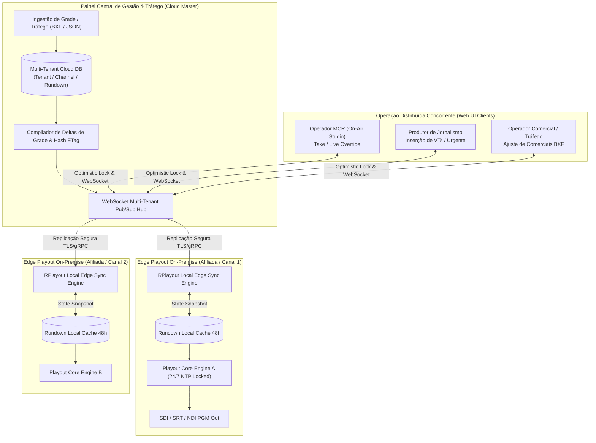
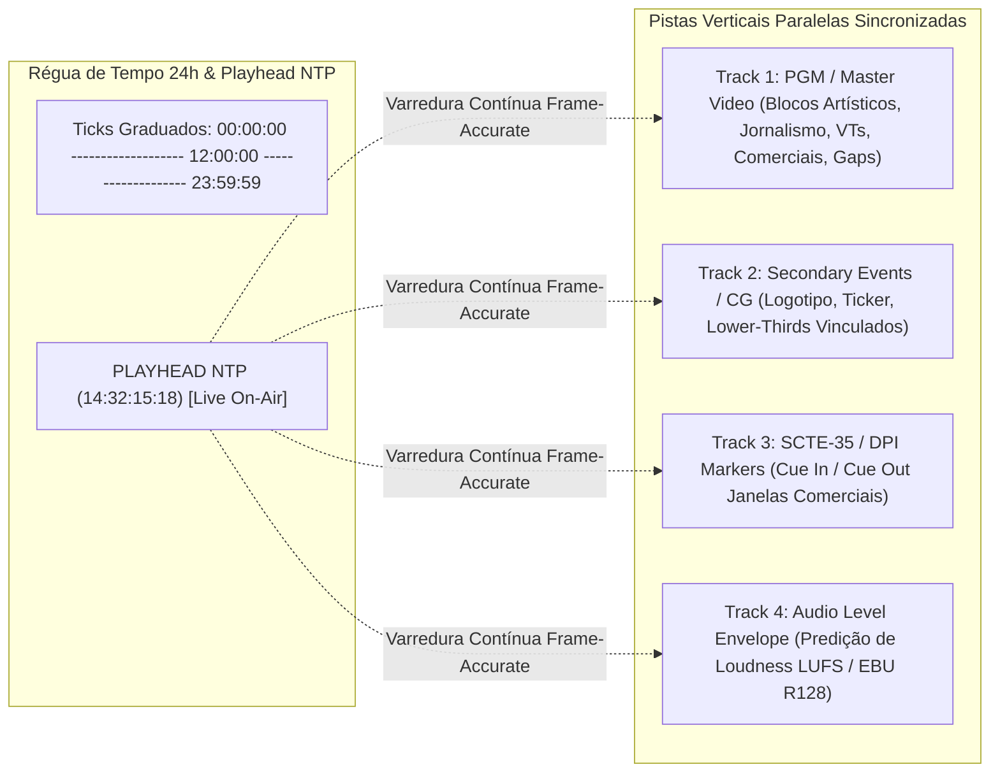
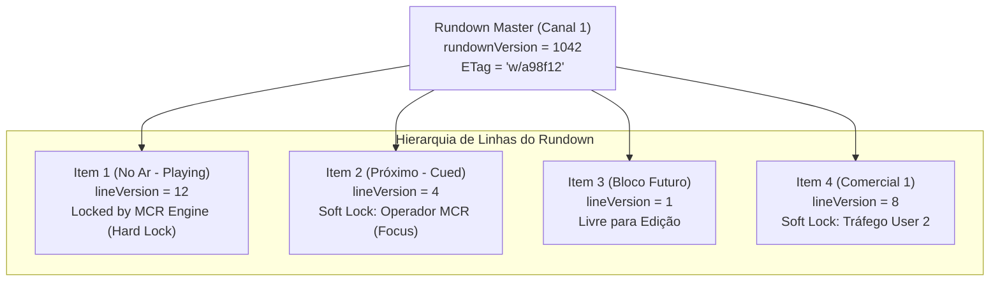
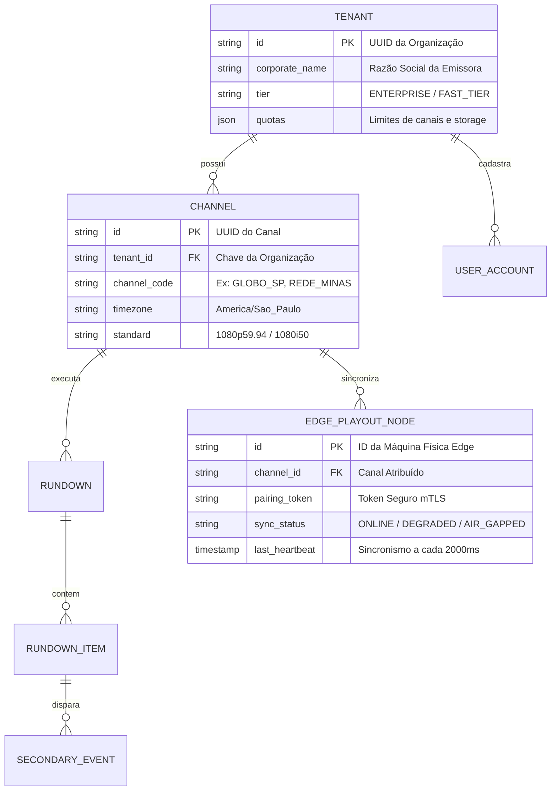
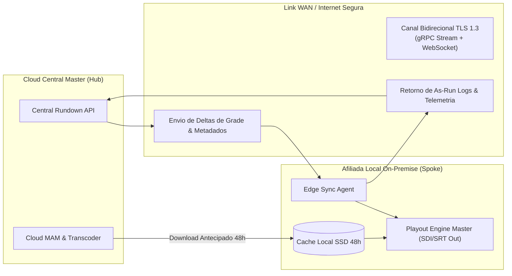

# Especificação Funcional e Técnica — Fase E: Timeline Visual Multicamada e Operação Distribuída

**Documento:** `SPEC-FASE-E-TIMELINE-OPERACAO-DISTRIBUIDA.md`  
**Módulo:** Timeline Visual 24h Multicamada (NTP Playhead, Vídeo, CG, SCTE, Áudio R128), Edição Concorrente com Bloqueio Otimista (Conflict Resolution Drawer), Arquitetura Multi-Tenant e Operação Híbrida Cloud/Edge On-Premise  
**Responsável:** Analista de Sistemas e Produto Broadcast  
**Destinatários:** Tech Lead (`tech_lead`), Broadcast Fullstack DEV (`broadcast_dev`), UI/UX Designer (`broadcast_ui_designer`), QA Tester (`broadcast_qa_tester`)  
**Status:** APROVADO PARA IMPLEMENTAÇÃO  
**Versão:** 1.0.0  
**Data:** 2026-09-24  
**Benchmark de Referência:** Axel Technology XPlayout / XTV Suite (XRemote, XScheduler, XMirror Distributed), Dalet Galaxy Five, Grass Valley Morpheus/iTX, EBU R128, SMPTE-2021 (BXF), SCTE-35 (2020)  

---

## 1. Visão Geral e Objetivos do Módulo

A **Fase E** consolida a camada visual de alta densidade e a infraestrutura corporativa do **RPlayout**, elevando a experiência operacional de Master Control Room (MCR) e Tráfego ao patamar dos sistemas de broadcast mais avançados do mercado internacional. Enquanto as Fases A a D estruturaram o motor de reprodução ininterrupto 24/7, os fluxos SRT e normalização, o cache local com redundância N+1 e a injeção sincronizada de CG/SCTE-35/104, a Fase E entrega as duas fronteiras críticas de usabilidade e escala empresarial:

1. **Visibilidade Temporal Unificada (Timeline 24h Multicamada)**:
   Substituição da percepção linear em lista de texto por uma representação visual temporalmente contínua de 00:00:00 a 23:59:59. O operador visualiza, em um único relance panorâmico, os blocos de vídeo do ar (PGM), as sobreposições de eventos secundários (CG), as janelas de desinsersão comercial regional (SCTE-35) e o perfil sonoro estimado (envelope de loudness EBU R128), com zoom dinâmico desde 24 horas até precisão de quadro (*frame-accurate* de 10 segundos).
2. **Colaboração e Edição Concorrente sem Bloqueio Destrutivo**:
   Emissoras modernas operam com equipes simultâneas atuando sobre a mesma grade: o operador de MCR monitora e dispara o TAKE do bloco atual; o produtor de jornalismo insere uma matéria de última hora no bloco seguinte; o departamento de Tráfego comercial atualiza o faturamento via importação BXF do dia seguinte. O RPlayout adota versionamento de rundown com **bloqueio otimista granular** e **gaveta interativa de resolução de conflitos (*Conflict Drawer*)**, eliminando o risco de sobreposição cega de dados (*blind overwrite*).
3. **Multi-Tenancy e Sincronização Híbrida Cloud / On-Premise**:
   Separação estrita de dados e fluxos por emissora (`tenantId`) e canal (`channelId`), permitindo que redes de televisão e geradoras gerenciem dezenas de afiliadas e canais FAST a partir de uma console unificada na nuvem, enquanto o playout físico local (*Edge On-Premise*) opera de forma desacoplada com garantia de sobrevivência a partições de rede (*offline-first resilience*).



---

## 2. Timeline 24H Visual Multicamada

### 2.1 Régua Gráfica de Tempo e Playhead NTP

A régua de tempo constitui a âncora visual de todo o sistema de automação. Ela projeta o dia broadcast operacional contínuo (24 horas: `00:00:00:00` a `23:59:59:29` @ 30fps ou `:24` @ 25fps) ou o ciclo de transição comercial (ex: início às 06:00:00 do dia civil).

#### Características Físicas e Matemáticas
- **Base de Tempo em Milissegundos e Timecode**: Internamente, todos os blocos e marcadores são calculados em milissegundos inteiros UTC corrigidos e projetados em timecode SMPTE (`HH:MM:SS:FF`) segundo o frame rate do canal (59.94p, 50p, 29.97p ou 25p).
- **Playhead em Tempo Real Sincronizado por NTP**: Uma linha vertical contínua vermelha luminescente (`#EF4444`, 2px de espessura com glow de 4px) percorre a timeline ancorada no relógio central de transmissão. Em modo de reprodução automática, a timeline realiza *auto-scroll* suave (*smooth pan*) mantendo o playhead a 25% da largura da tela à esquerda, garantindo ao operador 75% de visibilidade preditiva dos próximos eventos (*lookahead buffer*).
- **Marcadores de Hora Cheia e Subdivisões**: A régua possui ticks graduados:
  * Em zoom panorâmico (24h): marcadores principais a cada 1 hora com timecode textual (`14:00`, `15:00`).
  * Em zoom de bloco (1h): marcadores a cada 5 minutos com timecode e subdivisões a cada 1 minuto.
  * Em zoom de precisão (5 min): marcadores a cada 10 segundos com timecode completo.
  * Em zoom de quadro (10s): marcadores a cada segundo e ticks discretos para cada quadro individual.



---

### 2.2 Pistas Verticais Dedicadas (Tracks)

A área de visualização temporal é dividida em quatro pistas de exibição síncronas com altura ergonômica ajustável e renderização acelerada por GPU (Canvas / WebGL / SVG otimizado):

#### Track 1: Master Video / PGM (Pista Principal de Vídeo)
Representa a espinha dorsal da programação no ar. Cada item do rundown é desenhado como um bloco retangular contíguo cuja largura é rigorosamente proporcional à sua duração líquida executada ou prevista.
- **Paleta de Cores Broadcast Padronizada**:
  * **Vermelho Carmim (`#DC2626` / `#991B1B`)**: Transmissão Ao Vivo (`LIVE` / SRT Caller / SDI In). Exibe borda pulsante luminescente quando ativo no ar.
  * **Azul Cobalto (`#2563EB` / `#1E40AF`)**: Conteúdo Jornalístico / Notícias / Produção Própria.
  * **Roxo Imperial (`#7C3AED` / `#5B21B6`)**: Dramaturgia, Filmes, Séries e Entretenimento.
  * **Laranja Comercial (`#EA580C` / `#9A3412`)**: Reclames Publicitários, Patrocínios e Breaks Comerciais.
  * **Verde Esmeralda (`#059669` / `#065F46`)**: Chamadas Institucionais e Vinhetas de Canal (*Station Promos*).
  * **Cinzento Chumbo (`#475569` / `#334155`)**: Itens de Preenchimento Automático (`FILLER`).
  * **Hachurado Amarelo Alerta (`Striped #EAB308 / #713F12`)**: **GAP / Espaço Vazio** não coberto na programação.

#### Track 2: Secondary Events / CG (Eventos Secundários de Grafismo)
Exibe blocos flutuantes horizontais ancorados na barra de tempo que indicam a presença e duração de elementos de grafismo sobrepostos ao PGM:
- **Faixa de Logo**: Barra contínua com atenuações (*dimming/fade*) demarcadas em cinza transparente durante comerciais.
- **Blocos de Lower-Third**: Barras compactas turquesa (`#06B6D4`) indicando o momento exato de entrada (*In*), permanência (*Hold*) e saída (*Out*) das tarjas de apresentador e matérias.
- **Faixa de Ticker / Notícias**: Marcador contínuo em verde-oliva (`#84CC16`) nos segmentos jornalísticos com indicação de velocidade do crawl.

#### Track 3: SCTE-35 / DPI Cue Markers (Sinalização Comercial Digital)
Pista especializada na fiscalização de janelas de desinsersão para distribuidores DVB/ISDB-Tb, operadoras de cabo e canais FAST:
- **Cue Out (Início da Janela Local)**: Marcador vertical magenta pontiagudo (`#D946EF`, símbolo $\blacktriangleright$) com indicação de `Preroll` (ex: 4000ms) e `Duration` da janela (ex: 120s).
- **Janela Aberta**: Retângulo hachurado translúcido magenta cobrindo o intervalo exato reservado para a publicidade da afiliada/plataforma OTT.
- **Cue In (Fim da Janela / Retorno à Rede)**: Marcador de encerramento (`#A21CAF`, símbolo $\blacktriangleleft$) assegurando que o playout de rede reassuma o sinal sem corte abrupto de comerciais locais.

#### Track 4: Audio Level / Loudness Envelope (EBU R128 Estimado)
Projeta uma visualização prévia da curva de loudness integrada calculada na análise de ingestão (R128 Analyzer):
- **Linha de Alvo Regulamentar (-23 LUFS / -24 LKFS)**: Linha de referência horizontal tracejada verde em toda a extensão da pista.
- **Envelope Sonoro dos Blocos**: Formato de onda suavizado (envelope RMS/LUFS) com gradiente de cor:
  * Verde (`#10B981`): Sinal em conformidade ($\pm 0.5$ LU do alvo).
  * Amarelo (`#F59E0B`): Áudio moderadamente alto ou baixo ($\pm 1.5$ LU).
  * Vermelho (`#EF4444`): Áudio fora de compliance ou estouro de pico verdadeiro (*True Peak* $> -1.0$ dBTP), disparando aviso visual imediato de necessidade de normalização no engine.

---

### 2.3 Mecanismo de Zoom Horizontal Milimétrico

A timeline suporta transições suaves de escala temporal sem perda de posicionamento do playhead, acionadas via scroll do mouse, teclas de atalho broadcast ou botões seletores dedicados:

| Nível de Zoom | Extensão Visível | Resolução Temporal | Caso de Uso Operacional MCR |
| :--- | :--- | :--- | :--- |
| **Nível 1: Visão Geral 24h** (`ZOOM_24H`) | 24 horas completas | $\approx 1$ pixel a cada 15 a 30 segundos | Análise macro da grade do dia, identificação de grandes buracos de grade e blocos de rede. |
| **Nível 2: Visão de Bloco 1h** (`ZOOM_1H`) | 60 minutos | $\approx 1$ pixel a cada 1 segundo | Operação contínua de rotina do operador de MCR; visualização do programa corrente e do próximo. |
| **Nível 3: Trimming 5 Minutos** (`ZOOM_5M`) | 300 segundos | $\approx 5$ pixels por segundo | Inspeção detalhada de breaks comerciais, transições e ajuste de pré-roll de eventos de CG. |
| **Nível 4: Frame-Accurate 10s** (`ZOOM_10S`) | 10 segundos | $\approx 100$ a 180 pixels por segundo (marca individual por quadro) | Ajuste fino milimétrico de pontos In/Out de clipes, corte de black frames e alinhamento de áudio. |

```typescript
export type TimelineZoomLevel = 'ZOOM_24H' | 'ZOOM_1H' | 'ZOOM_5M' | 'ZOOM_10S';

export interface TimelineViewportState {
  zoomLevel: TimelineZoomLevel;
  pixelsPerMillisecond: number;
  viewportStartMs: number;
  viewportEndMs: number;
  playheadMs: number;
  followPlayhead: boolean;
}
```

---

### 2.4 Detecção Interativa de Gaps e Autofill Inteligente em 1-Clique

A descontinuidade de grade é a falha mais grave de uma transmissão comercial 24/7. O RPlayout implementa um subsistema autônomo de análise preditiva de lacunas:

#### Detecção Visual de Gaps
Qualquer intervalo temporal $> 0 \text{ ms}$ entre o término projetado de um item ($T_{end} = T_{start} + D$) e o início do próximo item não preenchido é instantaneamente demarcado na Track 1 com o padrão **Hachurado Amarelo Alerta**. 
- O bloco de gap exibe a duração exata do buraco em timecode vermelho centralizado (ex: `GAP: +00:01:23:15`).
- Um badge flutuante de alerta surge no cabeçalho da timeline: `[ ⚠ 1 GAP DETECTADO: 01m 23s às 15:45:00 ]`.

#### Ação de 1-Clique: Autofill Inteligente
Ao clicar sobre a área de Gap ou acionar o botão `[ AUTOFILL INTELIGENTE ]`, o sistema aciona a política de compensação configurada sem deslocar os horários de início dos eventos rígidos subsequentes (`HARD_TIME`):
1. **Opção A: Extensão de Itens Trimmable**: Se o clipe imediatamente anterior possuir a flag `TRIMMABLE` e possuir sobra de mídia no arquivo físico (*media head/tail*), o sistema sugere estender o clipe até zerar o gap.
2. **Opção B: Injeção de Filler Classificado**: O motor seleciona do repositório de fillers um clipe da categoria correspondente (ex: vinheta institucional, chamadas de programação ou clipe musical de contingência) cuja duração seja compatível com a lacuna.
3. **Opção C: Micro-Ajuste com Pad Estático**: Em lacunas inferiores a 3 segundos, o sistema gera automaticamente uma estampa de transição suave com logotipo da emissora (*slate*) com fade out/in de áudio.

```mermaid
sequenceDiagram
    autonumber
    actor Operador as Operador MCR / Tráfego
    participant UI as Timeline UI (Track 1)
    participant Engine as Rundown Gap Resolver
    participant MAM as Repositório de Fillers / Mídia

    UI->>UI: Renderiza Gap Hachurado Amarelo (+00:02:15:00)
    Operador->>UI: Clica no botão "1-Clique: Autofill Inteligente"
    UI->>Engine: POST /api/v1/rundown/resolve-gap { gapStartMs, gapDurationMs }
    Engine->>MAM: Busca ativo FILLER otimizado para duração exata (2m15s)
    MAM-->>Engine: Retorna: "PROMO_INSTITUCIONAL_VERAO_2M15S.mp4"
    Engine->>UI: Preview da proposta de preenchimento (Ghost Block Verde)
    Operador->>UI: Confirma [ APLICAR AUTOFILL ]
    UI->>Engine: Commit de Inserção de Item no Rundown
    Engine-->>UI: Rundown atualizado via WebSocket; Gap extinto
```

---

## 3. Edição Concorrente com Bloqueio Otimista e Resolução de Conflitos

### 3.1 O Problema da Concorrência em MCR Broadcast

Em operações televisivas de médio e grande porte, a grade de programação não é um documento estático. Três atores principais interagem com o rundown em tempo real:
1. **Operador Master (MCR)**: Opera na sala de controle ao vivo; executa TAKE, comuta para sinais ao vivo externos e ajusta a duração do bloco de jornalismo estendendo-o em 2 minutos.
2. **Produtor de Jornalismo**: No switcher de jornalismo, precisa injetar uma matéria recém-editada no break seguinte.
3. **Analista de Tráfego / Vendas**: Em escritório remoto, importa via BXF uma substituição emergencial de patrocínio comercial que deve entrar no ar nas próximas 2 horas.

Se o sistema operar com sobrescrita ingênua (*last-write-wins*), qualquer salvamento do Tráfego anularia os comandos de TAKE ou as matérias inseridas pelo produtor.

---

### 3.2 Arquitetura de Bloqueio Otimista por Linha e ETag de Grade

O RPlayout implementa uma arquitetura híbrida de **Versionamento Otimista Global + Bloqueio Suave (*Soft Lock*) por Linha**:



#### Definição das Regras de Controle
1. **Versão Global do Rundown (`rundownVersion`)**: Todo canal mantém um contador monotônico inteiro de versão. Toda alteração estrutural (inserção, deleção ou reordenação de linhas) incrementa o `rundownVersion`.
2. **Versionamento por Linha (`lineVersion`)**: Cada linha possui seu contador próprio de alterações. Mutações restritas a propriedades da linha (ex: ativar evento de CG, ajustar flag `TRIMMABLE`, trocar áudio channel) incrementam apenas o `lineVersion` daquela entidade.
3. **ETag HTTP e Cabeçalho `If-Match`**: Toda requisição REST de mutação (`PUT /api/v1/rundown/items/{id}`) exige o envio do cabeçalho `If-Match: "w/{rundownVersion}-{lineVersion}"`. Se a versão na base divergir da versão do cliente, o backend rejeita a gravação com código `409 Conflict` e retorna o estado atualizado do registro.
4. **Soft Lock de Presença em Tempo Real**: Quando um operador clica para editar uma linha na interface, o frontend emite uma mensagem WebSocket `USER_ROW_FOCUS`. Uma borda translúcida com a cor e avatar do usuário envolve a linha para os demais operadores conectados, prevenindo colisões acidentais (*collaborative awareness*).

---

### 3.3 Protocolo WebSocket Pub/Sub de Sincronização

Todas as instâncias conectadas à mesma grade participam de um canal pub/sub dedicado (`channel:{tenantId}:{channelId}:rundown`).

#### Eventos Principais do Protocolo

```typescript
// 1. Mensagem de Presença e Lock Suave
export interface UserFocusEvent {
  type: 'RUNDOWN_USER_FOCUS';
  tenantId: string;
  channelId: string;
  itemId: string;
  userId: string;
  userName: string;
  userRole: 'MCR_OPERATOR' | 'PRODUCER' | 'TRAFFIC' | 'ADMIN';
  timestampMs: number;
}

// 2. Notificação de Mutação Concluída
export interface ItemUpdatedEvent {
  type: 'RUNDOWN_ITEM_UPDATED';
  tenantId: string;
  channelId: string;
  newRundownVersion: number;
  item: {
    id: string;
    lineVersion: number;
    title: string;
    durationMs: number;
    timingType: string;
    secondaryEventsCount: number;
    updatedBy: string;
  };
}

// 3. Notificação de Reordenação Estrutural
export interface StructureChangedEvent {
  type: 'RUNDOWN_STRUCTURE_CHANGED';
  tenantId: string;
  channelId: string;
  newRundownVersion: number;
  action: 'INSERT' | 'DELETE' | 'MOVE';
  affectedItemIds: string[];
  updatedBy: string;
}
```

---

### 3.4 A Gaveta de Resolução de Conflitos (*Conflict Drawer*)

Quando ocorre uma tentativa concorrente de salvamento que resulte em `409 Conflict`, o RPlayout não aborta de forma cega nem perde as digitações do operador. Uma gaveta lateral animada (*Conflict Drawer*) desliza sobre o painel direito da tela, apresentando uma comparação visual lado a lado (*Three-Way Diff*):

```
+-----------------------------------------------------------------------------------------------+
| ⚠ CONFLITO DE EDIÇÃO DETECTADO — LINHA #14: VT_REPORTAGEM_POLITICA.mp4                      |
| Outro usuário (Rodrigo - Tráfego) modificou esta linha enquanto você editava.                  |
+---------------------------------------+-------------------------------------------------------+
| VERSÃO LOCAL (Suas alterações)        | VERSÃO REMOTA NO SERVIDOR (Rodrigo - Tráfego)         |
+---------------------------------------+-------------------------------------------------------+
| Duração: 00:02:45:00 (+15s)           | Duração: 00:02:30:00 (Original)                       |
| Flags: [TRIMMABLE] [OPTIONAL]         | Flags: [FIXED]                                        |
| CG: Lower-Third Ativo (Deputado)     | CG: Nenhum                                            |
| SCTE-35: Desativado                   | SCTE-35: Cue Out Programado (Break Regional)          |
+---------------------------------------+-------------------------------------------------------+
| [ MANTER MINHAS ALTERAÇÕES ]          | [ ACEITAR VERSÃO DO SERVIDOR ] | [ MESCLAR CAMPOS ]   |
+---------------------------------------+-------------------------------------------------------+
```

#### Regras de Precedência MCR de Segurança Broadcast:
- **Proteção do Item no Ar (`PLAYING`) e Próximo (`CUED`)**: Operadores de Tráfego ou jornalismo remoto são estritamente impedidos de alterar o item ativo no ar e o clipe imediatamente armado no buffer do engine. Tentativas de alteração nesses dois slots disparam erro impeditivo `403 Forbidden: Item em execução protegido por bloqueio MCR`.
- **Merge Inteligente Não Conflitante**: Se o Produtor alterou apenas o texto do Lower-Third do CG e o Tráfego alterou apenas o código de contrato comercial do item, o sistema realiza o merge automático com sucesso, gerando um evento consolidado no As-Run Log.

---

## 4. Arquitetura Multi-Tenant e Operação Híbrida Cloud/On-Premise

### 4.1 Modelo de Dados Multi-Tenant e Isolamento de Recursos

Para viabilizar a operação de grupos de mídia com múltiplas afiliadas ou operadoras gerenciando centenas de canais lineares e FAST, o RPlayout estrutura todas as tabelas e documentos sob o particionamento obrigatório por `tenant_id` e `channel_id`.



#### Isolamento Criptográfico e de Camada de Dados
- **Row-Level Security (RLS)**: No PostgreSQL, todas as queries executadas aplicam políticas de contexto de sessão baseadas no JWT assinado (`current_setting('app.current_tenant_id')`). É matematicamente impossível uma consulta de um tenant vazar registros de outro tenant.
- **Isolamento de Storage de Mídia**: Mídias físicas armazenadas em buckets S3 ou storages NAS recebem caminhos prefixados e segregados por chaves exclusivas de criptografia:
  `/storage/{tenantId}/{channelId}/assets/2026/09/arquivo.mp4`.

---

### 4.2 Sincronização Híbrida Hub-and-Spoke (Cloud Master $\rightarrow$ Edge Playout)

A transmissão de televisão linear exige execução determinística local (*on-premise*) para garantir sinal contínuo via placas SDI (DeckLink) e encoders físicos, sem dependência da latência da internet pública. A arquitetura do RPlayout opera em modelo **Hub-and-Spoke**:



#### Princípios de Sincronização e Tolerância a Falhas
1. **Espelho Determinístico Local (Offline-First Resilience)**: O Edge Playout da emissora possui um banco de dados local embarcado (SQLite / Embedded RocksDB) que replica os próximos 7 dias de programação. Se o link de internet com a nuvem for completamente cortado (falha de fibra WAN), **o playout local continua executando normalmente sem interrupção por dias**.
2. **Push de Deltas Incrementais com Vetor de Estado (*State Vector*)**: A nuvem não retransmite a grade inteira a cada salvamento. O sistema calcula a diferença estrita (*JSON Patch RFC 6902*) entre as versões e envia apenas as operações modificadas:
   `[ { "op": "replace", "path": "/items/12/durationMs", "value": 150000 } ]`.
3. **Reconciliação e Resolução de Conflitos na Reconexão**: Quando a conectividade WAN é restabelecida após um blecaute de rede:
   * Os **As-Run Logs executados localmente** são prioritariamente descarregados para a nuvem para consolidação comercial imediata.
   * Modificações de grade que já passaram do horário de exibição são descartadas localmente.
   * Alterações de itens futuros pendentes na nuvem são aplicadas ordenadamente no edge após checagem de integridade criptográfica (Hash SHA-256 da grade).

---

## 5. Modelagem de Dados e Contratos de API REST/WebSocket

### 5.1 Schemas TypeScript Canônicos

```typescript
// ==========================================
// 1. ESTRUTURA DO RUNDOWN E TIMELINE
// ==========================================

export type BroadcastItemCategory = 
  | 'LIVE' 
  | 'NEWS' 
  | 'DRAMA' 
  | 'COMMERCIAL' 
  | 'PROMO' 
  | 'FILLER' 
  | 'GAP';

export type TimingRule = 
  | 'FIXED' 
  | 'SEQUENTIAL' 
  | 'HARD_TIME';

export interface TimelineTrackMarker {
  id: string;
  trackIndex: 1 | 2 | 3 | 4;
  type: 'PRIMARY_VIDEO' | 'CG_EVENT' | 'SCTE35_CUE' | 'AUDIO_ENVELOPE';
  startMs: number;
  durationMs: number;
  endMs: number;
  label: string;
  category: BroadcastItemCategory;
  colorHex: string;
  isGap?: boolean;
  metadata?: Record<string, unknown>;
}

export interface RundownTimelinePayload {
  tenantId: string;
  channelId: string;
  broadcastDate: string; // YYYY-MM-DD
  rundownVersion: number;
  eTag: string;
  totalDurationMs: number;
  playheadMs: number;
  gapCount: number;
  tracks: {
    track1Video: TimelineTrackMarker[];
    track2CG: TimelineTrackMarker[];
    track3SCTE: TimelineTrackMarker[];
    track4AudioLoudness: Array<{
      timeMs: number;
      lufsIntegrated: number;
      truePeakDbtp: number;
    }>;
  };
}

// ==========================================
// 2. CONCORRÊNCIA E MUTATION PAYLOADS
// ==========================================

export interface UpdateRundownItemCommand {
  itemId: string;
  expectedRundownVersion: number;
  expectedLineVersion: number;
  patch: {
    title?: string;
    durationMs?: number;
    timingType?: TimingRule;
    isTrimmable?: boolean;
    isOptional?: boolean;
    transition?: 'CUT' | 'DISSOLVE';
    secondaryEvents?: Array<{
      id: string;
      eventType: 'LOGO' | 'CLOCK' | 'TICKER' | 'LOWER_THIRD';
      offsetFromStartMs: number;
      durationMs: number;
    }>;
  };
}

export interface ConflictResolutionDecision {
  conflictId: string;
  itemId: string;
  clientRundownVersion: number;
  resolutionStrategy: 'OVERWRITE_FORCE' | 'DISCARD_MINE' | 'APPLY_MERGED_FIELDS';
  mergedData?: Record<string, unknown>;
}
```

---

### 5.2 Contratos de Endpoints RESTful

#### A. Obtenção da Grade e Dados da Timeline Multicamada
```http
GET /api/v1/tenants/{tenantId}/channels/{channelId}/timeline?date=2026-09-24&zoom=ZOOM_1H&windowStartMs=50400000
Headers:
  Authorization: Bearer <JWT>
  Accept: application/json

Response 200 OK:
ETag: "w/1042-88231a"
Content-Type: application/json

{
  "tenantId": "t-brazil-south",
  "channelId": "ch-matriz-sp",
  "broadcastDate": "2026-09-24",
  "rundownVersion": 1042,
  "playheadMs": 52335100,
  "gapCount": 0,
  "tracks": { ... }
}
```

#### B. Atualização Atômica com Validação de ETag e Versão Otimista
```http
PUT /api/v1/tenants/{tenantId}/channels/{channelId}/rundown/items/item-vt-88192
Headers:
  Authorization: Bearer <JWT>
  If-Match: "w/1042-4"
  Content-Type: application/json

Payload:
{
  "expectedRundownVersion": 1042,
  "expectedLineVersion": 4,
  "patch": {
    "durationMs": 135000,
    "isTrimmable": true
  }
}

Response 200 OK (Sucesso sem conflito):
ETag: "w/1043-5"
{
  "success": true,
  "newRundownVersion": 1043,
  "newLineVersion": 5,
  "updatedAt": "2026-09-24T15:32:15.180Z"
}

Response 409 Conflict (Conflito de Concorrência Detectado):
Content-Type: application/json

{
  "error": "OPTIMISTIC_LOCK_CONFLICT",
  "message": "A linha foi atualizada por outro usuário.",
  "conflictId": "conf-77123",
  "currentRundownVersion": 1045,
  "serverItemState": {
    "id": "item-vt-88192",
    "lineVersion": 6,
    "durationMs": 120000,
    "lastModifiedBy": "rodrigo.trafego@emissora.com.br",
    "lastModifiedAt": "2026-09-24T15:32:12.000Z"
  }
}
```

#### C. Disparo de Autofill Inteligente em Gap
```http
POST /api/v1/tenants/{tenantId}/channels/{channelId}/rundown/autofill-gap
Headers:
  Authorization: Bearer <JWT>
  Content-Type: application/json

Payload:
{
  "gapStartMs": 52335000,
  "gapDurationMs": 75000,
  "preferredCategory": "PROMO",
  "allowExtendPrevious": true
}

Response 200 OK:
{
  "strategyApplied": "INSERT_OPTIMAL_FILLER",
  "insertedItemId": "filler-promo-75s-01",
  "newRundownVersion": 1046,
  "remainingGapMs": 0
}
```

---

## 6. Especificações de UI/UX Broadcast MCR

### 6.1 Design Tokens e Filosofia Ergonômica de Alta Densidade

Em conformidade com a identidade de alta densidade visual do RPlayout (Variante 2 — Monumental Grade) e diretrizes para ambientes escuros (*Dark Control Room / WCAG AAA*):
- **Contraste de Alto Nível**: Fundo ultra-escuro (`#0F172A` Slate-900 / `#020617` Slate-950) com elementos gráficos vibrantes e tipografia clara (`#F8FAFC` Slate-50) em fonte monoespaçada para todos os valores numéricos (`font-mono`, tabular figures `tnum`).
- **Feedback Tátil e Visível**: Qualquer ação destrutiva ou disparo de TAKE exige micro-transição visual e feedback sonoro opcional ou borda luminosa imediata.
- **Régua de Navegação Horizontal Contínua**: O canvas da timeline utiliza aceleração por hardware com `OffscreenCanvas` e renderização de blocos simplificada durante arrastes de alta velocidade (*panning* a 60fps constantes sem travamentos de thread).

```
+---------------------------------------------------------------------------------------------------------------+
| RPLAYOUT MCR | CANAL: REDE MATRIZ HD [ON-AIR] | NTP: 15:32:15.18 | STATUS: SYNC PRIMÁRIO | USUÁRIO: OP_MASTER |
+---------------------------------------------------------------------------------------------------------------+
| [24H] [1H] [5M] [10S] | [ ◄◄ REC ] [ AUTO-SCROLL: ON ] | [ ⚠ 0 GAPS ] | [ + INSERIR VT ] [ AUTOFILL GAP ]     |
+---------------------------------------------------------------------------------------------------------------+
| 15:30:00               15:31:00               15:32:00      ▼ (NTP 15:32:15)    15:33:00             15:34:00 |
+-------------------------------------------------------------|-------------------------------------------------+
| TRACK 1 (PGM): [   JORNAL DA CIDADE (AO VIVO)   ]           | [ VT REPORTAGEM ] [ BREAK 01 (COMERCIAL)        ]|
+-------------------------------------------------------------|-------------------------------------------------+
| TRACK 2 (CG):  [ LOGO ]        [ LOWER-THIRD ]              | [ LOWER-THIRD ]   [ FADE-OUT LOGO ]             |
+-------------------------------------------------------------|-------------------------------------------------+
| TRACK 3 (SCTE):                                             |                   | [ DPI CUE OUT 120s ]        |
+-------------------------------------------------------------|-------------------------------------------------+
| TRACK 4 (LOUD): ~~~~~~~~~~~~~~~~~~~~~~~~~~~~~~~~             | ~~~~~~~~~~~~~~~~~ ~~~~~~~~~~~~~~~~~~~~~~~~~~~~~ |
+---------------------------------------------------------------------------------------------------------------+
```

### 6.2 Hotkeys Broadcast MCR
Para permitir operação ágil por teclado sem dependência exclusiva de mouse:
- `1` / `2` / `3` / `4`: Alterna instantaneamente os níveis de zoom (`ZOOM_24H`, `ZOOM_1H`, `ZOOM_5M`, `ZOOM_10S`).
- `Home` / `End`: Posiciona a visão no início do dia (`00:00:00`) ou no final (`23:59:59`).
- `Space`: Centraliza e trava a visão imediatamente no Playhead NTP corrente (*Center on Playhead*).
- `Ctrl + Shift + G`: Navega diretamente para o próximo Gap identificado na grade.
- `Ctrl + Shift + F`: Abre o diálogo de Autofill inteligente para a seleção atual.
- `Esc`: Fecha qualquer gaveta lateral ativa (incluindo o Conflict Drawer após confirmação).

---

## 7. Critérios de Aceite e Cenários de Teste BDD / Gherkin

### Cenário 1: Navegação, Zoom na Timeline 24h e Detecção Interativa de Gaps
```gherkin
Cenário: Visualização de pistas multicamada e eliminação de gap via 1-Clique Autofill
  Dado que o operador de MCR acessa a interface de Timeline do canal "REDE_MATRIZ"
  E a grade de programação possui itens agendados entre 00:00:00 e 23:59:59
  Quando o operador seleciona o nível de zoom "ZOOM_1H"
  Então a régua deve exibir marcadores graduados a cada 5 minutos
  E o Playhead NTP deve avançar de forma contínua a cada segundo exatamente alinhado ao relógio do sistema
  E a Track 1 deve exibir blocos coloridos distinguindo Ao Vivo (Vermelho), Notícias (Azul) e Comercial (Laranja)
  E a Track 2 deve exibir as sobreposições de CG (Logo e Lower-Thirds)
  E a Track 3 deve exibir as janelas de SCTE-35 com os marcadores de Cue Out e Cue In
  Quando existe um buraco não programado de 01 minuto e 15 segundos entre dois blocos
  Então a Track 1 deve destacar a área com hachurado amarelo de alerta e label "GAP: +00:01:15:00"
  E o botão de cabeçalho "Autofill Inteligente" deve se tornar visível e ativo
  Quando o operador clica no botão "Autofill Inteligente"
  Então o sistema deve consultar o repositório de mídias de contingência
  E inserir um filler institucional compatível de 01:15:00 preenchendo perfeitamente o gap sem deslocar os horários subsequentes
```

### Cenário 2: Edição Concorrente com Bloqueio Otimista e Conflict Drawer
```gherkin
Cenário: Dois operadores editam a mesma linha da grade simultaneamente
  Dado que o "Operador_MCR" e o "Usuario_Trafego" estão com a mesma grade aberta com rundownVersion = 500
  Quando o "Usuario_Trafego" seleciona a linha #22 "VT_CAMPANHA_NATAL" e altera o contrato comercial salvando com sucesso
  Então o servidor aceita a alteração, incrementando o rundownVersion para 501 e lineVersion para 3
  E o servidor emite uma mensagem WebSocket RUNDOWN_ITEM_UPDATED para todos os clientes
  Quando o "Operador_MCR", que ainda tinha a tela aberta na versão 500, tenta alterar a duração da mesma linha #22 para 00:03:00:00
  E clica em "Salvar Alterações"
  Então o backend deve recusar a gravação com status HTTP 409 Conflict
  E no navegador do "Operador_MCR" a gaveta "Conflict Drawer" deve deslizar lateralmente
  E exibir a comparação lado a lado entre a Versão Local e a Versão Remota salva pelo Tráfego
  Quando o "Operador_MCR" clica em "Mesclar Campos" mantendo sua duração e aceitando os dados de contrato
  Então uma nova requisição com a versão atualizada é submetida e confirmada com sucesso
```

### Cenário 3: Isolamento Multi-Tenant e Resiliência Edge On-Premise
```gherkin
Cenário: Operação multi-tenant e autonomia local durante queda de link WAN
  Dado que existem os tenants "EMISSORA_ALFA" e "EMISSORA_BETA" operando no mesmo cluster RPlayout
  Quando um usuário autenticado com credenciais de "EMISSORA_ALFA" requisita a listagem de canais e itens de grade
  Então a API deve retornar estritamente os recursos vinculados ao tenantId de "EMISSORA_ALFA"
  E nenhuma informação ou ativo de "EMISSORA_BETA" deve ser visível ou acessível
  Dado que o canal "ALFA_PR" possui uma máquina física Edge Playout local sincronizada
  Quando ocorre o rompimento do cabo de fibra óptica WAN isolando a estação local da Internet
  Então o engine de playout local deve continuar executando a programação sem interrupção usando o cache de grade local
  E continuar gravando os registros de As-Run Log localmente com precisão de frame
  Quando o link de Internet WAN é restabelecido após 3 horas
  Então o agente Edge deve restabelecer o stream gRPC com a nuvem
  E descarregar com integridade todos os As-Run Logs acumulados durante a partição
```

---

## 8. Matriz de Rastreabilidade e Diretrizes de Implementação

| Componente | Agente Responsável | Tecnologias / Módulos Chave | Entregável Esperado |
| :--- | :--- | :--- | :--- |
| **Visual Timeline Engine (Tracks 1 a 4)** | `broadcast_ui_designer` + `broadcast_dev` | React, Canvas 2D / WebGL, TailwindCSS, date-fns, Lucide Icons | Componente de timeline fluida com zoom 24h a 10s, playhead NTP e detecção visual de gaps com Autofill. |
| **Optimistic Lock & Conflict Drawer** | `broadcast_dev` | Node.js Fastify, PostgreSQL ETag/Version, WebSockets Pub/Sub | Endpoints com suporte a `If-Match`, WebSocket de presença e gaveta de resolução de conflitos visual. |
| **Multi-Tenant & Edge Sync** | `broadcast_dev` | PostgreSQL RLS, JWT, gRPC Stream TLS 1.3, SQLite Embedded | Particionamento total por tenant/canal e tolerância a partição com replicação eventual. |
| **Suíte de Validação Automatizada** | `broadcast_qa_tester` | Playwright CDP, Vitest, Mock WebSocket Client | Testes de concorrência com 2 clientes paralelos, zoom na timeline e auditoria de isolamento multi-tenant. |

---

*Especificação homologada em conformidade com o Roadmap Técnico de Benchmark XPlayout (Axel Technology / XTV Suite).*
